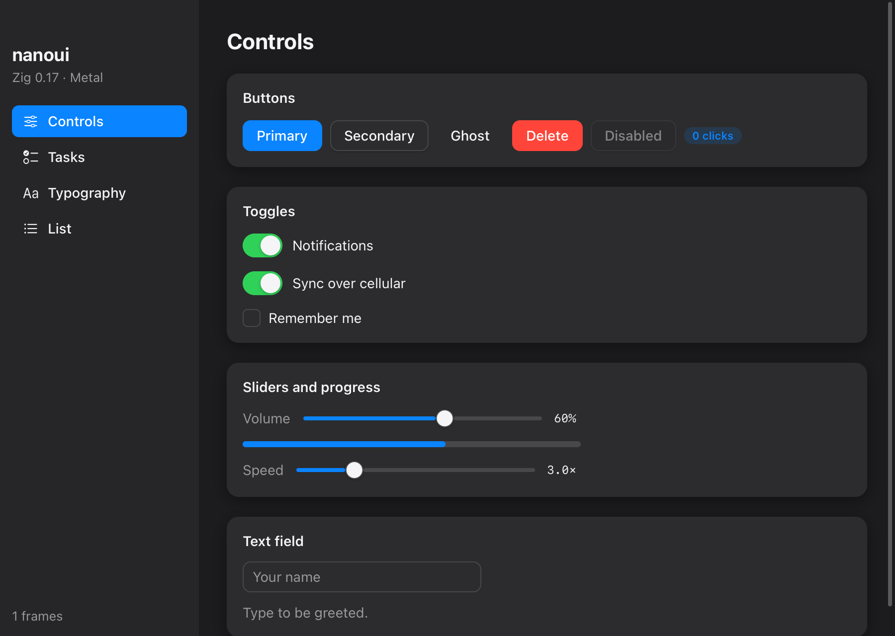

<p align="center">
  
</p>

<h1 align="center">myzig</h1>

<p align="center">Desktop apps in Zig, with native UI drawn on the GPU or a web frontend.</p>

<p align="center">
  
  
  
  
  
</p>

<p align="center">
  <a href="#get-started">Get started</a> ·
  <a href="#native-ui">Native UI</a> ·
  <a href="#web-pages">Web pages</a> ·
  <a href="#testing-without-a-window">Testing</a> ·
  <a href="#platforms">Platforms</a> ·
  <a href="#performance">Performance</a> ·
  <a href="docs/README.md">Docs</a> ·
  <a href="#credits">Credits</a>
</p>

Each window shows one of two kinds of interface:

- **Native UI**, written in Zig alone and drawn by myzig: no HTML, no
  JavaScript, no webview. It has flexbox and grid layout, text in a glyph
  atlas, a full widget set, motion, shaders, accessibility, and views you
  can test without a window. It draws in one instanced draw call per frame
  with Metal on macOS, Direct3D 11 on Windows, OpenGL on Linux and WebGL 2
  in browsers, and with myzig's own CPU renderer, which draws the same
  pixels, wherever there is no GPU.
- **A web page** in the system webview: WKWebView on macOS, WebKitGTK on
  Linux, WebView2 on Windows. The frontend calls Zig through a JavaScript
  client generated from your Zig types, with TypeScript declarations,
  typed events and channels.

Apps are single binaries. Nothing polls, so an idle app uses no CPU. The
[documentation](docs/README.md) covers all of it; it is also a
[VitePress](https://vitepress.dev) site, which `cd docs && npm install &&
npm run dev` serves locally.

## Get started

myzig was called nanoui. Its module, flags (`--myzig-*`), page runtime
(`window.myzig`) and URL scheme (`myzig://`) are named after it now; the build
still exports the module as `nanoui` too, for apps that import the old name.

```sh
git clone https://github.com/hunghg255/myzig
cd myzig
zig build run-gallery    # the native UI tour
zig build run-hello      # the webview example
zig build test           # unit and widget tests
```

You need Zig 0.17.0, plus the macOS SDK on a Mac (Xcode or the Command Line
Tools). Linux apps need GTK 3 at run time (and WebKitGTK for pages) and
nothing at build time; Windows apps need the WebView2 Runtime for pages.

To make an app of your own, build the CLI and run `myzig init`:

```sh
cd cli && zig build -Doptimize=ReleaseSmall   # cli/zig-out/bin/myzig
myzig init my-app                 # native UI; --template web for a page
cd my-app && myzig dev            # runs it, rebuilding as you edit
myzig build                       # the release and its packages
```

See [Getting started](docs/getting-started.md), which also tours every
example.

## Native UI

```zig
const Counter = struct {
    n: i64 = 0,

    fn view(s: *Counter, c: *ui.Context) void {
        const col = ui.div(c).column().sizeFull().center().gap(16);
        defer col.end();
        ui.textf(c, .{ .size = 56, .weight = .bold }, "{d}", .{s.n});
        if (ui.button(c, "Increment", .{ .variant = .primary }).clicked) s.n += 1;
    }
};

pub fn main(init: std.process.Init) !void {
    const app = try myzig.App.create(init, .{ .name = "Counter" });
    defer app.destroy();
    var state: Counter = .{};
    _ = try app.newWindow(.{ .title = "Counter", .content = .{ .view = .init(&state, Counter.view) } });
    try app.run();
}
```

<p align="center">
  
  <br><sub>The gallery example, <code>zig build run-gallery</code>.</sub>
</p>

Views are immediate mode: a function of your state, run on every event.
Widgets answer from the previous frame's layout. When an interaction changes
state, the frame is built again before it's drawn, so the screen never lags
the state.

<details>
<summary>What's in the toolkit</summary>

- **Layout:** rows, columns, cards and scroll views, with flexbox grow,
  shrink, absolute placement and maximum sizes, a CSS-like grid
  (`ui.grid`), and right to left.
- **Elements:** GPUI-style method chains, such as
  `ui.div(c).row().gap(8).bg(...)`.
- **Text:** wrapping, monospace, weights and rich spans, with text that can
  be selected and copied like a terminal's; CoreText on macOS, myzig's own
  TrueType reader elsewhere.
- **Controls:** buttons, links, checkboxes, toggles, radios, segmented
  controls, ratings, sliders and range sliders, steppers, number inputs,
  meters, progress, spinners, text fields with IME support, search and
  token fields, comboboxes, calendars, date, time and color pickers, and
  forms with validation.
- **Overlays:** popovers, tooltips, dialogs, alerts, toasts, menus,
  context menus and selects.
- **Structures:** tabs, disclosures, accordions, splits, sidebars,
  toolbars, breadcrumbs, a virtualized list (`ui.list`), trees, outlines,
  sortable tables and grid views, a router, actions and focus groups.
- **Editors:** a text area on a rope, a code editor with syntax
  highlighting and find, a diff viewer, a rich text editor, and streaming
  Markdown.
- **Drawing:** pictures in an atlas, canvases of paths, SVG, charts,
  gradients, blur, backdrop effects, transforms, and shaders written once
  in ZSL and drawn by every renderer.
- **Look and motion:** light and dark themes that follow the system, named
  themes, springs, keyframes, timelines and layout transitions, and
  Gaussian shadows.
- **Pointer:** hover that follows ancestry as CSS's `:hover` does, double
  clicks, drag and drop, and pointer tracking for graphs (`c.wants_moves`).
- **Accessibility:** VoiceOver, AT-SPI (Orca) and UI Automation read the
  view; an inspector (F12 in debug builds) shows its boxes.

</details>

## Web pages

```zig
const Greeter = struct {
    pub const myzig_params = .{ .greet = .{"name"} };

    pub fn greet(_: *Greeter, call: *myzig.Call, name: []const u8) ![]const u8 {
        return std.fmt.allocPrint(call.arena, "Hello, {s}!", .{name});
    }
};

const Tick = myzig.Event("tick", struct { uptime: u64 });

// in main:
try app.bind(&greeter);
try app.registerEvent(Tick);
_ = try app.newWindow(.{ .title = "Hello", .content = .{ .page = .{ .url = "/", .assets = &assets } } });
```

```js
import { Greeter, onTick } from "/myzig.js"; // generated, served by the app

document.body.textContent = await Greeter.greet("Ada");
onTick(({ uptime }) => console.log(uptime));
```

`zig build gen` writes `myzig.d.ts`:

```ts
export declare const Greeter: { greet(name: string): Promise<string> };
export declare function onTick(listener: (payload: TickPayload) => void): () => void;
```

Methods may return error unions; an error rejects the page's promise with
the error's name. Assets are served from the `myzig://localhost/` scheme
(`http://myzig.localhost/` on Windows), and apps can serve schemes of their
own. Elements styled `--app-region: drag` move frameless windows. Pages
also have channels, eval, downloads, cookies, permissions, find and PDF:
see [Pages](docs/pages.md) and [Bindings](docs/bindings.md).

## Testing without a window

```zig
var t: ui.Tester = undefined;
try t.init(gpa, .init(&state, Counter.view), .{});
defer t.deinit();
try t.clickText("Increment");
try std.testing.expect(t.hasText("1"));
try t.screenshot("/tmp/counter.png"); // rendered offscreen by the Metal renderer
```

The real apps run headless too, their windows never shown:

```sh
zig-out/bin/gallery --myzig-snapshot=shot.png --myzig-script="click:Tasks;type:Hi;key:enter"
zig-out/bin/hello --myzig-eval='myzig.call("Greeter.greet","Ada").then(v => { myzig.log(v); myzig.window.close() })'
zig build test-pages   # pages hidden, through the real webview
zig build test-web     # counter and gallery built for browsers, under Node
```

## Platforms

myzig loads what Linux and Windows have instead of linking it, so their
apps build from any machine: `zig build -Dtarget=x86_64-linux-gnu` or
`-Dtarget=x86_64-windows-gnu` makes a Linux or Windows binary. macOS apps
link Apple's frameworks, from the macOS SDK. Native UI also builds for
browsers (`wasm32-wasi`, see [Browsers](docs/browsers.md)).

| | macOS | Linux | Windows | browsers |
|---|---|---|---|---|
| windows, input, timers | AppKit | GTK 3 (loaded with `dlopen`) | Win32 | a canvas in the page |
| text | CoreText | myzig's TrueType reader (`src/ui/tt/`) | the same | the same |
| rendering | Metal | OpenGL (libepoxy, in a GtkGLArea); without it, CPU shown with cairo | Direct3D 11; without it, CPU shown with GDI | WebGL 2; without it, CPU on a 2D canvas |
| icons | SF Symbols | line icons drawn by myzig (`src/ui/icons.zig`) | the same | the same |
| pages (webview) | WKWebView | WebKitGTK | WebView2 | no |
| menus | the menu bar | accelerators | a menu bar in each window | accelerators |
| accessibility | VoiceOver | AT-SPI over D-Bus | UI Automation | no |

Every GPU renderer is held to the CPU one (`src/ui/raster.zig`), its twin:
each shader computes per pixel what the CPU computes, and tests render the
same frames both ways and compare them. `zig build test -Dportable=true`
runs the Linux and Windows text and renderer on a Mac. Linux is also tested
in a container (`tools/linux.Dockerfile`: GTK, WebKitGTK, fonts, Mesa and a
virtual display), Windows natively or under Wine (`tools/wine*.Dockerfile`).

## Performance

Performance is measured headless with [`hillclimb/`](hillclimb/README.md):
the same scenes rendered through each framework's own frames and offscreen
Metal renderer, on an Apple M3 Ultra. The figures are medians per frame in
milliseconds; lower is better.

| scene | frame CPU myzig | frame CPU mygo | GPU myzig | GPU mygo |
|---|---:|---:|---:|---:|
| boxes (600 shadowed boxes) | 0.061 | 0.301 | 0.140 | 1.616 |
| text (300 changing labels) | 0.108 | 0.418 | 0.065 | 0.056 |
| scroll (1000-row column) | 0.315 | 2.076 | 0.055 | 0.122 |
| list (100 000-row virtual list) | 0.060 | 0.367 | 0.046 | 0.045 |
| dashboard (12 cards) | 0.015 | 0.087 | 0.098 | 0.295 |

Release binaries are about 0.7 MB for myzig and 11.8 MB for mygo. IPC (5000
sequential calls from the page to native code) took 493 ms with myzig and
528 ms with mygo.

On Windows (an Intel Core i5-1145G7, 8 threads), these runs compare the
two frameworks' CPU renderers: both draw every frame whole into memory,
both on several cores, so the process's CPU per frame counts them all
(Zig 0.17.0 against mygo 9c05b11, [the runs](hillclimb/notes/windows-results-2026-10-20.md);
windowed runs on a Mac are in [hillclimb/notes](hillclimb/notes/windowed-results-2026-10-17.md)):

| scene | frame CPU myzig | frame CPU mygo | render myzig | render mygo | process CPU myzig | process CPU mygo |
|---|---:|---:|---:|---:|---:|---:|
| boxes | 0.094 | 0.646 | 5.6 | 17.2 | 37.3 | 125.4 |
| text | 0.276 | 0.993 | 0.8 | 2.5 | 4.8 | 20.3 |
| scroll | 0.658 | 4.094 | 0.7 | 0.9 | 5.8 | 7.4 |
| list | 0.065 | 0.731 | 0.5 | 1.1 | 3.9 | 8.9 |
| dashboard | 0.054 | 0.179 | 4.3 | 6.7 | 27.7 | 34.2 |
| layout | 0.166 | 0.473 | 1.4 | 2.6 | 8.8 | 12.9 |

There the release binaries of the counter are 0.68 MB for myzig
(`ReleaseSmall`; 1.14 MB `ReleaseFast`) and 9.04 MB for mygo's
`counter-native` (as mygo's benchmarks build it). A shadow under an
opaque box is no longer drawn where the box covers it: `dashboard`
renders in 2.7 ms instead of 4.0 on the same machine, the pixels unchanged
([the runs](hillclimb/notes/windows-shadow-cover-2026-10-20.md)).

### Memory

Apps of native UI keep little: on Windows the counter's private memory is
2.6 MB, and chart-streaming's, which draws a canvas, 11 to 14 MB. The
image atlas starts at 512 pixels a side and grows as pictures need, and
where the GPU draws (Metal, Direct3D 11) no copy of it stays in memory;
fonts kept for every size shown start over past 256 of them. A page's
webview is most of a web app's memory (WebView2's processes take about
128 MB for `hello`). Plugins let go of what they kept for a page (its
connections, requests and databases) when it navigates, reloads or
closes.

## Development

```sh
zig build lines                                                       # the 600-line limit, enforced
zig build test-pages                                                  # pages hidden: hello and examples/pages
zig build web && zig build test-web                                   # counter and gallery for browsers, tested under Node
zig build test-bin -Dtarget=aarch64-linux-gnu --prefix zig-out/linux  # Linux tests, for the container
cd cli && zig build test && zig build e2e                             # the CLI, and apps made by `myzig init`
cd plugins/fetch && zig build test                                    # a plugin (each has its own test step)
cd hillclimb && zig build run -- --label "change"                     # benchmarks against mygo and history
cd docs && npm install && npm run dev                                 # the documentation site (VitePress)
```

Rules for working here, by hand or with an agent, are in
[AGENTS.md](AGENTS.md).

How myzig is built, from its layers to the IPC wire protocol and the
renderers, is in [the architecture guide](docs/architecture.md). Official
plugins live in [`plugins/`](docs/plugins.md): fetch, websocket, sqlite,
watch, updater, terminal, glass, game and mainthread. Bound methods run on
the main thread.

## License

myzig is licensed under the [MIT License](LICENSE). Material from mygo (MIT)
and GPUI (Apache 2.0) keeps its own notices; see
[third-party notices](THIRD_PARTY_NOTICES.md).

## Credits

myzig stands on the shoulders of two projects:

- **[mygo](https://github.com/egoist/mygo)** by [egoist](https://github.com/egoist):
  myzig began as a port of its core to Zig, and keeps its architecture. That
  means:
  - the Objective-C runtime called directly, with runtime classes for
    delegates;
  - a batched outbox with one evaluation per main-loop turn;
  - events held until the page is ready;
  - a generated, typed client;
  - native UI drawn by the framework.
- **[GPUI](https://github.com/zed-industries/zed/tree/main/crates/gpui)** by
  [Zed Industries](https://zed.dev). From GPUI, myzig takes:
  - elements styled by method chains;
  - the virtualized `uniform_list`;
  - layouts cached across frames, with glyphs rasterized once into an atlas;
  - Gaussian shadows;
  - its general idea of a fast, GPU-drawn native UI.

<p align="center"><sub>Built in Zig 0.17 · <a href="AGENTS.md">AGENTS.md</a> · <a href="hillclimb/README.md">benchmarks</a> · <a href="LICENSE">MIT</a> · <a href="THIRD_PARTY_NOTICES.md">third-party notices</a></sub></p>
