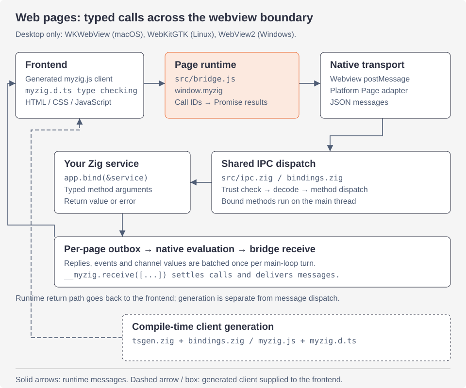

# IPC and TypeScript generation

How a page and the Zig app talk: the page runtime, the wire protocol, the
outbox, events, channels, evaluation, trust, the app's schemes, and the
client generated from Zig types. For how apps use them, see
[bindings](bindings.md) and [pages](pages.md). For the rest of the
architecture, see [the overview](architecture.md).

## The pieces



- The solid arrows are a runtime call and its reply.
- The dashed generation path happens at compile time. Zig service types
  produce the JavaScript client and TypeScript declarations the frontend
  uses.
- Events and channel values share the outbox return path.

| file | what |
|---|---|
| `src/bridge.js` | the page runtime, `window.myzig`, injected into every document's main frame |
| `src/ipc.zig` | `Call`, `Event`, bound services' dispatch, `handleMessage` (every message from a page) |
| `src/bindings.zig` | the app's bound services and registered events and channel kinds; the generated client |
| `src/channel.zig` | `myzig.Channel(T)` and `myzig.ChannelKind(name, T)` |
| `src/page_channel.zig` | one page's channels: ids, sequence numbers, flow control |
| `src/page_core.zig` | what every page shares: dev server, trust, evaluations, user scripts, page events |
| `src/page_serve.zig` | what the app's schemes serve (`myzig://` and `PageOptions.schemes`) |
| `src/page_find.zig` | find in page, through the bridge |
| `src/tsgen.zig` | comptime TypeScript declarations and the JavaScript client |
| `page.zig`, `linux/page.zig`, `windows/page.zig` | each platform's web view: injecting the bridge, posting, the outbox, schemes |

The protocol is the same on every platform. Only the transport differs:

| | page → Zig | Zig → page | app scheme |
|---|---|---|---|
| macOS | `webkit.messageHandlers.myzig.postMessage` | `evaluateJavaScript:` | `myzig://localhost/` (WKURLSchemeHandler) |
| Linux | `webkit.messageHandlers.myzig.postMessage` | `webkit_web_view_run_javascript` | `myzig://localhost/` (registered on the web context) |
| Windows | `chrome.webview.postMessage` | `ExecuteScript` | `http://myzig.localhost/` (WebResourceRequested) |

WebView2 cannot register custom schemes the way WebKit does. So there, an
app scheme `<s>` is served at `http://<s>.localhost/`
(`page_core.scheme_hosts`). Its requests are turned back into
`SchemeRequest`s of `<s>://localhost/` before the app sees them.

## The page runtime

`bridge.js` runs at document start in the main frame, before the page's
own scripts. It is a `WKUserScript`, a script of WebKitGTK's user content
manager, or WebView2's `AddScriptToExecuteOnDocumentCreated`. It defines
two frozen globals:

- `window.myzig`: `call`, `on`, `once`, `onChannel`, `Channel`, `log`,
  `window` (`close`, `minimize`, `toggleMaximize`, `setTitle`),
  `platform` (`"macos"`, `"linux"` or `"windows"`) and `version`.
- `window.__myzig`: `receive`, `settle`, `find`, `stopFind`, which only
  Zig calls.

It also:

- posts `dom-ready` when the DOM is loaded;
- turns a left mouse down in an element styled `--app-region: drag` into
  a `drag` message, or `dblclick` for a double click. So frameless
  windows move from the page.
- stops the search up the tree at `--app-region: no-drag`.

## Wire protocol

Every message is one JSON object with a type `t`. The page posts each one
as a string.

Zig answers in batches. Messages wait in the page's **outbox**. Once per
turn of the main loop, the outbox is flushed as one script,
`__myzig.receive([m1, m2, ...])`.

Page → Zig:

| message | meaning |
|---|---|
| `{"t":"call","id":N,"m":"Service.method","a":[...]}` | call a bound method with JSON arguments |
| `{"t":"eval","id":N,"k":TOKEN,"ok":true,"v":"JSON"}` | the result of an evaluation (`ok:false,"e":...` for its error) |
| `{"t":"chan-msg","c":ID,"v":"JSON","n":SEQ[,"a":1]}` | a channel value (`a`: acknowledge it) |
| `{"t":"chan-ack","c":ID,"n":SEQ}` | the page took Zig's values up to SEQ |
| `{"t":"chan-close","c":ID}` | the page closed a channel |
| `{"t":"dom-ready"}` | the document's DOM is ready |
| `{"t":"log","v":"..."}` | `myzig.log(...)`: printed as `page: ...` on stderr |
| `{"t":"drag"}`, `{"t":"dblclick"}` | a drag region was pressed (move, or zoom the window) |
| `{"t":"win","op":"close"\|"minimize"\|"zoom"\|"title","v":...}` | `myzig.window.*` |

Zig → page:

| message | meaning |
|---|---|
| `{"t":"reply","id":N,"ok":true,"v":VALUE}` | a call's result |
| `{"t":"reply","id":N,"ok":false,"e":"Service.method: ErrorName"}` | a call's error |
| `{"t":"event","n":NAME,"p":PAYLOAD}` | a typed event |
| `{"t":"chan","c":ID,"p":VALUE[,"a":1]}` | a channel value (`a`: acknowledge it) |
| `{"t":"chan","c":ID,"end":true}` | Zig closed the channel |
| `{"t":"chan-open","c":ID,"n":NAME}` | Zig opened a channel of kind NAME (ids below 0) |
| `{"t":"chan-ack","c":ID,"n":SEQ}` | Zig took the page's values up to SEQ |

### Calls

`ipc.handleMessage` runs on the main thread for every message. A call:

1. is parsed into an envelope, in an arena freed when the reply is sent;
2. is refused with `Untrusted` unless the page's current URL is trusted
   (below);
3. finds the service by the part before the dot (`UnknownService`), and
   dispatches the method by name. Dispatch is an `inline for` over the
   service's methods, generated at compile time (`UnknownMethod`).
4. decodes each argument into the parameter's Zig type, with
   `std.json.parseFromValueLeaky`, ignoring unknown fields
   (`InvalidArgument`, `MissingArgument`, `TooManyArguments`).
   - A `*myzig.Call` parameter is filled by myzig (the call's `arena` and
     its `window`) and takes no argument.
   - A `myzig.Channel(T)` parameter takes the id of a channel the page
     made.
5. calls the method, unwraps an error union, and writes the result with
   `std.json.Stringify` (`void` is `null`).

- An error becomes `"ok":false` with `"Service.method: ErrorName"`. It
  rejects the page's promise with an `Error` of that message.
- If the method closed its own window, no reply is sent: the page is
  gone.
- Call and evaluation IDs must be nonnegative JavaScript safe integers.
  Messages with missing or invalid IDs are ignored.

### The outbox

`Page.enqueue(msg, hold)` appends a message to the outbox. It schedules
one flush if none is scheduled: `objc.dispatchMain` on macOS,
`g_idle_add` on Linux, a posted `WM_FLUSH` on Windows. However many
replies, events and channel values a turn of the loop produces, the page
runs one script.

Events and channel values are sent with `hold = true`:

- Until the document posts `dom-ready`, they wait in a list of held
  messages, up to 1024.
- They move to the outbox when it does. So a page never misses an event
  sent while it loads.
- A navigation (`Page.navigated`) drops what is held and fails the
  evaluations under way. It closes the old document's channels with the
  reason `lost`.

### Events

`myzig.Event("tick", T)` is a type with `name`, `Payload` and its
generated client.

- `emit(window, payload)` encodes `{"t":"event","n":"tick","p":...}` on
  the calling thread. It hands it to the window's thread
  (`Window.sendOwned`), so it is safe from any thread.
- `broadcast(app, payload)` enqueues it for every window with a page, on
  the main thread.
- The page's `myzig.on("tick", fn)`, or the generated `onTick(fn)`, gets
  the payload.

### Channels

Channels are ordered streams of typed values both ways, until either side
closes them.

- A page makes one with `new Channel()` and passes it to a bound method
  taking `myzig.Channel(T)`. Its id is above 0.
- Zig opens one with `myzig.ChannelKind("logs", T).open(window)`. Its id
  is below 0. The page hears of it through `myzig.onChannel("logs", fn)`
  or the generated `onLogsChannel(fn)`.
- Retained Zig channels report closed after their window closes. The app
  must outlive its channels.
- An `onClose` listener may close its window or navigate. The old
  channel's end message is not sent to a page that disappeared or to a
  new document.

**Flow control** is a window of bytes on each side
(`page_channel.window_bytes`, 1 MiB).

- Values from Zig wait in the page until it takes them, with an
  `onmessage` handler or `for await`.
- Every half window, the sender asks for an acknowledgment (`"a":1`).
- The receiver answers with `chan-ack` of the sequence number once it has
  taken that value.

While more than a window is unacknowledged:

- in Zig, `Channel.send` fails with `error.ChannelFull`, and the
  channel's `onDrain` listener runs when the page took enough;
- in the page, `channel.send(v)` returns a promise that resolves once Zig
  has room again.

A channel closes with a `CloseReason`: `zig`, `page`, or `lost` (the page
navigated or closed). `Channel.onClose` hears it. Values sent after are
refused with `error.ChannelClosed`.

### Evaluation

`Page.eval(js)` runs a script without waiting. `Page.evalResult(js, cb)`
wraps the expression as

```js
window.__myzig&&__myzig.settle(ID,"TOKEN",async()=>(
  <expression>
))
```

- The bridge awaits it and posts `{"t":"eval","id":ID,"k":TOKEN,...}`.
- The token is 8 random bytes per page (16 hex digits), so a page's own
  scripts cannot forge a result.
- A navigation or closing fails what is pending ("the page navigated",
  "the page closed").
- Values that cannot be encoded as JSON, such as a `BigInt` or an object
  with circular references, report an evaluation error too.

### Trust

Only a trusted document may call bound services, open channels and get
permissions. `page_core.trusted` trusts:

- `about:`, `file:` and `blob:` URLs of a trusted origin;
- the app's schemes (`myzig` and those of `PageOptions.schemes`, and on
  Windows their `http://<scheme>.localhost` hosts);
- the dev server's origin (`MYZIG_DEV_URL`, else `PageOptions.dev_url`);
- the origins in `PageOptions.trusted_origins` (`"*"` trusts any).

How it is checked:

- Against the page's current URL, at each call. A page that navigates
  elsewhere loses it.
- Origins are compared in full, including long authorities. Fixed-size
  header buffers never decide whether an origin is trusted.
- Messages from subframes are refused before dispatching IPC. macOS
  checks the frame, and WebView2 delivers only the top frame's. On Linux
  the bridge's messages carry the page's token, which subframes never
  see.

## The app's schemes

`page_serve.dispatch` answers every request of an app scheme, the same
way on every platform:

1. A trusted page of another origin gets CORS headers
   (`Access-Control-Allow-Origin` its origin; `OPTIONS` answered `204`).
2. A scheme of `PageOptions.schemes` goes to its handler. The handler
   answers the `SchemeRequest` now or later
   (`req.respond(status, headers, body)`).
3. `myzig://` serves the frontend, trying in order:
   - `/myzig.js`, the generated client (`App.clientJs`);
   - the file of `assets_dir`. `MYZIG_ASSETS_DIR` overrides it. Paths are
     percent-decoded once, then paths with `..`, backslashes, drives or
     NUL bytes are refused.
   - the embedded `assets`;
   - for a path without an extension that is no file: `/index.html`. It
     is a client-side route.
4. Anything else is `404 Not Found`.

Responses carry `Cache-Control: no-cache`, so a rebuilt frontend shows on
reload.

## TypeScript generation (`tsgen.zig`)

Zig keeps types at compile time, so the compiler generates the client.

- `App.bind(&service)` stores the service's dispatch and its
  `tsgen.service(T)`.
- `App.registerEvent(E)` stores `E.client`, an event's or a channel
  kind's.
- Nothing is generated at run time but the concatenation.

A service exposes its public functions whose first parameter is the
service (`T`, `*T` or `*const T`), that are not generic and don't start
with `_`. Its name in the client is `T.myzig_name`, else the last part of
`@typeName(T)`.

Zig keeps no parameter names in function types, so a service names them:

```zig
pub const myzig_params = .{ .greet = .{"name"} };
```

Unnamed parameters are `arg0`, `arg1`, ... `*myzig.Call` parameters are
left out of the client.

Types map as follows:

| Zig | TypeScript |
|---|---|
| `void` | `void` |
| `bool` | `boolean` |
| integers, floats | `number` |
| `[]const u8`, `[N]u8` | `string` |
| `[]T`, `[N]T` | `T[]` (`(A \| B)[]` when needed) |
| `?T` | `T \| null`; an optional struct field is also `field?:` |
| `E!T` | `T` (errors reject the promise) |
| `enum { a, b }` | `export type E = "a" \| "b";` |
| `struct {...}` | `export interface S {...}`, deduplicated by name; recursive types terminate |
| `std.json.Value` | `unknown` |
| `myzig.Channel(T)` | `Channel<T>` |

Tuples and other types are a compile error naming the type.

The output:

- `myzig.d.ts` (`Bindings.clientDts`) holds, in order:
  - `runtime_dts`: the `Channel<T>` interface and `myzig`'s declaration;
  - the declarations of every type;
  - every service, as
    `export declare const Greeter: { greet(name: string): Promise<string>; }`;
  - every event as `onTick(listener)`, every channel kind as
    `onLogsChannel(listener)`.
- `myzig.js` (`Bindings.clientJs`) re-exports `myzig` and `Channel`. Then:
  - each service is a frozen object of methods calling
    `window.myzig.call("Greeter.greet", ...a)`;
  - each event is `(fn) => window.myzig.on("tick", fn)`.

  It is served at `/myzig.js` and built once per app.

Event names become PascalCase after `on`: `build-logs` gives
`onBuildLogsChannel`. Services are sorted, so the output is stable.

- `--myzig-generate=DIR` makes `App.run` write both files into `DIR` and
  exit. `zig build gen` does it for the hello example, `myzig generate`
  for an app.
- Every new type mapping gets a test in `tsgen.zig`.
- Plugins with a page side ship their own JavaScript as an `Asset`, which
  calls their bound service through `window.myzig`. An example is the
  fetch plugin's `fetch.asset` at `/plugins/fetch.js`.
