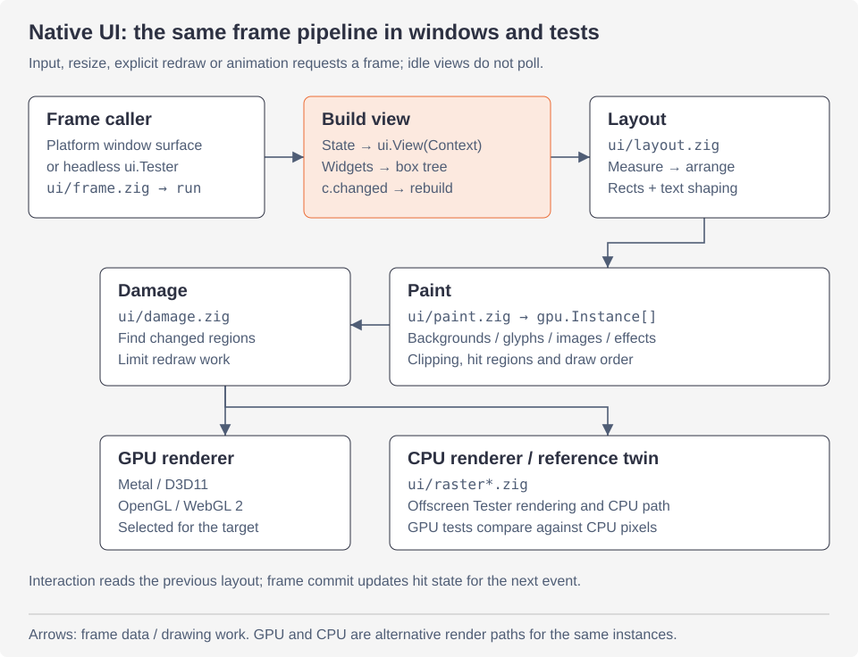

# Rendering native UI

How a view becomes pixels. This page covers:

- the frame pipeline shared by windows and the Tester;
- the instances every renderer draws;
- the five renderers: Metal, Direct3D 11, OpenGL, WebGL 2 and the CPU;
- the CPU twin that proves they agree;
- text and atlases, and each platform's surface.

For using native UI, see [the native UI guide](ui/README.md). For its
rendering and performance from an app's side, see
[rendering](ui/rendering.md) and [performance](ui/performance.md). Back
to [the overview](architecture.md).

## One frame



Read the arrows from the frame caller through build, layout and paint,
then down to the renderer. `gpu.Instance` is the shared drawing contract.
The CPU path also provides the reference pixels for GPU tests. Text
shaping happens during layout; glyph atlases are read during paint.

`ui/frame.zig`'s `run` makes one frame. Every window's surface and
`ui.Tester` call it, so what a test sees is what a window shows:

1. **Build.** The view (`ui.View`: a pointer and a `build` function) runs
   with a `*ui.Context`.
   - Widgets open and close boxes (`Context.open`, `leaf`, `end`) into a
     flat tree of nodes for this frame.
   - They answer interactions (clicks, hovers, drags, keys) from the
     **previous** frame's layout.
   - A widget whose interaction changed the app's state sets `c.changed`.
     The frame is then built again (`c.rebuild()`), up to four passes, so
     the screen never lags the state.
   - A box left open panics with how many.
2. **Layout** (`ui/layout.zig`). Flexbox in two passes:
   - `measure` sizes boxes from their content, bottom up. Text is shaped
     and wrapped here, from cached layouts.
   - Each text box's width and wraps are kept by its id across frames
     and compared, in `layout_cache.zig`. A box measured again at a
     width in one frame is as it was.
   - `arrange` places them top down. It shares free room among boxes
     that grow and takes it from those that shrink, as CSS flexbox does
     (`layout_flex.zig`). It lines up baselines (`layout_baseline.zig`).
   - Absolute boxes, scroll views, grids (`grid_layout.zig`) and right to
     left (`direction.zig`) are handled here.
   - Each node's rectangle is recorded by id for the next frame's
     interactions.
3. **Paint** (`ui/paint.zig`). The laid out tree becomes the renderer's
   **instances**, in paint order.
   - Instances are backgrounds, borders, shadows, glyph runs, icons,
     pictures, gradients, effects and layer marks.
   - Each has its clip, rounded clips included. Boxes outside their clip
     are culled.
   - Transformed boxes draw their subtree in their own space
     (`paint_xf.zig`). Gradients, transforms and effects add rows of data
     after the instances.
   - Interactive boxes record their visible rectangle (`hit.zig`), with
     the inverse map for transformed ones. So the pointer follows what is
     drawn.
   - A box whose **ink** its clip leaves out is skipped with all it
     holds, as Blink and Flutter skip what lies outside the cull rect. A
     clipped page of a thousand rows paints the rows in view.
   - Ink is the box grown by its shadow, blur, text and icons reaching out
     of it, plus the ink of the boxes inside it. It is found from the tree
     in one pass, back to front.
   - Transformed boxes and selectable text are painted wherever they are.
     Nothing is skipped while transitions move boxes, or with web views.
   - `tests_paint_cull.zig` checks that the instances are those painted
     without skipping.
   - If an atlas filled up and reset during paint, the frame is painted
     again.
4. **Commit.** What the pointer is over is updated from the new hits. If
   it changed under a still pointer, `Result.hot_changed` asks for another
   frame.

What the view passes is read in the later phases, after it returns:

- a text's shaping and wrapping in layout;
- its glyphs in paint;
- the accessibility tree after both.

So `Context.leaf` copies a text box's string and spans into the frame's
arena (`c.alloc()`, reset when the next frame begins). `access.describe`
copies its strings too. Freeing them in the view cannot leave layout
reading freed memory, even between two widgets that show them
(`tests_frame_strings.zig`).

The copy costs 0.04 to 0.06 ms a frame per thousand text boxes on the
hill climb's scenes.

Everything else a node points to must live until the frame is drawn: a
picture's bytes, an icon's name, gradients, canvas paths. The app frees
such data after the frame (a frame later, or on the next event). Or it
keeps the old copy for one more update.

`c.stats` (`ui.FrameStats`) records each phase's milliseconds, the
passes, nodes and instances. The inspector and the hill climb read it.

Frames run only when something asks:

- input;
- a resize;
- a change from outside the view: `Window.redraw()`, on the main thread,
  for state changed by a timer or a process's output;
- an animation in flight (`c.animating`, set by `Context.animate` and
  motion).

Idle, a window draws nothing. `tests_idle.zig` hovers a button with a
tooltip, clicks, toggles, types, leaves a field, turns dark and resizes.
After each, it checks three things:

- the settled window animates nothing;
- it asks for no later frame;
- a frame built anyway would draw nothing.

While nothing of a window shows, frames no input asked for wait until
some of it shows. Browsers likewise draw nothing for windows out of
sight.

- Not showing means occluded, on another Space or minimized on macOS.
  On Windows it means minimized or hidden.
- Such frames are the display link's or the animation timer's, requests
  from outside, and resizes.
- Input still builds one, as for keys typed into a key window other
  windows cover.

## Instances

`ui/gpu.zig` is the contract between paint and every renderer. A frame is
an array of `gpu.Instance`, one quad each:

```zig
pub const Instance = extern struct {
    rect: [4]f32,
    color: [4]f32,
    border_color: [4]f32 = .{ 0, 0, 0, 0 },
    uv: [4]f32 = .{ 0, 0, 0, 0 },
    clip: [4]f32 = .{ -1e6, -1e6, 1e6, 1e6 },
    radius: f32 = 0,
    border_width: f32 = 0,
    kind: f32 = 0,
    clip_round: f32 = 0,
};
```

`kind` (`gpu.Kind`) says what the quad is:

| `kind` | |
|---|---|
| `quad` | a rounded rectangle with a border |
| `text` | a glyph or icon from the glyph atlas |
| `shadow` | a Gaussian blur of a rounded box, as GPUI draws them |
| `image` | from the image atlas |
| `effect` | a backdrop effect's mark |
| `gradient` | a gradient |
| `layer`, `layer_end` | a blurred or faded group |
| `trailer` | points at the rows of data |

The high bits of `kind` carry the row of a transform.
`gpu.Frame.of(instances)` splits the instances drawn from the rows of
data packed after them, which a final `trailer` instance points at. A
renderer draws a frame in one instanced draw call. It splits it only at
effects and layers.

**Continuous corners.** A negative `radius` asks for continuous corners
(`Style.corners`, `raster_corner.zig`, after mygo's: Core Animation's
curve). A `clip_round` made by `gpu.clipContinuous` asks for a clip's:
its corners' bits plus 16.

- Every renderer computes the curve by the same arithmetic, the shaders'
  `cont_*` functions.
- The curve applies only in a corner's box: `extent` times the radius
  from the corner. Elsewhere it is the distance to the nearest side, as
  for square corners.
- Its edge is smoothed by the value's gradient, by differences a
  sixteenth of a pixel apart.
- A blurred shadow's rows are narrowed where the curve is, found by
  regula falsi.

<details>
<summary>Nine-patches for large shadows</summary>

The GPU renderers cut large shadows with continuous corners into
nine-patches (`gpu_corners.zig`, after mygo's 8b35d8e and 3e9f9c6):

- The bands of rows across the corners are drawn as they are at their
  ends, and as their twin with square corners between.
- The band between them is drawn as the twin. The twin computes the very
  same values without the search.
- A band is cut only where the twin's pixels save more than the pieces
  cost (an instance each).

The CPU renderer draws them whole; its pixels are the same.

</details>

## The renderers

| renderer | file and shader | where |
|---|---|---|
| Metal | `ui/metal.zig`, `shader.metal`, effects in `metal_fx.zig`/`metal_fx.metal` | macOS, into a `CAMetalLayer` the native view hosts |
| Direct3D 11 | `ui/d3d11.zig`, `d3d11.hlsl` (compiled ahead to `d3d11.cso`), `d3d11_fx.*` | Windows, into a flip sequential swap chain |
| OpenGL | `ui/gl.zig`, `gl.glsl`, `gl_fx.*`, loaded through `gl_api.zig` (libepoxy) | Linux, in a GtkGLArea (`gl_gtk.zig`); OpenGL 3.3 core or ES 3.0 |
| WebGL 2 | `ui/webgl.zig`, `webgl_shaders.zig` (`gl.glsl` as GLSL ES 3.0) | browsers; the context lives in `web/host_gl.js` |
| CPU | `ui/raster.zig`, `raster_lanes.zig`, `raster_fill.zig`, `raster_shadow.zig`, `raster_xf.zig`, `raster_fx.zig`, `raster_pool.zig` | everywhere: the fallback, the Tester off macOS, the reference |

Each GPU renderer uses one pipeline. It uploads the frame's instances
and the rows of the atlases that changed since it last did (`dirty`).
Then it draws the instances in one call. Metal and Direct3D 11 take
pictures straight into their texture, with no copy of the image atlas in
memory.

Effects and blurred layers need what was drawn so far. At an `effect`
mark the renderer:

1. reads the pixels around the shape;
2. blurs them (`backdrop.zig`): averaged down for large blurs, then a
   Gaussian along rows and columns;
3. draws the box from them, with the effect's shader or as it is.

`d3d11.cso` is the HLSL compiled ahead of time with `zig run
src/ui/d3d11_gen.zig`. Run it on Windows after changing the shader.
Windows then open without loading the shader compiler. The file starts
with the source's hash. A renderer whose embedded hash differs from its
source compiles the source at start instead.

### Drawing only what changed

A frame that changes little of a window draws only the pixels that may
differ from the last frame. Think of a caret blinking, a spinner turning,
a button under the pointer. The rest is kept as it was. This follows
mygo's `scene.Differ` (`ui/damage.zig`).

- `Differ` compares a frame's instances with the last one's from both
  ends.
- The instances that differ damage the pixels they drew and draw now.
  `boundsOf` gives the CPU renderer's bounds, two pixels more for the
  GPUs' quads, five under a transform.
- Instances are compared with the rows they read (a transform's, a
  gradient's, an effect's), wherever those rows are.
- Pictures count as changed when the image atlas did.
- A frame draws whole if it has another size, scale or background, or
  comes after the glyph atlas was emptied (`Atlas.resets`).
- Effects and blurred layers read what is under them. An area that meets
  one grows by all the effect reads (`grow`, to a fixed point). So the
  effect reads nothing of the last frame.
- Drawn in part, a frame draws only the effects and layers in its area
  (`Markers`).
- Past half the window, the frame is drawn whole.
- `MYZIG_PARTIAL=0` draws every frame whole.

Drawn in part, every pixel is the one drawing the frame whole gives,
byte for byte. `damage_test.zig` draws random frames of every kind of
instance, changing frame after frame, both ways. It does so on the CPU
and with each GPU renderer.

| renderer | the target that keeps the last frame | drawing a part |
|---|---|---|
| CPU | the window's pixels | in up to eight rectangles apart from each other (`raster.drawPart`), each band clipped to them |
| Direct3D 11 | the swap chain, flip *sequential*: as a frame is presented with the area it drew as its dirty rectangle (`Present1`), DXGI fills the rest of the buffer from the frame presented before | scissored, cleared by an opaque quad of the frame's color (`damage.clearQuad`); a frame that changed nothing is not presented |
| OpenGL | a GtkGLArea's framebuffer, which GTK keeps from render to render but makes anew as it allocates the area (`Gpu.invalidate`) | the scissor test, which `glClear` keeps to too |
| WebGL 2 | the canvas, with `preserveDrawingBuffer` | the scissor test, as OpenGL |
| Metal | the layer's drawables, each holding the frame drawn into it some frames ago: `damage.Ages` keeps, by the drawable's texture (retained, so that no other takes its address), what changed since | passes that load the drawable, scissored, cleared by the quad; a frame that changed nothing takes no drawable |

Measured, in ms a frame: drawn in part (drawn whole).

| scene | caret blinking | spinner |
|---|---|---|
| 2560 × 1600 window, 108 cards, Intel Iris Xe: CPU | 0.15 (9.3) | 0.34 (10.4) |
| the same, Direct3D, to completion | 0.64 (5.6) | 0.78 (6.0) |
| hill climb's `caret` and `spinner` (900 × 640 at 2x): CPU | 0.07 (6.7) | 0.19 (6.8) |
| the same with `--gpu`: Direct3D's GPU time | 0.02 (2.2) | 0.03 (2.2) |

The passes of effects and blurred layers draw through textures kept from
frame to frame by their size. This is `Pool` in `d3d11_fx.zig`,
`gl_fx.zig` and `metal_fx.zig`, after mygo's effect layers.

- An effect whose box moves reads through the textures of the frame
  before, rather than new ones.
- 40 frames of a moving effect and layer make 13 textures, not 240.
- Textures no frame took for 120 frames go.

### Falling back to the CPU

A GPU renderer that cannot start never stops a window from showing. The
same frames are drawn on the CPU instead:

- **Windows**: a thread makes the Direct3D device. Meanwhile the
  window's first frames are drawn on the CPU and GDI shows them. The main
  thread then makes the swap chain (`Startup` in
  `windows/surface_present.zig`), and the next frame presents through it.
  Without a device or swap chain, GDI goes on showing the CPU renderer's
  pixels (`windows/surface.zig`).
- **Linux**: without OpenGL, a GtkDrawingArea and cairo show them. That
  is no libepoxy, no GL context, or a renderer that fails. `MYZIG_GPU=0`
  keeps frames on the CPU. `MYZIG_GPU=1` uses OpenGL even on Mesa's
  llvmpipe, which is otherwise skipped as slower than myzig's own CPU
  renderer.
- **Browsers**: without WebGL 2, a 2D canvas shows them.

### The CPU renderer

`raster.zig` draws the instances `shader.metal` draws, into memory:
BGRA, premultiplied, sRGB-encoded values blended as the GPU blends them.

- A frame is drawn in bands of 64 rows. Several cores take them in turn
  when the frame is large.
- Every pixel is what drawing it alone gives, so bands may draw in any
  order.
- The cores are threads of `raster_pool.zig`. They start when a frame
  first needs them, then wait on a futex between frames. Starting threads
  each frame costs about what drawing a small frame does.
- A frame is shared from about 2¹⁸ pixels' work a core.
- The clear skips the pixels the first instance sets to its fill,
  whatever is under them, so they are not written twice. This holds when
  that instance is an opaque quad nothing clips the corners of, as a
  window's background (`Frame.clearRows`, `raster_fill.zig`).
- Within an instance, what is the same along a row or a column is
  computed once. Solid fills are copied, and empty texels are skipped.
- `raster_lanes.zig` computes eight pixels at a time.
- Each fast path gives the exact value of the general one.

## The CPU twin

The CPU renderer is the reference every GPU renderer is held to. Each
shader is written to compute, per pixel, what `raster.zig` computes, by
the same arithmetic:

- instance bounds rounded the same way;
- exact distance gradients instead of `fwidth`;
- textures filtered by hand from texels, with full precision weights.

Tests render the same frames both ways and compare them, to a level or
two of blending's rounding:

| test | compares |
|---|---|
| `ui/tests_raster.zig` | the CPU renderer against Metal (macOS): widgets, text, icons, borders, rounded corners and clips, shadows, a picture |
| `ui/d3d11_test.zig` | Direct3D 11 offscreen (a texture read back) against the CPU; skipped without a GPU |
| `ui/gl_test.zig` | OpenGL 3.3 and ES 3.0 offscreen (EGL without a surface, `gl_offscreen.zig`; Mesa's llvmpipe needs no GPU) against the CPU |
| `ui/gl_gtk_test.zig` | the GtkGLArea path |
| `ui/gpu_fx_test.zig` | every GPU renderer against the CPU on the general path: random transforms of every kind, gradients, backdrop effects plain and with a shader, blurred layers, in widget frames and random frames |
| `ui/shader/tests_gpu.zig` | shaders of `ui.shader` on each GPU against their CPU twin |
| `ui/damage_test.zig` | frames drawn in part against them drawn whole, byte for byte: the CPU, Direct3D 11 (a texture, and a hidden window's swap chain), OpenGL 3.3 and ES 3.0 |

`ui.gpu_testing` exports `gpu_fx_test.zig`, so plugins hold their own
effects to the same standard. The glass plugin's shader has a CPU twin
that must draw the same pixels.

Shaders apps write follow the same rule: `ui.shader`, files like
`examples/*/*.zsl`. A small language in Zig's syntax
(`ui/shader/parse.zig`) is compiled at compile time into:

- HLSL;
- GLSL (3.3, ES 3.0, WebGL 2);
- Metal;
- a CPU twin of Zig code (`shader/cpu.zig`) that the CPU renderer and
  the Tester run.

See [shaders](ui/shaders.md).

Canvases (`ui.canvas`) and SVG pictures are rasterized on the CPU into
the image atlas (`canvas_render.zig`, `path_raster.zig`). The rasterizer
accumulates, after font-rs, with both fill rules. Every renderer then
draws the atlas as it draws `ui.image`, so they look the same everywhere
by construction.

## Text

`ui/text.zig` picks the text system at compile time:

- **CoreText** on macOS (`text_mac.zig`, `atlas.zig`). The system does
  fonts, shaping and glyph rasterization, into an R8 atlas texture.
  Printable ASCII takes an exact fast path (`shaper.zig`), tested against
  CoreText's own shaping.
- **myzig's TrueType** everywhere else, and on macOS with
  `-Dportable=true` (`text_tt.zig`, `ui/tt/`):
  - `tt/fontdb.zig` finds the installed fonts once, by family, weight,
    italics and width. They load on first use. Missing characters fall
    back to fallback families, then to any face.
  - `tt/font.zig` reads the font files.
  - `tt/raster.zig` turns outlines into coverage.
  - `atlas_tt.zig` keeps the glyphs in a byte-per-texel image in memory.
    The CPU renderer samples it and GPU renderers upload it.
  - Icons are line icons drawn by myzig (`icons.zig`) instead of SF
    Symbols.
  - In browsers the fonts come with the site ([browsers](browsers.md)).

Both give the same interface: fonts, shaped and wrapped layouts cached
across frames, carets, and the glyph atlas.

- Glyphs are rasterized once per font and quarter pixel of horizontal
  position, at the display's scale.
- They are shelf packed.
- An atlas grows when full, then resets, and the frame is painted again.

Pictures (`ui.image`) are decoded once: ImageIO on macOS,
`png_decode.zig` elsewhere. They are scaled to at most the atlas's side
and packed into one BGRA atlas (`images.zig`). It is emptied and packed
again when full.

## Surfaces

A surface connects a window to its native UI. It turns the platform's
events into `ui.Input`, runs frames on demand, and presents them.

| platform | surface | presents | paces frames with |
|---|---|---|---|
| macOS | `ui/surface.zig`: an NSView hosting the Metal layer, NSTextInputClient (`textinput.zig`) | Metal | the view's display link, while something animates; skipped while the window is occluded |
| Linux | `linux/surface.zig` | GtkGLArea (OpenGL), else GtkDrawingArea and cairo | GTK's frame clock (a tick callback) |
| Windows | `windows/surface.zig` | Direct3D 11 swap chain, else GDI | a 60 Hz timer while something animates; `WM_FRAME` for requests from outside; the swap chain's frame latency object (`surface_present.zig`) |
| Browsers | `web/surface.zig` | WebGL 2, else a 2D canvas | `requestAnimationFrame`, asked once per frame needed |

All of them draw at the monitor's scale: Retina, per-monitor DPI, the
device pixel ratio. All feed input methods' text to the focused field.

**Windows.** One frame waits ahead of the screen, and `Present` never
blocks the main thread for it, after mygo's.

- The swap chain has a frame latency object
  (`FRAME_LATENCY_WAITABLE_OBJECT`, `SetMaximumFrameLatency(1)` on
  `IDXGISwapChain2`). DXGI signals it as the screen takes a frame.
- A frame presents once a wait on it succeeded: the wait's token.
- A frame drawn while it is not signaled waits (`pending`). A thread
  waits on the object and posts `WM_PRESENT`, and the frame presents
  then.
- The animation timer's frames are not built meanwhile. Frames for input
  draw into the frame waiting, which presents as the union of their
  dirty areas.
- A resize's frame presents at once.
- Every present takes one token, so the object's count stays that of the
  frames the screen can take.

**macOS.** The main thread never blocks in
`-[CAMetalLayer nextDrawable]`, after mygo's. That call waits while the
layer's drawables are all in use. The display holds them until its next
refreshes. So a frame following another would wait most of a refresh,
with input queued behind it.

- After each frame is presented, as soon as drawn, a serial dispatch
  queue fetches the next frame's drawable. It runs at the main thread's
  priority (user interactive).
- The drawable goes into a one-slot mailbox (`ui/metal_present.zig`). The
  queue posts its completion to the main queue.
- A frame for input that comes meanwhile is built at once: input
  handled, laid out, painted. Its drawing waits.
- Once the drawable came, the main thread draws the surface's instances
  as they are then (`wake`, the surface's `drawableCame`). A frame like
  the last one draws nothing.
- The display link's ticks build no frame while a fetch is in flight
  (`Renderer.ready`). The next is built once the drawable came, with the
  link ticking meanwhile.

<details>
<summary>The threads, the layer changing, and freeing</summary>

Threads share one thing. The queue writes the mailbox's drawable, then
posts the completion. The main thread reads it only in that completion
or after `settle`, which waits for the queue (`dispatch_sync_f`). Both
order the write before the read. Everything else is the main thread's:
in flight, wanted, the completions' counts.

Before the layer changes, the main thread settles the fetch and lets the
drawable go. Changes are its drawables' size, their format, presenting
with the transaction, and the renderer freed. A frame presented with the
transaction (a live resize's) takes its own drawable on the main thread,
as the first frame does.

A presenter freed with completions posted frees itself when the last one
runs, so none reaches freed memory. A fetch whose completion comes after
`settle` is counted stale and does not end the next. The protocol is
tested with a fake layer and queue (`ui/metal_present_test.zig`).

</details>

**Input latency** is the time from an event's arrival to the frame
showing it on the screen. `tools/inputlatency` measures it (see its
README), after mygo's.

- It measures typing, scrolling, dragging and animations in a window it
  shows.
- It splits the time into waiting for the main thread, handling,
  reaching the present, and reaching the screen.
- It also reports the main thread's waits for drawables, and the share
  of refreshes showing a new frame.
- It synthesizes input into its own window, so a person runs it. Agents
  build and test it.

Accessibility is a separate tree built from the frame
(`ui/access_tree.zig`) and served per platform:

- NSAccessibility (`access_mac.zig`);
- AT-SPI over D-Bus (`linux/atspi*.zig`);
- UI Automation (`windows/uia*.zig`).

See [accessibility](ui/accessibility.md).
