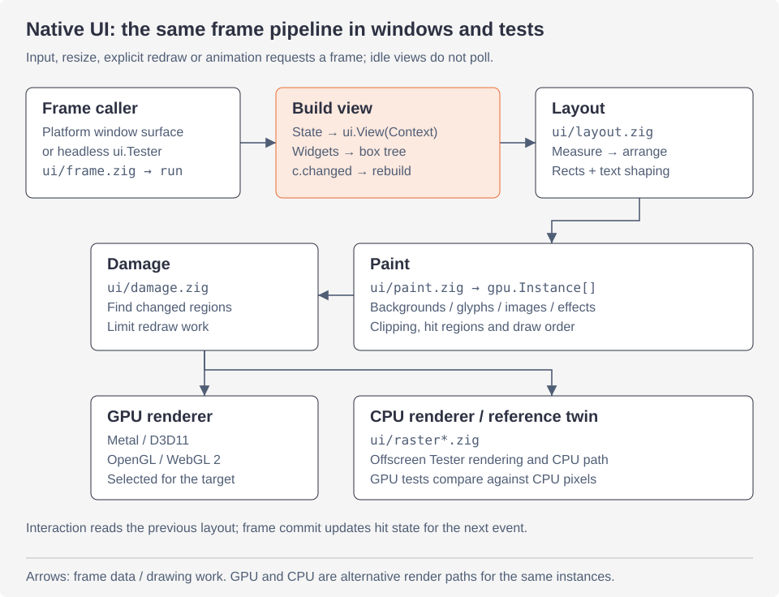

# Rendering native UI

How a view becomes pixels: the frame pipeline shared by windows and the
Tester, the instances every renderer draws, the five renderers (Metal,
Direct3D 11, OpenGL, WebGL 2 and the CPU), the CPU twin that proves they
agree, text and atlases, and each platform's surface. For using native UI,
see [the native UI guide](ui/README.md); for its rendering and
performance from an app's side, [rendering](ui/rendering.md) and
[performance](ui/performance.md). Back to [the overview](architecture.md).

## One frame



Read the arrows from the frame caller through build, layout and paint,
then down to the renderer. `gpu.Instance` is the shared drawing contract;
the CPU path also provides the reference pixels for GPU tests. Text
shaping happens during layout and glyph atlases are read during paint.

`ui/frame.zig`'s `run` makes one frame, and both every window's surface
and `ui.Tester` call it, so what a test sees is what a window shows:

1. **Build.** The view (`ui.View`: a pointer and a `build` function) runs
   with a `*ui.Context`. Widgets open and close boxes (`Context.open`,
   `leaf`, `end`) into a flat tree of nodes for this frame, and answer
   interactions (clicks, hovers, drags, keys) from the **previous**
   frame's layout. A widget whose interaction changed the app's state sets
   `c.changed`; the frame is then built again (`c.rebuild()`), up to four
   passes, so the screen never lags the state. A box left open panics
   with how many.
2. **Layout** (`ui/layout.zig`). Flexbox in two passes: `measure` sizes
   boxes from their content bottom up (text is shaped and wrapped here,
   from cached layouts; each text box's width and wraps are kept by its id
   across frames, compared, in `layout_cache.zig`, and a box measured again
   at a width in one frame is as it was), `arrange` places them top down,
   sharing free room among boxes that grow and taking it from those that
   shrink as CSS flexbox does (`layout_flex.zig`), lining up baselines
   (`layout_baseline.zig`);
   absolute boxes, scroll views, grids (`grid_layout.zig`) and right to
   left (`direction.zig`) are handled here. Each node's rectangle is
   recorded by id for the next frame's interactions.
3. **Paint** (`ui/paint.zig`). The laid out tree becomes the renderer's
   **instances** in paint order: backgrounds, borders, shadows, glyph runs,
   icons, pictures, gradients, effects and layer marks, each with its clip
   (rounded clips included), boxes outside their clip culled. Transformed
   boxes draw their subtree in their own space (`paint_xf.zig`), and
   gradients, transforms and effects add rows of data after the instances.
   Interactive boxes record their visible rectangle (`hit.zig`), with the
   inverse map for transformed ones, so the pointer follows what is drawn.
   A box whose **ink** (its box grown by its shadow, blur, text and icons
   reaching out of it, and the ink of the boxes inside it, found from the
   tree in one pass back to front) its clip leaves out is skipped with all
   it holds, as Blink and Flutter skip what lies outside the cull rect: a
   clipped page of a thousand rows paints the rows in view. Transformed
   boxes and selectable text are painted wherever they are, and nothing
   is skipped while transitions move boxes or with web views;
   `tests_paint_cull.zig` checks that the instances are those painted
   without skipping. If an atlas filled up and reset during paint, the
   frame is painted again.
4. **Commit.** What the pointer is over is updated from the new hits; if
   it changed under a still pointer, `Result.hot_changed` asks for another
   frame.

What the view passes is read in the later phases, after it returns: a
text's shaping and wrapping in layout, its glyphs in paint, the
accessibility tree after both. So `Context.leaf` copies a text box's
string and spans into the frame's arena (`c.alloc()`, reset when the next
frame begins), and `access.describe` its strings: freeing them in the
view, even between two widgets that show them, cannot leave layout reading
freed memory (`tests_frame_strings.zig`). The copy costs 0.04 to 0.06 ms a
frame per thousand text boxes on the hill climb's scenes. Everything else
a node points to (a picture's bytes, an icon's name, gradients, canvas
paths) must live until the frame is drawn: the app frees such data after
the frame (a frame later, or on the next event) or keeps the old copy for
one more update.

`c.stats` (`ui.FrameStats`) records each phase's milliseconds, the
passes, nodes and instances: the inspector and the hill climb read it.

Frames run only when something asks: input, a resize, a change from
outside the view (`Window.redraw()`, on the main thread, for state
changed outside the view: a timer, a process's output), or an animation in
flight (`c.animating`, set by `Context.animate` and motion). Idle, a
window draws nothing: `tests_idle.zig` hovers a button with a tooltip,
clicks, toggles, types, leaves a field, turns dark and resizes, and after
each checks that the settled window animates nothing, asks for no later
frame, and that a frame built anyway would draw nothing. While nothing of
a window shows (macOS: occluded, another Space, minimized; Windows:
minimized or hidden), frames no input asked for (the display link's or
the animation timer's, requests from outside, resizes) wait until some
of it shows, as browsers draw nothing for windows out of sight; input
still builds one, as keys typed into a key window other windows cover.

## Instances

`ui/gpu.zig` is the contract between paint and every renderer. A frame is
an array of `gpu.Instance`, one quad each:

```zig
pub const Instance = extern struct {
    rect: [4]f32,
    color: [4]f32,
    border_color: [4]f32 = .{ 0, 0, 0, 0 },
    uv: [4]f32 = .{ 0, 0, 0, 0 },
    clip: [4]f32 = .{ -1e6, -1e6, 1e6, 1e6 },
    radius: f32 = 0,
    border_width: f32 = 0,
    kind: f32 = 0,
    clip_round: f32 = 0,
};
```

`kind` (`gpu.Kind`) says what the quad is: `quad` (a rounded rectangle
with a border), `text` (a glyph or icon from the glyph atlas), `shadow`
(a Gaussian blur of a rounded box, as GPUI draws them), `image` (from
the image atlas), `effect` (a backdrop effect's mark), `gradient`,
`layer`/`layer_end` (a blurred or faded group), and `trailer`. The high
bits of `kind` carry the row of a transform. `gpu.Frame.of(instances)`
splits the instances drawn from the rows of data packed after them,
which a final `trailer` instance points at. A renderer draws a frame in
one instanced draw call, splitting it only at effects and layers.

A negative `radius` asks for continuous corners (`Style.corners`,
`raster_corner.zig`, after mygo's: Core Animation's curve), and a
`clip_round` made by `gpu.clipContinuous` (its corners' bits plus 16) for
a clip's. Every renderer computes the curve by the same arithmetic (the
shaders' `cont_*` functions): only in a corner's box (`extent` times the
radius from the corner), elsewhere the distance to the nearest side as for
square corners, its edge smoothed by the value's gradient by differences a
sixteenth of a pixel apart, and a blurred shadow's rows narrowed where the
curve is, found by regula falsi. The GPU renderers cut large shadows with
continuous corners into nine-patches (`gpu_corners.zig`, after mygo's
8b35d8e and 3e9f9c6): the bands of rows across the corners as they are at
their ends and as their twin with square corners between, and the band
between them as the twin, which computes the very same values without the
search; a band is cut only where the twin's pixels save more than the
pieces (an instance each) cost. The CPU renderer draws them whole; its
pixels are the same.

## The renderers

| renderer | file and shader | where |
|---|---|---|
| Metal | `ui/metal.zig`, `shader.metal`, effects in `metal_fx.zig`/`metal_fx.metal` | macOS, into a `CAMetalLayer` the native view hosts |
| Direct3D 11 | `ui/d3d11.zig`, `d3d11.hlsl` (compiled ahead to `d3d11.cso`), `d3d11_fx.*` | Windows, into a flip sequential swap chain |
| OpenGL | `ui/gl.zig`, `gl.glsl`, `gl_fx.*`, loaded through `gl_api.zig` (libepoxy) | Linux, in a GtkGLArea (`gl_gtk.zig`); OpenGL 3.3 core or ES 3.0 |
| WebGL 2 | `ui/webgl.zig`, `webgl_shaders.zig` (`gl.glsl` as GLSL ES 3.0) | browsers; the context lives in `web/host_gl.js` |
| CPU | `ui/raster.zig`, `raster_lanes.zig`, `raster_fill.zig`, `raster_shadow.zig`, `raster_xf.zig`, `raster_fx.zig`, `raster_pool.zig` | everywhere: the fallback, the Tester off macOS, the reference |

Each GPU renderer uses one pipeline: it uploads the frame's instances,
the rows of the atlases that changed since it last did (`dirty`), and
draws the instances in one call. Metal and Direct3D 11 take pictures
straight into their texture, with no copy of the image atlas in memory. Effects and blurred layers need what was drawn so
far: at an `effect` mark the renderer reads the pixels around the shape,
blurs them (`backdrop.zig`: averaged down for large blurs, then a Gaussian
along rows and columns) and draws the box from them, with the effect's
shader or as it is.

`d3d11.cso` is the HLSL compiled ahead of time with `zig run
src/ui/d3d11_gen.zig` (on Windows, after changing the shader), so windows
open without loading the shader compiler; it starts with the source's
hash, and a renderer whose embedded hash differs from its source compiles
the source at start instead.

### Drawing only what changed

A frame that changes little of a window (a caret blinking, a spinner
turning, a button under the pointer) draws only the pixels that may
differ from the last frame, over the rest kept as it was, after mygo's
`scene.Differ` (`ui/damage.zig`). `Differ` compares a frame's instances
with the last one's from both ends; the instances that differ damage
the pixels they drew and draw now (`boundsOf`: the CPU renderer's
bounds, two pixels more for the GPUs' quads, five under a transform).
Instances are compared with the rows they read (a transform's, a
gradient's, an effect's) wherever those rows are; pictures count as
changed when the image atlas did; a frame of another size, scale or
background, or after the glyph atlas was emptied (`Atlas.resets`), draws
whole. Effects and blurred layers read what is under them: an area meets
one, it grows by all the effect reads (`grow`, to a fixed point), so
that the effect reads nothing of the last frame, and drawn in part, a
frame draws only the effects and layers in its area (`Markers`). Past
half the window, it is drawn whole. Drawn in part, every pixel is the one
drawing the frame whole gives, byte for byte: `damage_test.zig` draws
random frames of every kind of instance changing frame after frame both
ways, on the CPU and with each GPU renderer. `MYZIG_PARTIAL=0` draws every
frame whole.

| renderer | the target that keeps the last frame | drawing a part |
|---|---|---|
| CPU | the window's pixels | in up to eight rectangles apart from each other (`raster.drawPart`), each band clipped to them |
| Direct3D 11 | the swap chain, flip *sequential*: as a frame is presented with the area it drew as its dirty rectangle (`Present1`), DXGI fills the rest of the buffer from the frame presented before | scissored, cleared by an opaque quad of the frame's color (`damage.clearQuad`); a frame that changed nothing is not presented |
| OpenGL | a GtkGLArea's framebuffer, which GTK keeps from render to render but makes anew as it allocates the area (`Gpu.invalidate`) | the scissor test, which `glClear` keeps to too |
| WebGL 2 | the canvas, with `preserveDrawingBuffer` | the scissor test, as OpenGL |
| Metal | the layer's drawables, each holding the frame drawn into it some frames ago: `damage.Ages` keeps, by the drawable's texture (retained, so that no other takes its address), what changed since | passes that load the drawable, scissored, cleared by the quad; a frame that changed nothing takes no drawable |

On a window of 2560 × 1600 pixels (a page of 108 cards, Intel Iris Xe),
a caret blinking takes the CPU renderer 0.15 ms a frame rather than 9.3,
a spinner 0.34 rather than 10.4; Direct3D draws them to completion in
0.64 and 0.78 ms rather than 5.6 and 6.0. The hill climb's `caret` and
`spinner` scenes (900 × 640 at 2x) measure it: on the CPU 0.07 and 0.19
ms rather than 6.7 and 6.8, and with `--gpu` 0.02 and 0.03 ms of
Direct3D's GPU time rather than 2.2.

The passes of effects and blurred layers draw through textures kept from
frame to frame by their size (`Pool` in `d3d11_fx.zig`, `gl_fx.zig`,
`metal_fx.zig`), after mygo's effect layers: an effect whose box moves
reads through the textures of the frame before rather than new ones (40
frames of a moving effect and layer make 13 textures, not 240), and
textures no frame took for 120 frames go.

### Falling back to the CPU

A GPU renderer that cannot start never stops a window from showing; the
same frames are drawn on the CPU instead:

- **Windows**: without a Direct3D device or swap chain, GDI shows the CPU
  renderer's pixels (`windows/surface.zig`).
- **Linux**: without OpenGL (no libepoxy, no GL context, or a renderer
  that fails), a GtkDrawingArea and cairo show them. `MYZIG_GPU=0` keeps
  frames on the CPU; `MYZIG_GPU=1` uses OpenGL even on Mesa's llvmpipe,
  which is otherwise skipped as slower than myzig's own CPU renderer.
- **Browsers**: without WebGL 2, a 2D canvas shows them.

### The CPU renderer

`raster.zig` draws the instances `shader.metal` draws into memory: BGRA,
premultiplied, sRGB-encoded values blended as the GPU blends them. A
frame is drawn in bands of 64 rows, taken in turn by several cores when
the frame is large; every pixel is what drawing it alone gives, so bands
may draw in any order. The cores are threads of `raster_pool.zig`,
started when a frame first needs them and then waiting on a futex between
frames, as starting threads each frame costs about what drawing a small
frame does: a frame is shared from about 2¹⁸ pixels' work a core. The
clear leaves the pixels the first instance sets to its fill whatever is
under them, when it is an opaque quad nothing clips the corners of, as a
window's background (`Frame.clearRows`, `raster_fill.zig`), so they are
not written twice. Within an instance, what is the same along a row or a
column is computed once, solid fills are copied, empty texels are
skipped, and `raster_lanes.zig` computes eight pixels at a time, each fast
path giving the exact value of the general one.

## The CPU twin

The CPU renderer is the reference every GPU renderer is held to: each
shader is written to compute, per pixel, what `raster.zig` computes, by
the same arithmetic (instance bounds rounded the same way, exact distance
gradients instead of `fwidth`, textures filtered by hand from texels with
full precision weights). Tests render the same frames both ways and
compare them, to a level or two of blending's rounding:

| test | compares |
|---|---|
| `ui/tests_raster.zig` | the CPU renderer against Metal (macOS): widgets, text, icons, borders, rounded corners and clips, shadows, a picture |
| `ui/d3d11_test.zig` | Direct3D 11 offscreen (a texture read back) against the CPU; skipped without a GPU |
| `ui/gl_test.zig` | OpenGL 3.3 and ES 3.0 offscreen (EGL without a surface, `gl_offscreen.zig`; Mesa's llvmpipe needs no GPU) against the CPU |
| `ui/gl_gtk_test.zig` | the GtkGLArea path |
| `ui/gpu_fx_test.zig` | every GPU renderer against the CPU on the general path: random transforms of every kind, gradients, backdrop effects plain and with a shader, blurred layers, in widget frames and random frames |
| `ui/shader/tests_gpu.zig` | shaders of `ui.shader` on each GPU against their CPU twin |
| `ui/damage_test.zig` | frames drawn in part against them drawn whole, byte for byte: the CPU, Direct3D 11 (a texture, and a hidden window's swap chain), OpenGL 3.3 and ES 3.0 |

`ui.gpu_testing` exports `gpu_fx_test.zig` so plugins hold their own
effects to the same standard (the glass plugin's shader has a CPU twin
that must draw the same pixels).

Shaders apps write (`ui.shader`, files like `examples/*/*.zsl`) follow the
same rule: a small language in Zig's syntax (`ui/shader/parse.zig`) is
compiled at compile time into HLSL, GLSL (3.3, ES 3.0, WebGL 2), Metal,
and a CPU twin of Zig code (`shader/cpu.zig`) that the CPU renderer and
the Tester run. See [shaders](ui/shaders.md).

Canvases (`ui.canvas`) and SVG pictures are rasterized on the CPU
(`canvas_render.zig`, `path_raster.zig`: an accumulation rasterizer after
font-rs, with both fill rules) into the image atlas, which every
renderer then draws as it draws `ui.image`, so they look the same
everywhere by construction.

## Text

`ui/text.zig` picks the text system at compile time:

- **CoreText** on macOS (`text_mac.zig`, `atlas.zig`): fonts, shaping and
  glyph rasterization by the system, into an R8 atlas texture. Printable
  ASCII takes an exact fast path (`shaper.zig`), tested against
  CoreText's own shaping.
- **myzig's TrueType** everywhere else, and on macOS with
  `-Dportable=true` (`text_tt.zig`, `ui/tt/`): `tt/fontdb.zig` finds the
  installed fonts once (by family, weight, italics and width, loaded on
  first use, with fallback families and then any face for missing
  characters), `tt/font.zig` reads the font files, `tt/raster.zig` turns
  outlines into coverage, and `atlas_tt.zig` keeps the glyphs in a
  byte-per-texel image in memory, which the CPU renderer samples and GPU
  renderers upload. Icons are line icons drawn by myzig (`icons.zig`)
  instead of SF Symbols. In browsers the fonts come with the site
  ([browsers](browsers.md)).

Both give the same interface: fonts, shaped and wrapped layouts cached
across frames, carets, and the glyph atlas. Glyphs are rasterized once
per font and quarter pixel of horizontal position, at the display's
scale, shelf packed; an atlas grows when full, then resets (and the
frame is painted again).

Pictures (`ui.image`) are decoded once (ImageIO on macOS, `png_decode.zig`
elsewhere), scaled to at most the atlas's side, and packed into one BGRA
atlas (`images.zig`), emptied and packed again when full.

## Surfaces

A surface connects a window to its native UI: it turns the platform's
events into `ui.Input`, runs frames on demand, and presents them.

| platform | surface | presents | paces frames with |
|---|---|---|---|
| macOS | `ui/surface.zig`: an NSView hosting the Metal layer, NSTextInputClient (`textinput.zig`) | Metal | the view's display link, while something animates; skipped while the window is occluded |
| Linux | `linux/surface.zig` | GtkGLArea (OpenGL), else GtkDrawingArea and cairo | GTK's frame clock (a tick callback) |
| Windows | `windows/surface.zig` | Direct3D 11 swap chain, else GDI | a 60 Hz timer while something animates; `WM_FRAME` for requests from outside; the swap chain's frame latency object (`surface_present.zig`) |
| Browsers | `web/surface.zig` | WebGL 2, else a 2D canvas | `requestAnimationFrame`, asked once per frame needed |

All of them draw at the monitor's scale (Retina, per-monitor DPI, the
device pixel ratio) and feed input methods' text to the focused field.

On Windows one frame waits ahead of the screen, and `Present` never
blocks the main thread for it, after mygo's: the swap chain has a frame
latency object (`FRAME_LATENCY_WAITABLE_OBJECT`, `SetMaximumFrameLatency(1)`
on `IDXGISwapChain2`), which DXGI signals as the screen takes a frame. A
frame presents once a wait on it succeeded, the wait's token; a frame
drawn while it is not signaled waits (`pending`) as a thread waits on the
object and posts `WM_PRESENT`, when it presents. The animation timer's
frames are not built meanwhile; frames for input draw into the frame
waiting (it presents as the union of their dirty areas). A resize's
frame presents at once. Every present takes one token, so the object's
count stays that of the frames the screen can take.

On macOS the main thread never blocks in `-[CAMetalLayer nextDrawable]`,
after mygo's: that call waits while the layer's drawables are all in
use, which the display holds until its next refreshes, so a frame
following another would wait most of a refresh with input queued
behind it. After each frame presented as soon as drawn, a serial
dispatch queue at the main thread's priority (user interactive) fetches
the next frame's drawable into a one-slot mailbox
(`ui/metal_present.zig`) and posts its completion to the main queue. A
frame for input that comes meanwhile is built at once (input handled,
laid out, painted) and its drawing waits; once the drawable came, the
main thread draws the surface's instances as they are then (`wake`, the
surface's `drawableCame`), a frame like the last one drawing nothing.
The display link's ticks build no frame while a fetch is in flight
(`Renderer.ready`): the next is built once the drawable came, with the
link ticking meanwhile. Threads share one thing: the queue writes the
mailbox's drawable, then posts the completion; the main thread reads it
only in that completion or after `settle`, which waits for the queue
(`dispatch_sync_f`), both of which order the write before the read.
Everything else (in flight, wanted, the completions' counts) is the
main thread's. Before the layer changes (its drawables' size, their
format, presenting with the transaction, the renderer freed) the main
thread settles the fetch and lets the drawable go; a frame presented
with the transaction (a live resize's) takes its own on the main thread,
as the first frame does. A presenter freed with completions posted
frees itself when the last one runs, so none reaches freed memory; a
fetch whose completion comes after `settle` is counted stale and does
not end the next. The protocol is tested with a fake layer and queue
(`ui/metal_present_test.zig`).

Input latency, from an event's arrival to the frame showing it on the
screen, is measured by `tools/inputlatency` (its README), after mygo's:
typing, scrolling, dragging and animations in a window it shows, split
into waiting for the main thread, handling, reaching the present, and
reaching the screen, with the main thread's waits for drawables and the
share of refreshes showing a new frame. It synthesizes input into its own
window, so a person runs it; agents build and test it.

Accessibility is a separate tree built from the frame
(`ui/access_tree.zig`) and served per platform: NSAccessibility
(`access_mac.zig`), AT-SPI over D-Bus (`linux/atspi*.zig`), UI Automation
(`windows/uia*.zig`). See [accessibility](ui/accessibility.md).
