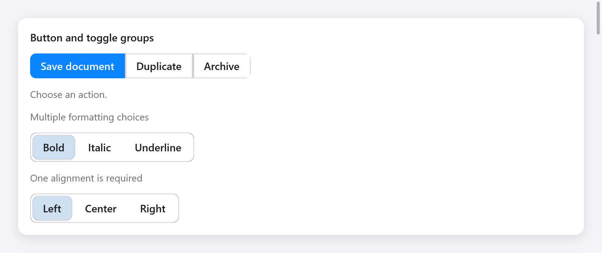

# Button and toggle groups



`buttonGroup` joins related actions. Close the group with `end` after
adding its buttons:

```zig
var group = ui.buttonGroup(c, .{ .label = "Document actions" });
if (group.button("Save", .{ .variant = .primary })) save();
if (group.button("Duplicate", .{})) duplicate();
group.end();
```

`ButtonGroupOptions` accepts `vertical`, `label` and `disabled`. Each button
also accepts the usual `ButtonOptions`. Disabled actions do not activate
or take keyboard focus.

`toggleGroup` keeps one boolean per item in app-owned memory:

```zig
// State, retained between frames:
styles: [3]bool = .{ true, false, false },

// View:
_ = ui.toggleGroup(c, &.{
    .{ .label = "Bold" },
    .{ .label = "Italic" },
    .{ .label = "Underline", .disabled = true },
}, &s.styles, .{ .multiple = true, .label = "Formatting" });
```

Each `ToggleGroupItem` has a label, optional icon name and disabled flag.
The default is single selection: initialize at most one selected flag.
Set `multiple = true` to allow several. `allow_empty = false` keeps the
last choice selected. The flags and items must have equal lengths.

Both groups form one Tab stop. Arrows, Home and End move focus, skipping
disabled buttons; Space and Enter activate the focused button. Vertical
groups use Up/Down, horizontal groups respect right-to-left layout. Toggle
buttons expose their checked state to assistive technology.

See the Gallery's **Actions & choices** page and
[focus groups](navigation.md).
