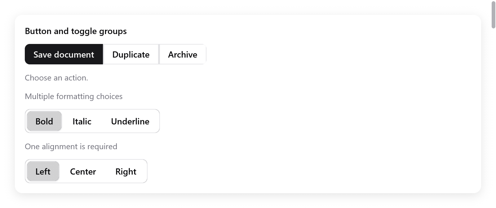

# Button and toggle groups

Joined buttons for related actions, and toggles for one or several
choices.

<!-- demo: button-groups height=360 -->



`buttonGroup` joins related actions. Add its buttons, then close it with
`end`:

```zig
var group = ui.buttonGroup(c, .{ .label = "Document actions" });
if (group.button("Save", .{ .variant = .primary })) save();
if (group.button("Duplicate", .{})) duplicate();
group.end();
```

- `ButtonGroupOptions`: `vertical`, `label` and `disabled`.
- Each button takes the usual `ButtonOptions`.
- Disabled actions do not activate or take keyboard focus.

`toggleGroup` keeps one boolean per item in memory the app owns:

```zig
// State, retained between frames:
styles: [3]bool = .{ true, false, false },

// View:
_ = ui.toggleGroup(c, &.{
    .{ .label = "Bold" },
    .{ .label = "Italic" },
    .{ .label = "Underline", .disabled = true },
}, &s.styles, .{ .multiple = true, .label = "Formatting" });
```

- A `ToggleGroupItem` has a label, an optional icon name and a disabled
  flag.
- The default is single selection: set at most one flag at the start.
- `multiple = true` allows several.
- `allow_empty = false` keeps the last choice selected.
- The flags and the items must have the same length.

**Keyboard**

- Each group is one Tab stop.
- Arrows, Home and End move the focus and skip disabled buttons.
- Space and Enter activate the focused button.
- Vertical groups use Up and Down. Horizontal groups follow right-to-left
  layout.
- Toggle buttons tell assistive technology whether they are checked.

See the Gallery's **Actions & choices** page and
[focus groups](navigation.md).
