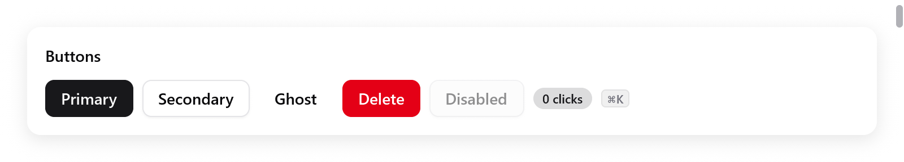

# Buttons and small things

Buttons, links, badges, key caps, icons, pictures, avatars and a
history's back and forward buttons: the small pieces most views are made
of.

<!-- demo: buttons height=76 -->



*Primary, secondary, ghost, danger and disabled buttons, with a badge and key cap.*

## Buttons

```zig
if (ui.button(c, "Save", .{ .variant = .primary }).clicked) s.save();
if (ui.button(c, "Cancel", .{}).clicked) s.editing = false;
if (ui.button(c, "Delete", .{ .variant = .danger }).clicked) s.remove();
_ = ui.button(c, "Disabled", .{ .disabled = true });
```

`ui.button(c, title, options)` draws a button and returns its
`ui.Interaction`. `.clicked` is true in the build that handles the click.

| `ui.ButtonOptions` | Default | |
|---|---|---|
| `variant` | `.secondary` | `.primary` (the accent), `.secondary` (the surface, bordered), `.ghost` (no fill until hovered), `.danger` (the danger color) |
| `width` | `.auto` | a `ui.Length`; `.fill` for a button across its parent |
| `size` | 14 | the text's size, which also sets the padding |
| `disabled` | false | dimmed, and never clicked, hovered or focused |
| `icon` | `""` | a symbol before the title, or alone when the title is empty |

```zig
// A button of an icon alone: assistive technology reads its symbol's name.
if (ui.button(c, "", .{ .icon = "trash", .variant = .ghost }).clicked) s.remove();
if (ui.button(c, "New", .{ .icon = "plus", .variant = .primary }).clicked) s.add();
```

**Behavior**

- The fill eases toward hover and press. A pressed button sinks half a
  point.
- It takes the keyboard focus (Tab), and clicks on Enter or Space while
  focused.
- A click sets `c.changed`, so what it changes shows in this frame.

```zig
const it = ui.button(c, "Share", .{ .icon = "globe" });
if (it.clicked) s.share_open = !s.share_open;
```

The interaction also has `hovered`, `pressed` (held down), `focused`,
`double_clicked` and `rect`. `rect` is where the button was last laid
out, null in the first frame. Use it for a popover anchored to the button
or a tooltip.

- A box of your own that acts as a button is a `ui.pressable` or a
  `ui.div(c)...clicked()`. See [custom widgets](custom-widgets.md).
- A button that opens a menu is `ui.menuButton`. See [menus](menus.md).

## Links

```zig
if (ui.link(c, "Privacy policy", .{})) _ = myzig.shell.openUrl("https://example.com/privacy");
```

`ui.link(c, title, .{ .size = 14 })` is text in the accent color,
underlined while the pointer is over it. It clicks as a button does, and
with Enter while it has the keyboard focus. It returns true when clicked.

## Badges

```zig
ui.badge(c, "done", c.theme.success);
ui.badge(c, c.print("{d} new", .{s.unread}), c.theme.accent);
```

`ui.badge(c, str, color)` is a small rounded label: its text in `color`
on a faint fill of it.

## Key caps

```zig
ui.kbd(c, ui.keys.label("⌘K"));
```

`ui.kbd(c, str)` draws a key combination as a key cap. Write combinations
with the Mac's symbols. `ui.keys.label`, a compile-time function, spells
them as the platform does: `⌘⇧M` on macOS, `Ctrl+Shift+M` elsewhere.

## Icons

```zig
ui.icon(c, "star.fill", .{ .color = c.theme.accent });
ui.icon(c, "doc.text", .{ .size = 13, .frame = 18, .color = c.theme.muted });
```

`ui.icon(c, name, options)` draws a symbol by its SF Symbols name.

| `ui.IconOptions` | Default | |
|---|---|---|
| `size` | 16 | |
| `weight` | `.regular` | SF Symbols draw heavier strokes at heavier weights |
| `color` | the text's | |
| `frame` | | a square box the symbol is centered in, so symbols of different widths line up in a column of rows |

- On macOS every SF Symbol is available.
- On Linux, Windows and in browsers, myzig draws its own line icons, in
  the manner of Lucide (`src/ui/icons.zig`). It has the symbols its
  widgets and apps name. A name it does not have draws nothing there.
- Use these names in apps meant for every platform. For a picture of
  your own, use an image or an [SVG](drawing.md).

<details>
<summary>The names myzig draws off macOS</summary>

| | |
|---|---|
| arrows and actions | `checkmark` `xmark` `plus` `chevron.down` `chevron.up` `chevron.right` `chevron.left` `chevron.up.chevron.down` `arrow.right` `arrow.up` `arrow.clockwise` `arrow.right.square` `arrow.up.left.and.arrow.down.right` `arrow.triangle.branch` `magnifyingglass` |
| status | `circle` `circle.dotted` `checkmark.circle.fill` `stop.circle` `play.fill` `pause.fill` `star.fill` `sparkles` `wand.and.stars` `exclamationmark.triangle` `exclamationmark.triangle.fill` `exclamationmark.circle.fill` `questionmark.circle` `info.circle` `info.circle.fill` `xmark.octagon` `ellipsis.circle` `hand.raised` |
| things | `person.fill` `photo` `doc` `doc.text` `doc.richtext` `doc.on.doc` `folder` `trash` `pencil` `square.and.pencil` `paperclip` `globe` `network` `terminal` `terminal.fill` `command` `cpu` `memorychip` `brain` `cube` `internaldrive` `desktopcomputer` `wrench.and.screwdriver` |
| layout and the rest | `list.bullet` `checklist` `sun.max` `moon` `circle.lefthalf.filled` `chart.bar.xaxis` `gauge.with.dots.needle.33percent` `slider.horizontal.3` `equal.square` `plus.square` `xmark.square` `square.grid.2x2` `square.grid.3x3` `rectangle.on.rectangle` `rectangle.split.1x2` `rectangle.split.2x1` `chevron.left.forwardslash.chevron.right` `text.cursor` `textformat` `code` `flame` `waveform.path.ecg` `clear` |

</details>

## Images

```zig
const logo = @embedFile("logo.png");

_ = ui.image(c, .{ .key = "logo", .bytes = logo, .max_width = 120, .label = "myzig" });
```

`ui.image(c, options)` shows a picture from its encoded bytes. It returns
false, drawing nothing, if they cannot be decoded.

| `ui.ImageOptions` | Default | |
|---|---|---|
| `key` | (required) | names the picture: the same key is decoded once |
| `bytes` | (required) | the encoded picture, kept by the caller while it is shown |
| `max_width`, `max_height` | 480, 360 | the most room it takes, in points |
| `radius` | 8 | its corners |
| `opacity` | 1 | its opacity |
| `label` | `""` | what it shows, for assistive technology; unnamed pictures are decoration |

**Behavior**

- A picture keeps its proportions. It is shown at half its pixel size
  (its pixels are taken as 2× ones), never larger, within the maximum
  room.
- It is decoded once per key, scaled to at most 1024 pixels on its
  longest side, and packed into one image atlas the renderers sample.
- A new picture under a key already used shows the old one. Give a
  changed picture a new key.
- `ui.imageSize(c, key, bytes)` is its size in pixels as decoded, null
  when it doesn't decode. Use it to size the picture with `size`
  yourself, as a viewer that zooms and pans does.

<details>
<summary>Which formats decode</summary>

- macOS: ImageIO, which reads PNG, JPEG, HEIC and more.
- Elsewhere: myzig's PNG decoder.
- Windows also uses the Windows Imaging Component for the rest: JPEG,
  GIF, BMP, TIFF, ICO, WebP.

</details>

## Avatars

```zig
ui.avatar(c, "Ada Lovelace", .{});
ui.avatar(c, "Linus", .{ .size = 24 });
ui.avatar(c, s.user.name, .{ .image = .{ .key = s.user.id, .bytes = s.user.photo } });
```

`ui.avatar(c, name, options)` shows a person or a thing as a circle:

- its picture cropped round;
- or the initials of the first and last words of its name, on a color
  picked from the name. Each name keeps its own color.

| `ui.AvatarOptions` | Default | |
|---|---|---|
| `size` | 32 points | |
| `image` | | a `ui.ImageOptions` shown instead of the initials when it decodes |

## History buttons

```zig
switch (ui.historyButtons(c, .{ .can_back = s.at > 0, .can_forward = s.at + 1 < s.visited.len })) {
    .back => s.at -= 1,
    .forward => s.at += 1,
    .none => {},
}
```

`ui.historyButtons` draws a history's back and forward buttons, as in
Finder's toolbar or a browser's.

- They are disabled at the history's ends.
- It returns where to go: `ui.HistoryAction`, `.none`, `.back` or
  `.forward`.
- With `shortcuts` (on by default) they also take the keys that go back
  and forward: Command-[ and Command-] on macOS, Alt-Left and Alt-Right
  elsewhere.

The [router](navigation.md) keeps such a history for you.
