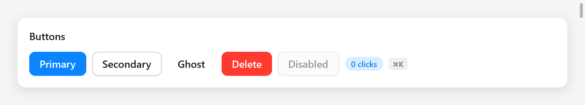

# Buttons and small things

Buttons, links, badges, key caps, icons, pictures, avatars and a history's
back and forward buttons: the small pieces most views are made of.



*Primary, secondary, ghost, danger and disabled buttons, with a badge and key cap.*

## Buttons

`ui.button(c, title, options)` draws a button and returns its
`ui.Interaction`; `.clicked` is true in the build that handles the click:

```zig
if (ui.button(c, "Save", .{ .variant = .primary }).clicked) s.save();
if (ui.button(c, "Cancel", .{}).clicked) s.editing = false;
if (ui.button(c, "Delete", .{ .variant = .danger }).clicked) s.remove();
_ = ui.button(c, "Disabled", .{ .disabled = true });
```

`ui.ButtonOptions`:

| field | default | what it does |
|---|---|---|
| `variant` | `.secondary` | `.primary` (the accent), `.secondary` (the surface, bordered), `.ghost` (no fill until hovered), `.danger` (the danger color) |
| `width` | `.auto` | a `ui.Length`; `.fill` for a button across its parent |
| `size` | 14 | the text's size, which also sets the padding |
| `disabled` | false | dimmed, and never clicked, hovered or focused |
| `icon` | `""` | a symbol before the title, or alone when the title is empty |

```zig
// A button of an icon alone: assistive technology reads its symbol's name.
if (ui.button(c, "", .{ .icon = "trash", .variant = .ghost }).clicked) s.remove();
if (ui.button(c, "New", .{ .icon = "plus", .variant = .primary }).clicked) s.add();
```

Buttons ease their fill toward hover and press, sink half a point while
pressed, take the keyboard focus (Tab), and click on Enter or Space while
focused. A click sets `c.changed`, so what it changes shows in this frame.

The interaction also has `hovered`, `pressed` (held down), `focused`,
`double_clicked` and `rect` (where the button was last laid out, null in the
first frame), for a popover anchored to it or a tooltip:

```zig
const it = ui.button(c, "Share", .{ .icon = "globe" });
if (it.clicked) s.share_open = !s.share_open;
```

A box of your own that acts as a button is a `ui.pressable` or a
`ui.div(c)...clicked()`; see [custom widgets](custom-widgets.md). A button
that opens a menu is `ui.menuButton`; see [menus](menus.md).

## Links

`ui.link(c, title, .{ .size = 14 })` is text in the accent color, underlined
while the pointer is over it, that clicks as a button does (and with Enter
while it has the keyboard focus). It returns true when clicked:

```zig
if (ui.link(c, "Privacy policy", .{})) _ = myzig.shell.openUrl("https://example.com/privacy");
```

## Badges

`ui.badge(c, str, color)` is a small rounded label, its text in `color` on
a faint fill of it:

```zig
ui.badge(c, "done", c.theme.success);
ui.badge(c, c.print("{d} new", .{s.unread}), c.theme.accent);
```

## Key caps

`ui.kbd(c, str)` draws a key combination as a key cap. Write combinations
with the Mac's symbols and let `ui.keys.label` (a compile-time function)
spell them as the platform does: `⌘⇧M` on macOS, `Ctrl+Shift+M` elsewhere.

```zig
ui.kbd(c, ui.keys.label("⌘K"));
```

## Icons

`ui.icon(c, name, options)` draws a symbol by its SF Symbols name:

```zig
ui.icon(c, "star.fill", .{ .color = c.theme.accent });
ui.icon(c, "doc.text", .{ .size = 13, .frame = 18, .color = c.theme.muted });
```

`ui.IconOptions`: `size` (16), `weight` (`.regular`; SF Symbols draw
heavier strokes at heavier weights), `color` (the text's by default), and
`frame`, a square box the symbol is centered in, so symbols of different
widths line up in a column of rows.

On macOS every SF Symbol is available. On Linux, Windows and in browsers,
myzig draws its own line icons, in the manner of Lucide, for the symbols its
widgets and apps name (`src/ui/icons.zig`); a name it does not have draws
nothing there. They are:

`checkmark` `xmark` `plus` `chevron.down` `chevron.up` `chevron.right`
`chevron.up.chevron.down` `arrow.right` `arrow.up` `arrow.clockwise`
`arrow.right.square` `arrow.up.left.and.arrow.down.right`
`arrow.triangle.branch` `magnifyingglass` `circle` `circle.dotted`
`checkmark.circle.fill` `stop.circle` `play.fill` `pause.fill` `star.fill`
`sparkles` `wand.and.stars` `person.fill` `photo` `doc` `doc.text`
`doc.richtext` `doc.on.doc` `folder` `trash` `pencil` `square.and.pencil`
`paperclip` `globe` `network` `terminal` `terminal.fill` `command` `cpu`
`memorychip` `brain` `cube` `internaldrive` `desktopcomputer`
`wrench.and.screwdriver` `exclamationmark.triangle` `questionmark.circle`
`info.circle` `xmark.octagon` `ellipsis.circle` `hand.raised` `list.bullet`
`checklist` `sun.max` `moon` `circle.lefthalf.filled` `chart.bar.xaxis`
`equal.square` `plus.square` `xmark.square` `rectangle.on.rectangle`
`chevron.left.forwardslash.chevron.right` `text.cursor` `textformat` `code`
`flame` `waveform.path.ecg` `clear`

Use these names in apps meant for every platform. For a picture of your own,
use an image or an [SVG](drawing.md).

## Images

`ui.image(c, options)` shows a picture from its encoded bytes, and returns
false (drawing nothing) if they cannot be decoded:

```zig
const logo = @embedFile("logo.png");

_ = ui.image(c, .{ .key = "logo", .bytes = logo, .max_width = 120, .label = "myzig" });
```

`ui.ImageOptions`:

| field | default | what it does |
|---|---|---|
| `key` | (required) | names the picture: the same key is decoded once |
| `bytes` | (required) | the encoded picture, kept by the caller while it is shown |
| `max_width`, `max_height` | 480, 360 | the most room it takes, in points |
| `radius` | 8 | its corners |
| `opacity` | 1 | its opacity |
| `label` | `""` | what it shows, for assistive technology; unnamed pictures are decoration |

A picture keeps its proportions and is shown at half its pixel size (its
pixels are taken as 2× ones), never larger, within the maximum room. It is
decoded once per key (by ImageIO on macOS, which reads PNG, JPEG, HEIC and
more; by myzig's PNG decoder elsewhere, and on Windows by the Windows
Imaging Component for the rest: JPEG, GIF, BMP, TIFF, ICO, WebP), scaled to at most 1024 pixels on
its longest side, and packed into one image atlas the renderers sample. A
new picture under a key already used shows the old one: give a changed
picture a new key. `ui.imageSize(c, key, bytes)` is its size in pixels
as decoded (null when it doesn't decode), to size it with `size` yourself:
a viewer that zooms and pans.

## Avatars

`ui.avatar(c, name, options)` shows a person or a thing as a circle: its
picture cropped round, or the initials of the first and last words of its
name on a color picked from the name (each name keeps its own):

```zig
ui.avatar(c, "Ada Lovelace", .{});
ui.avatar(c, "Linus", .{ .size = 24 });
ui.avatar(c, s.user.name, .{ .image = .{ .key = s.user.id, .bytes = s.user.photo } });
```

`ui.AvatarOptions`: `size` (32 points) and `image`, a `ui.ImageOptions`
shown instead of the initials when it decodes.

## History buttons

`ui.historyButtons` draws a history's back and forward buttons, as in
Finder's toolbar or a browser's, disabled at its ends, and returns where
to go (`ui.HistoryAction`: `.none`, `.back` or `.forward`):

```zig
switch (ui.historyButtons(c, .{ .can_back = s.at > 0, .can_forward = s.at + 1 < s.visited.len })) {
    .back => s.at -= 1,
    .forward => s.at += 1,
    .none => {},
}
```

With `shortcuts` (on by default) they also take the keys that go back and
forward: Command-[ and Command-] on macOS, Alt-Left and Alt-Right elsewhere.
The [router](navigation.md) keeps such a history for you.
