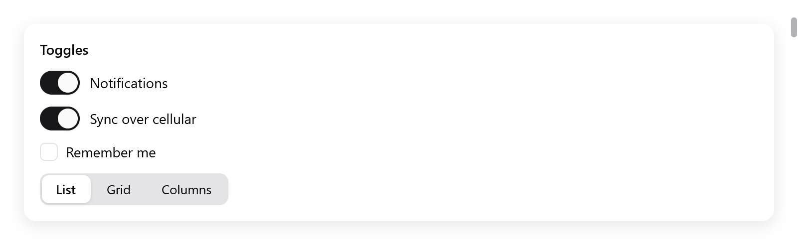
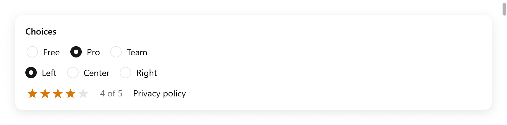

# Choices

Controls that choose:

- checkboxes and switches for one setting;
- checkbox groups for several;
- radio buttons and segmented controls for one of a few;
- ratings.

Each edits a value of your state through a pointer. It returns true when
the user changed it, so you can act on the change.

<!-- demo: toggles height=220 -->



*Switches, a checkbox and a segmented control in the Gallery.*

## Checkboxes

```zig
_ = ui.checkbox(c, "Remember me", &s.remember);
if (ui.checkbox(c, "Show hidden files", &s.hidden)) s.reload();
```

`ui.checkbox(c, title, &value)` draws a box and its label. It flips the
`bool` on a click, or on Enter or Space while focused.

- The check eases in and out.
- The label is part of the control: a click on it toggles too.
- With an empty title it is the box alone, for a table's column of checks.

## Checkbox groups

```zig
const State = struct {
    notify: [3]bool = .{ true, false, true },
};

_ = ui.checkboxGroup(c, "Notifications", &s.notify, &.{ "Mail", "Calendar", "Reminders" });
```

`ui.checkboxGroup(c, title, values, labels)` draws one checkbox over a
group, as for a list of permissions. Below it, indented, is a checkbox for
each of `values` (a `[]bool`), named by `labels`.

- The group's box is checked when all are, and mixed (a dash) when some
  are.
- A click on it, or Space while focused, checks them all. When all are
  checked, it clears them.
- It returns true when any changed.
- Assistive technology reads the group's box as a checkbox that is on, off
  or mixed.

## Switches

```zig
_ = ui.toggle(c, "Notifications", &s.notifications);
if (ui.toggle(c, "Dark", &s.dark)) s.theme.switchTo(if (s.dark) ui.Theme.dark_theme else ui.Theme.light);
```

`ui.toggle(c, title, &value)` is a switch, as on iOS and in macOS's
settings. Use it for a setting that applies at once.

- Its knob slides, and its track fills with the success color as it turns
  on.
- In a [form](forms.md), give it an empty title and let the field label it.

## Radio buttons

<!-- demo: choices height=223 -->



*Radio groups and a four-star rating.*

```zig
ui.row(c, .{ .gap = 16, .align_items = .center });
defer ui.end(c);
_ = ui.radio(c, &s.alignment, 0, "Left");
_ = ui.radio(c, &s.alignment, 1, "Center");
_ = ui.radio(c, &s.alignment, 2, "Right");
```

`ui.radio(c, &selected, value, title)` is one radio button.

- It is on while `selected.*` equals `value`.
- They are compared with `std.meta.eql`, so any type works: an integer, an
  enum, a struct.
- A click sets it and returns true.
- A click on the one already selected changes nothing and returns false.

## Radio groups

```zig
const Plan = enum { free, pro, team };

_ = ui.radioGroup(c, &s.plan, &.{
    .{ .label = "Free", .value = .free },
    .{ .label = "Pro", .value = .pro },
    .{ .label = "Team", .value = .team },
}, .{ .row = true, .gap = 16 });
```

`ui.radioGroup(c, &selected, choices, options)` draws a radio button for
each of `choices`, as one control that takes the keyboard focus.
`choices` is a `[]const ui.Choice(T)`: a `label` and a `value`.

- The arrows choose among them; Home and End choose the first and the
  last.
- It returns true when the choice changes.
- Assistive technology reads it as a radio group, with each button's place
  in it.

| `ui.RadioGroupOptions` | Default | |
|---|---|---|
| `row` | `false` | a row rather than a column |
| `gap` | 8 | between the buttons |

## Segmented controls

```zig
_ = ui.segmented(c, &.{ "List", "Grid", "Columns" }, &s.view_mode);
switch (s.view_mode) {
    0 => s.listView(c),
    1 => s.gridView(c),
    else => s.columnView(c),
}
```

`ui.segmented(c, options, &selected)` chooses one of a few labels, as
AppKit's segmented control. `options` is a slice of strings and `selected`
a `usize` index.

- It returns true when the choice changes.
- The chosen segment lifts onto the surface color with a shadow, and eases
  between segments.

## Ratings

```zig
_ = ui.rating(c, &s.stars, .{});
ui.text(c, c.print("{d} of 5", .{s.stars}), .{ .color = c.theme.muted });
```

`ui.rating(c, &value, options)` is a row of stars, `value` (a `u8`) of
them filled.

- A click on a star sets the rating. A click on the star already set
  clears it.
- With the keyboard focus, the arrows, Home and End change it.
- While the pointer rests on the stars, they show what a click would set.
- It returns true when the rating changes.

| `ui.RatingOptions` | Default | |
|---|---|---|
| `max` | 5 | stars |
| `size` | 18 | points |

## Toggling from the keyboard

- Every control here takes the keyboard focus with Tab.
- It draws the focus ring when focused from the keyboard.
- Checkboxes and switches toggle on Enter and Space.
- Radio groups and ratings move with the arrows.

Tests drive them the same way:

```zig
try t.clickText("Large"); // selects the radio button labeled "Large"
t.key(.right);            // the next choice of a focused radio group
```

See [testing](testing.md).
