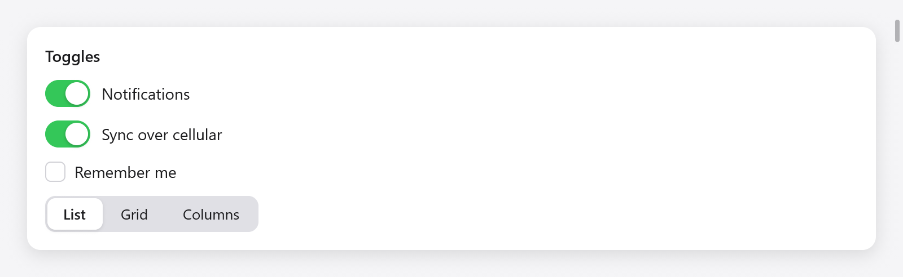
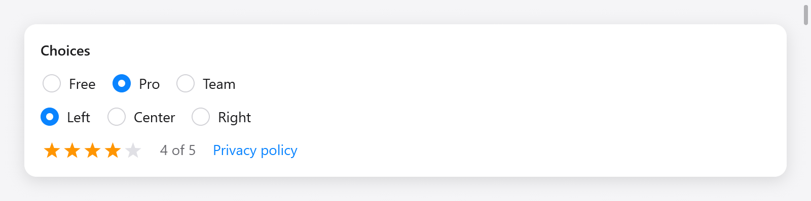

# Choices

Controls that choose: checkboxes and switches for one setting, checkbox
groups for several, radio buttons and segmented controls for one of a few,
and ratings. Each edits a value of your state through a pointer and returns
true when the user changed it, so you can act on the change.



*Switches, a checkbox and a segmented control in the Gallery.*

## Checkboxes

`ui.checkbox(c, title, &value)` draws a box and its label and flips the
`bool` on a click (or Enter or Space while focused):

```zig
_ = ui.checkbox(c, "Remember me", &s.remember);
if (ui.checkbox(c, "Show hidden files", &s.hidden)) s.reload();
```

The check eases in and out. The label is part of the control: a click on it
toggles too. A checkbox with an empty title is the box alone, for a table's
column of checks.

## Checkbox groups

`ui.checkboxGroup(c, title, values, labels)` draws a checkbox over a group
of checkboxes, one for each of `values` (a `[]bool`) named by `labels`,
indented below it, as a list of permissions. The group's box is checked
when they all are and mixed (a dash) when some are; a click on it, or
Space while it has the focus, checks them all, or none when they all are.
It returns true when any changed:

```zig
const State = struct {
    notify: [3]bool = .{ true, false, true },
};

_ = ui.checkboxGroup(c, "Notifications", &s.notify, &.{ "Mail", "Calendar", "Reminders" });
```

Assistive technology reads the group's box as a checkbox that is on, off or
mixed.

## Switches

`ui.toggle(c, title, &value)` is a switch, as on iOS and in macOS's
settings, for a setting that applies at once:

```zig
_ = ui.toggle(c, "Notifications", &s.notifications);
if (ui.toggle(c, "Dark", &s.dark)) s.theme.switchTo(if (s.dark) ui.Theme.dark_theme else ui.Theme.light);
```

Its knob slides and its track fills with the success color as it turns on.
In a [form](forms.md), give it an empty title and let the field label it.

## Radio buttons



*Radio groups and a four-star rating.*

`ui.radio(c, &selected, value, title)` is one radio button: it is on while
`selected.*` equals `value` (compared with `std.meta.eql`, so any type
works: an integer, an enum, a struct), and a click sets it. It returns true
when a click selects it:

```zig
ui.row(c, .{ .gap = 16, .align_items = .center });
defer ui.end(c);
_ = ui.radio(c, &s.alignment, 0, "Left");
_ = ui.radio(c, &s.alignment, 1, "Center");
_ = ui.radio(c, &s.alignment, 2, "Right");
```

Clicking the one already selected changes nothing and returns false.

## Radio groups

`ui.radioGroup(c, &selected, choices, options)` draws a radio button for
each of `choices` (`[]const ui.Choice(T)`: a `label` and a `value`) as one
control taking the keyboard focus: the arrows choose among them, and Home
and End the first and the last. It returns true when the choice changes:

```zig
const Plan = enum { free, pro, team };

_ = ui.radioGroup(c, &s.plan, &.{
    .{ .label = "Free", .value = .free },
    .{ .label = "Pro", .value = .pro },
    .{ .label = "Team", .value = .team },
}, .{ .row = true, .gap = 16 });
```

`ui.RadioGroupOptions`: `row` (a row rather than a column) and `gap` (8).
Assistive technology reads the group as a radio group, and each button's
place in it.

## Segmented controls

`ui.segmented(c, options, &selected)` chooses one of a few labels, as
AppKit's segmented control: `options` is a slice of strings and `selected`
a `usize` index. It returns true when the choice changes:

```zig
_ = ui.segmented(c, &.{ "List", "Grid", "Columns" }, &s.view_mode);
switch (s.view_mode) {
    0 => s.listView(c),
    1 => s.gridView(c),
    else => s.columnView(c),
}
```

The chosen segment lifts onto the surface color with a shadow, easing
between segments.

## Ratings

`ui.rating(c, &value, options)` is a row of stars, `value` (a `u8`) of them
filled. A click on a star sets the rating, a click on the star already set
clears it, and the arrows, Home and End change it with the keyboard focus.
While the pointer rests on the stars, they show what a click would set. It
returns true when the rating changes:

```zig
_ = ui.rating(c, &s.stars, .{});
ui.text(c, c.print("{d} of 5", .{s.stars}), .{ .color = c.theme.muted });
```

`ui.RatingOptions`: `max` (5 stars) and `size` (18 points).

## Toggling from the keyboard

Every control here takes the keyboard focus with Tab and draws the focus
ring when focused from the keyboard. Checkboxes and switches toggle on
Enter and Space; radio groups and ratings move with the arrows. Tests drive
them the same way:

```zig
try t.clickText("Large"); // selects the radio button labeled "Large"
t.key(.right);            // the next choice of a focused radio group
```

See [testing](testing.md).
