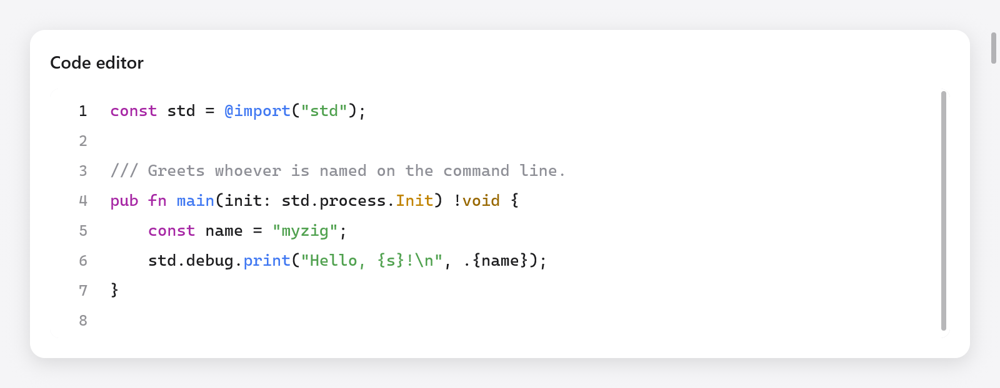
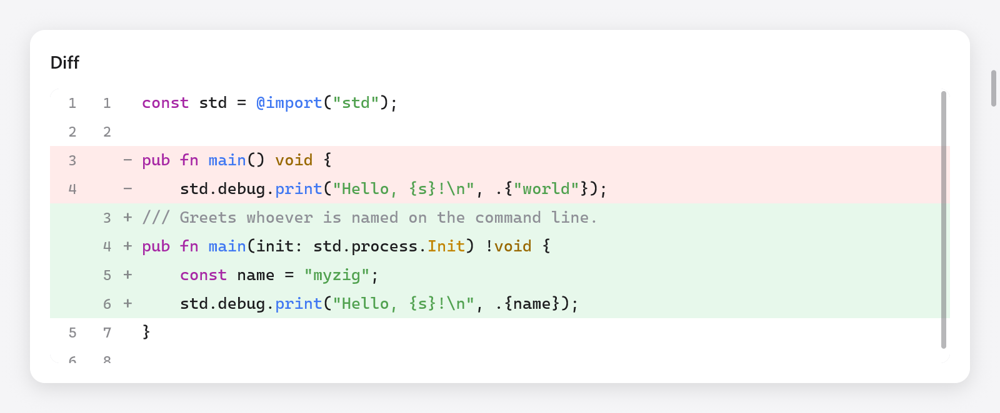

# Code editor and diff viewer

`ui.codeEditor` edits source code, after Zed's editor and mygo's
`ui/editor`: a gutter of line numbers, syntax colors, the caret's line
filled, indentation, brackets and quotes that close as they are typed,
the bracket at the caret matched, a find bar that also replaces (by case,
whole words, or regular expressions), going to a line, and soft wraps or
long lines scrolled sideways. `ui.diffView` shows the changes between two
texts, unified or side by side. Both build only the lines in view, so a
file of 100 000 lines costs what a screenful does.



*The Zig editor with syntax highlighting and a line-number gutter.*

```zig
const Editor = struct {
    code: ui.CodeEditor,

    fn view(s: *Editor, c: *ui.Context) void {
        _ = ui.codeEditor(c, &s.code, .{});
    }
};

var s: Editor = .{ .code = .init(gpa, source, "main.zig") };
defer s.code.deinit();
```

`zig build run-code-editor` edits files of several languages, with their
changes against the files as they were (`examples/code-editor`); headless:
`zig-out/bin/code-editor --myzig-snapshot=diff.png --myzig-script="click:Changes"`.

## The editor

`ui.CodeEditor.init(gpa, text, name)` makes an editor of `text`,
highlighted as the language of the file `name` (null: none). Free it with
`deinit()`. Its fields and methods:

| | |
|---|---|
| `area` | its `ui.TextArea`: the text, the selection, undo ([Text area](text-area.md)) |
| `wrap` | lines wrap at the editor's width, rather than scrolling sideways |
| `wrap_column` | with `wrap`, lines wrap at this column, or at the width where that is nearer (0, the default: the width) |
| `read_only` | selectable, searchable and copyable, not editable |
| `indent` | `unit` (one level: `"    "` by default, or `"\t"`) and `tab_size` (4) |
| `find` | the find bar's state: `open`, `replacing`, `query`, `replacement`, `flags` (`case`, `word`, `regex`), `matches` |
| `setLanguage(name)` | highlights as a file named `name`, or a language's name (`"zig"`, `"go"`); null for none |
| `goToLine(line)` | puts the caret at the start of a line (from 1) and shows it |
| `openFind(replacing)` | opens the find bar, on the selection's text |
| `closeBars()` | closes the find and go-to bars |
| `own_find_bar` | the app draws the find bar itself from `find`, `query_id`, `replacement_id` and `focus_next` (the editor still finds, marks and takes the keys) |
| `extra` | what the app adds to the lines (below) |
| `background` | the text's background (null: the default light or dark one) |
| `guides` | a color for lines at each level of indentation (null: none) |
| `syntax.colors` | the tokens' colors, a `ui.SyntaxColors` (null: the defaults) |

The app reads and edits the text through `area`, as with a text area:

```zig
const ta = &s.code.area;
const line = ta.caretLine();
const col = ta.sel.caret - ta.doc.lineStart(line);
ui.text(c, c.print("Ln {d}, Col {d}", .{ line + 1, col + 1 }), .{ .size = 12 });
const modified = ta.doc.canUndo();
```

`ui.CodeEditorOptions`: `width` and `height` (`.fill`), `size` (13),
`line_numbers` (true), `current_line` (true: fill the caret's line),
`leading` (1.45, the line height as a multiple of the font's), `weight`
(or `weight_value`, 100 to 900), `family` (the theme's monospaced one
when null), `features` (OpenType, as `ui.TextStyle` takes them) and
`placeholder`. It returns what a text area does (`changed`, `focused`,
`first_line`, `last_line`).

## What the app adds to the lines

`extra`, a `ui.CodeEditor.Extra`, lets the app decorate the lines as they
are built, for only the lines in view: `marks(ctx, c, line, start, str)`
returns backgrounds of runs (`ui.TextMark`s: byte ranges of the line and a
color: the other occurrences of a word; an `end` of `ui.TextMark.whole`
fills the line across the view, under the selection: conflict blocks), `gutter(ctx, c,
line)` a color for a bar along the gutter's left edge (the lines changed
since a commit), and `after(ctx, c, line)` a `ui.TextAfter`, faint text
after the line's end (the caret line's blame, a note). A press in the
gutter sets `area.gutter_press` to its line, for the app to read and clear.

```zig
s.code.extra = .{ .ctx = s, .gutter = State.changed, .after = State.blame };
s.code.guides = c.theme.text.alpha(0.08);
```

## Keys

Besides a text area's keys ([Text area](text-area.md#editing)); "Mod" is
Command on macOS and Control elsewhere:

| keys | does |
|---|---|
| Mod+F | find |
| Mod+Option+F (macOS), Ctrl+H | find and replace |
| Mod+G, Mod+Shift+G (macOS), F3, Shift+F3 | the next and previous match |
| Ctrl+G | go to a line |
| Escape | closes the bars, or collapses the selection |
| Tab, Shift+Tab | indent and outdent the selected lines (or type a level at the caret) |
| Mod+], Mod+[ | indent and outdent the lines |
| Mod+/ | comment the lines out, or back in, with the language's line comment (nothing in one without) |
| Alt+Z | wrap long lines, or not |
| Mod+C, Mod+X without a selection | copy or cut the caret's line |

As code is typed:

- Enter keeps the line's indentation, one level more after an opening
  bracket, and puts the closing bracket on a line of its own between a
  pair.
- Brackets and quotes close as they are typed, wrap the selection when
  there is one, and typing the closing one steps over it; Backspace takes
  an empty pair.
- The bracket at the caret and its partner are marked, its partner looked
  for within 2000 lines and 64 KB (a few long lines are a whole file).

## Languages

The editor highlights what the [Markdown](markdown.md) view highlights
(Zig, JavaScript and TypeScript, Go, Python, Rust, C and its family,
markup, Markdown, diffs and some sixty others), by the file's extension or
a language's name. `ui.languageFor(name)` finds the language of a file name
(null when there is none). Lines are tokenized a line at a time from the
state each starts in (inside a block comment, a multiline string), and
the states are kept per line: after an edit, only the lines from it are
tokenized again, until one starts in the state it started in before, and
only as far as the lines shown. Of a line longer than 20 000 bytes the
first 20 000 are colored and the rest is plain, as VS Code does, and a long
line's colors are kept until the text changes: long lines are laid out a
frame's budget at a time, as a [text area](text-area.md)'s.

## Find and replace

The find bar finds the query's matches a line at a time, as plain text
(with or without case, whole words) or as a regular expression, found
again only when the query, its options or the text change. Replace
replaces the current match or all of them; with a regular expression, `$1`
to `$9` put its groups in the replacement.

An app with a find bar of its own look sets `own_find_bar`: the editor
draws none, and the app's bar edits `find.query` and `find.replacement`,
calls `find.step` and `find.replaceOne` / `replaceAll`, gives its fields
the keyboard when `focus_next` asks (`.query`, `.replacement`), keeps
their ids in `query_id` and `replacement_id`, and closes with
`closeBars()`; `ui.findBarEscaped(c, id)` says a field took Escape.

Regular expressions are matched by a small backtracking machine
(`src/ui/editor/regex.zig`): literals and escapes (`\d \w \s \b` and their
negations, `\t \n`), `.`, classes (`[a-z]`, `[^…]`), anchors (`^ $`),
groups (capturing and `(?:…)`), alternation, and the quantifiers `* + ?
{n} {n,} {n,m}`, greedy or lazy. A budget of steps keeps a pathological
pattern from hanging the editor: past it, a line doesn't match.

## The diff viewer



*A diff with deleted lines in red and added lines in green.*

```zig
var d = try ui.DiffView.init(gpa, before, after, "main.zig");
defer d.deinit();

// In the view:
const st = d.stats();
ui.text(c, c.print("+{d}  −{d}", .{ st.added, st.deleted }), .{ .size = 13 });
if (ui.segmented(c, &.{ "Unified", "Split" }, &s.split)) d.setMode(if (s.split == 1) .split else .unified);
ui.diffView(c, &d, .{});
```

A `ui.DiffView` compares two texts line by line and keeps the rows it
shows. `init(gpa, old, new, name)` copies both texts and highlights them
as the language of `name`; `set(old, new)` compares new texts (the editor
example does so when the editor's `area.doc.version` changes).

- `setMode(mode)`: `ui.DiffMode.unified` (the deleted lines over the added
  ones) or `.split` (side by side, lines aligned).
- `context`: the unchanged lines shown around each change (3). Longer runs
  between changes collapse into a row that a click expands;
  `expandAll()` and `collapseAll()` do it for every run.
- `stats()`: the lines `added` and `deleted`.

Each side has its line numbers and syntax colors, and the words that
changed within a changed line are marked, unless the two lines are less
alike than `ui.DiffViewOptions.min_same` (0.3 of their bytes the same).
The options also have `width`, `height`, `size` (13), `colors` (the
tokens', a `ui.SyntaxColors`), `digits` (of the numbers' column), and
`family`, `features` and `weight_value` as the editor has them.
`scroll_to`, a row, shows that row at the top in the next frame.

Several diffs in one scroll (each file under a header, rows of the app's
own between them) are built from rows: after `dv.build()`, `ui.diffRow(c,
&dv, i, opts)` builds row `i` of `dv.rows`, `ui.diffRowHeight(c, opts)`
tall, in a list of the app's. Long lines wrap there as pieces of rows:
`ui.diffWrapColumns(c, &dv, opts, width, split)` is how many characters a
side has room for, `ui.diffRowParts(&dv, i, cols)` how many pieces row `i`
takes, and `ui.diffRowPart(c, &dv, i, opts, part, cols)` builds one (the
line numbers and the sign on the first).

## Comparing texts yourself

`ui.diff` is the comparison under the viewer, as mygo's `internal/diff`:
Myers's O(ND) algorithm in linear space, with xdiff's cost limit, which
bounds the time on large unrelated texts at the price of a diff that may
not be minimal.

```zig
const old_lines = try ui.diff.splitLines(gpa, before);
defer gpa.free(old_lines);
const new_lines = try ui.diff.splitLines(gpa, after);
defer gpa.free(new_lines);
const hunks = try ui.diff.lines(gpa, old_lines, new_lines);
defer gpa.free(hunks);
for (hunks) |h| {
    // Old lines h.a0..h.a1 replaced by new lines h.b0..h.b1.
}
```

- `diff.lines(gpa, a, b)` compares sequences of lines, `diff.ints(gpa, a,
  b)` of integers; both return `diff.Hunk`s (`a0`, `a1`, `b0`, `b1`;
  `a0 == a1` is an insertion, `b0 == b1` a deletion).
- `diff.words(gpa, a, b)` compares two lines word by word: the byte ranges
  of each that changed, joined across the spaces between them, and `same`,
  how much of them stayed the same, from 0 to 1. Free it with
  `deinit(gpa)`.

## Testing

The editor works in the Tester as in a window, with the Tester's own
clipboard:

```zig
var s: Editor = .{ .code = .init(gpa, "fn main() {}\n", "main.zig") };
defer s.code.deinit();
var t: ui.Tester = undefined;
try t.init(gpa, .init(&s, Editor.view), .{});
defer t.deinit();
try t.clickText("main");
const mac = @import("builtin").os.tag == .macos;
_ = t.shortcut(if (mac) .{ .key = 'f', .cmd = true } else .{ .key = 'f', .ctrl = true });
try std.testing.expect(s.code.find.open);
```

See `src/ui/tests_editor.zig`, `src/ui/tests_diff.zig` and
[Testing](testing.md).
