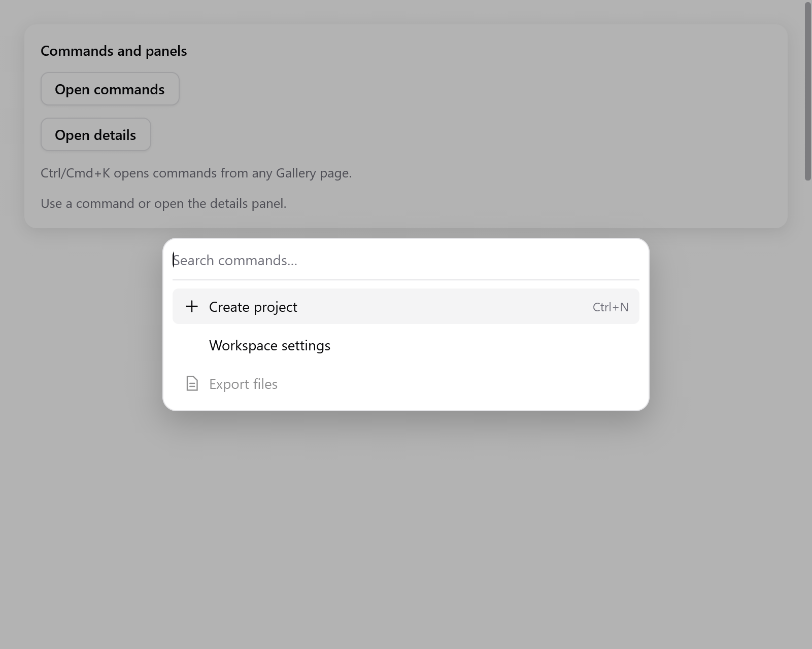

# Command palette

`ui.commandPalette` shows searchable commands in a modal dialog. It
returns the item's index in the app's list when a command is activated.

<!-- demo: panels height=520 -->



```zig
// In app state: commands: ui.CommandState = .{},
if (c.shortcut(.{ .key = 'k', .cmd = true })) s.commands.toggle();
const items: []const ui.CommandItem = &.{
    .{ .title = "New file", .group = "Files", .keywords = "create", .icon = "doc.text" },
    .{ .title = "Settings", .group = "Application", .keywords = "preferences" },
    .{ .title = "Export", .group = "Files", .disabled = !s.has_files },
};
if (ui.commandPalette(c, &s.commands, items, .{})) |index| s.runCommand(index);
```

Keep `CommandState` in app state:

- `show`, `close` and `toggle` open and close it.
- `query` is its search buffer. Each reopening clears it.
- `selected` is the active item's index in the app's list.

Build the palette after the rest of the view, so its controls handle
input last.

## Items and options

An item has a `title` and, optionally, `group`, `keywords`, `icon`,
`shortcut` (display text) and `disabled`. Place the items of a group
together.

| `CommandOptions` | Default | Meaning |
|---|---|---|
| `width` | `.{ .px = 480 }` | Dialog width, capped to the window |
| `max_height` | `320` | Maximum results height before scrolling |
| `label` | `"Commands"` | Accessible dialog/list name |
| `placeholder` | `"Search commands…"` | Search hint |
| `search_label` | `"Search commands"` | Accessible search-field name |
| `empty_label` | `"No commands found."` | Text for an empty result |

**Search and keys**

- Search matches title and keywords, ignoring ASCII case. Prefix
  matches come first.
- Disabled matches are shown, and navigation skips them.
- Typing keeps the search field focused. Space is ordinary search text.
- Up/Down wrap through enabled matches. Home/End go to the first/last.
- Enter or a click activates a result, and closes the palette.
- The active result scrolls into view. Screen readers get it as the
  search field's active descendant.
- Tab stays in the dialog. Escape or a click on the backdrop closes it.
- Closing gives the focus back to the trigger.
- It opens without an entrance animation, since it is used often.

## Shared actions

When the app already uses [`ui.Actions`](navigation.md#actions), use the
adapter to share titles, icons, enabled states and shortcut labels:

```zig
if (s.actions.commandPalette(c, &s.commands, .{})) |cmd| s.run(cmd);
```

It returns the action's enum tag and updates `actions.last`, like
`menuItem` and `button`. Shortcut labels are only shown. Keep calling
`actions.shortcuts(c)` to dispatch those key combinations.

See [Gallery](../../examples/gallery/feedback.zig) for commands opening a
[Sheet](sheet.md) or updating the workspace.
