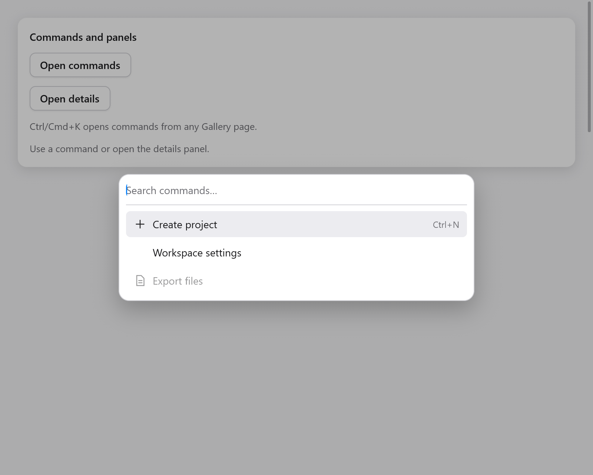

# Command palette

`ui.commandPalette` provides searchable commands in a modal dialog. It
returns the original index in the app's items when a command is activated.



```zig
// In app state: commands: ui.CommandState = .{},
if (c.shortcut(.{ .key = 'k', .cmd = true })) s.commands.toggle();
const items: []const ui.CommandItem = &.{
    .{ .title = "New file", .group = "Files", .keywords = "create", .icon = "doc.text" },
    .{ .title = "Settings", .group = "Application", .keywords = "preferences" },
    .{ .title = "Export", .group = "Files", .disabled = !s.has_files },
};
if (ui.commandPalette(c, &s.commands, items, .{})) |index| s.runCommand(index);
```

Keep `CommandState` in app state. `show`, `close` and `toggle` control its
overlay; `query` is its search buffer and `selected` the active original
item index. Each reopening clears the query. Build the palette after the
rest of the view so its controls have the last chance to handle input.

## Items and options

An item has `title`, optional `group`, `keywords`, `icon`, `shortcut`
(display text) and `disabled`. Place items of a group together. Search
matches title and keywords, ignoring ASCII case; prefix matches come first.
The palette displays disabled matches and skips them during navigation.

| `CommandOptions` | Default | Meaning |
|---|---|---|
| `width` | `.{ .px = 480 }` | Dialog width, capped to the window |
| `max_height` | `320` | Maximum results height before scrolling |
| `label` | `"Commands"` | Accessible dialog/list name |
| `placeholder` | `"Search commands…"` | Search hint |
| `search_label` | `"Search commands"` | Accessible search-field name |
| `empty_label` | `"No commands found."` | Text for an empty result |

Typing keeps the search field focused. Up/Down wrap through enabled
matches; Home/End go to the first/last. Enter activates the current match,
and a pointer click activates a result. Space remains ordinary search
text. The active result scrolls into view and is exposed to assistive
technology as the search field's active descendant.

Tab stays inside the dialog. Escape or a click on its backdrop closes
it; activation closes it too. Closing restores the trigger's focus. This
frequently used menu opens without an entrance animation.

## Shared actions

When the app already uses [`ui.Actions`](navigation.md#actions), use the
adapter to share titles, icons, enabled states and shortcut labels:

```zig
if (s.actions.commandPalette(c, &s.commands, .{})) |cmd| s.run(cmd);
```

It returns the action's enum tag and updates `actions.last`, like
`menuItem` and `button`. Shortcut labels are presentation; continue to use
`actions.shortcuts(c)` to dispatch those key combinations.

See [Gallery](../../examples/gallery/feedback.zig) for commands opening a
[Sheet](sheet.md) or updating the workspace.
