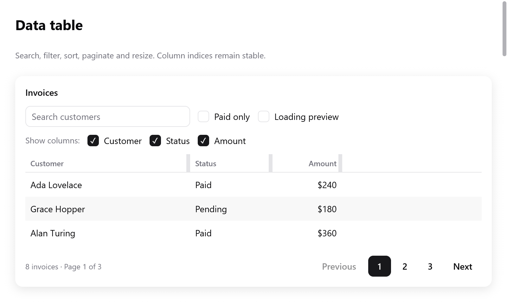

# Data table composition

<!-- demo: data-table height=350 -->



The Gallery's **Data table** page composes `textField`, checkboxes,
`table`, `pagination`, `skeleton` and `empty`.

- Search and status filtering run before sorting. Then pagination slices
  the matching rows.
- A filter or sort change clears the row cursor. A filter change also
  resets the page.
- Loading and no-results states are shown separately.

Columns support `hidden`, `min_width` and `max_width`.

- Hidden headers and cells are left out.
- `table.cell()` and `state.sort.column` still return the original
  column indices.
- Cell arrows skip hidden columns.

```zig
// State:
widths: [3]f32 = .{ 260, 130, 110 },

// View:
const columns = [_]ui.TableColumn{
    .{ .title = "Customer", .sortable = true, .min_width = 120 },
    .{ .title = "Status", .hidden = !s.show_status },
    .{ .title = "Amount", .alignment = .end },
};
var table = ui.table(c, &s.table, &columns, rows.len, .{
    .column_widths = &s.widths,
    .height = .{ .px = 240 },
});
// Build rows with next()/cell(), then:
const result = table.end();
if (result.resized) saveColumnPreferences();
```

**Resizing.** `column_widths` is an optional mutable slice the app owns.
It has one width per column, hidden columns included. Passing it turns
on resize grips.

- Positive widths are clamped to each column's limits.
- A zero width shares the remaining space until resized.
- Widths do not change just because the window shrinks.
- Drag a grip, or focus it and use Left/Right (ten points), Home
  (minimum) or End (maximum).
- Right-to-left layout reverses the arrows.
- Grips are accessible splitters. They do not trigger sorting.

A table too wide for its box scrolls with `.sideways = true`. It keeps
its first columns in view with `.frozen = n`. See
[lists, trees and tables](lists.md).

Sorting stays with the app; `result.sorted` reports a change. If the
selection must survive reordering or filtering, supply stable row keys,
as [lists, trees and tables](lists.md) describes. See the complete
[Gallery composition](../../examples/gallery/data_table.zig).
