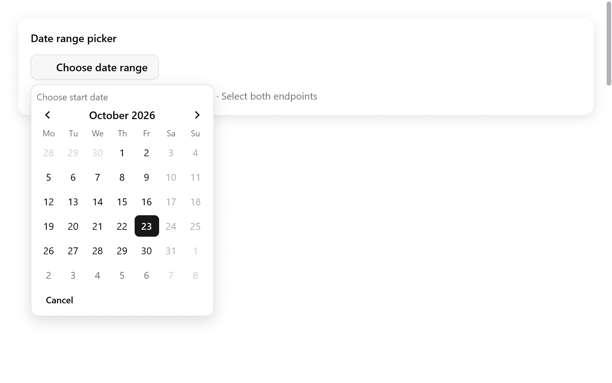

# Date range picker

<!-- demo: date-range height=520 -->



`dateRangeInput` commits an inclusive `DateRange` after the user chooses
both endpoints. The user may pick the later day first; `start` is always
on or before `end`.

```zig
// App state:
period: ?ui.DateRange = null,
period_picker: ui.DateRangeState = .{},

// View:
_ = ui.dateRangeInput(c, &s.period, &s.period_picker, .{
    .label = "Reporting period",
    .format = .day_month_year,
    .calendar = .{
        .min = .{ .year = 2026, .month = 10, .day = 1 },
        .max = .{ .year = 2026, .month = 12, .day = 31 },
        .first_weekday = 1,
    },
});
```

`CalendarOptions` supports inclusive `min`/`max` and
`disabled: ?*const fn (ui.Date) bool`. These work with `calendar` and
`dateInput` too.

- A range cannot include any disabled day, even between its endpoints.
- With a callback, validation visits each day in the chosen range. Keep
  it cheap.

**Behavior**

- The popup shades the pending range.
- A first click does not change the committed value.
- Cancel, Escape or a press outside leaves that value unchanged.
  Reopening starts a fresh choice.
- `disabled = true` locks the input.
- No allocator is needed.
- Arrows move by days and weeks, Page Up/Down by months, Home/End to the
  month's edges.
- Enter or Space chooses the current day.
- The cursor may visit disabled days, but they cannot be chosen.
- The function returns true only after a different complete range is
  committed.

See [dates, times and colors](dates-and-colors.md) and the Gallery's
**Actions & choices** page.
