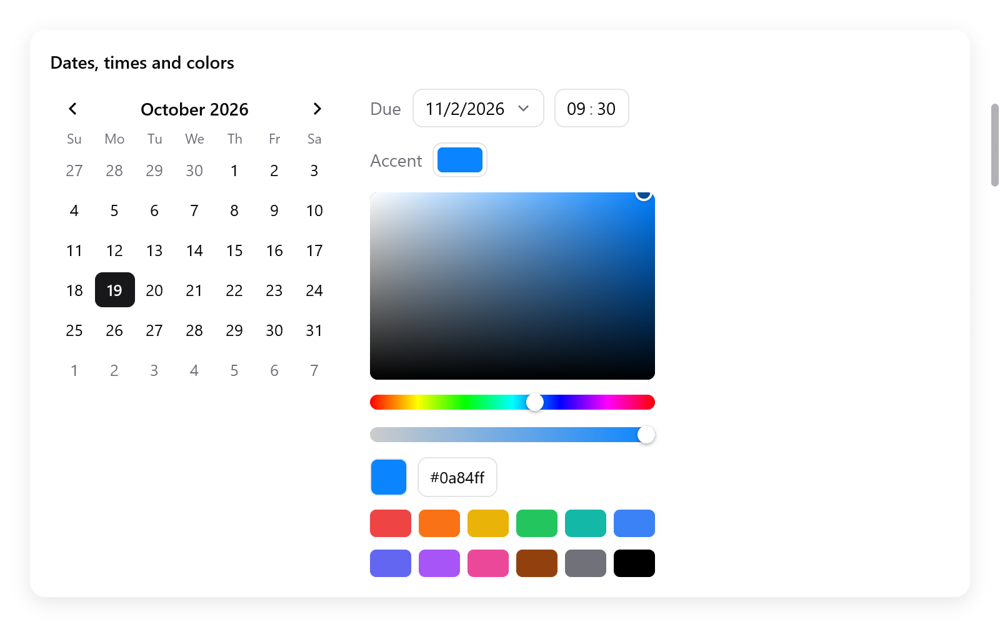

# Dates, times and colors

Calendars, fields of dates and times of day, and color pickers. Each edits
a value of your state through a pointer. It returns true when the user
changed it.

<!-- demo: dates-and-colors height=520 -->



*Calendar, date and time inputs, color well and color picker.*

## Dates

`ui.Date` is a day of the proleptic Gregorian calendar:

- `year`, an `i32`;
- `month`, 1 to 12;
- `day`, 1 to the month's last.

It has no time zone and no time of day.

| method | what it does |
|---|---|
| `toDays()`, `fromDays(n)` | days since 1970-01-01, and back |
| `addDays(n)` | `n` days later (earlier if negative) |
| `addMonths(n)` | `n` months later, on the same day or the month's last: January 31 and a month is February's last day |
| `weekday()` | 0 for Sunday to 6 for Saturday |
| `eql(b)` | the same day |
| `valid()` | the month and the day within their bounds |

```zig
const due: ui.Date = .{ .year = 2026, .month = 11, .day = 2 };
const week_later = due.addDays(7);
const days_left = due.toDays() - today.toDays();
```

The widgets do not read the clock: the app passes today where it is
wanted. To show dates as the user's language writes them, see
[i18n](../i18n.md).

## Calendars

```zig
_ = ui.calendar(c, &s.day, .{ .today = s.today, .first_weekday = 1 });
```

`ui.calendar(c, &date, options)` shows a month and chooses a day, as
SwiftUI's graphical date picker. It returns true when the date changes.

- A click chooses a day. So do the arrows while it has the keyboard focus.
- Page Up and Page Down, or its buttons, move by months.
- Home and End go to the first and the last day of the month.

| `ui.CalendarOptions` | Default | |
|---|---|---|
| `first_weekday` | 0 | the first day of the week: 0 for Sunday (the United States), 1 for Monday (most of Europe) |
| `today` | null | today, marked with a ring; none when null |
| `min`, `max`, `disabled` | null | days outside them, or for which `disabled(day)` is true, cannot be chosen |
| `browse` | `false` | moving shows other days without choosing; only a click, Enter or Space chooses |

## Date inputs

```zig
ui.row(c, .{ .gap = 8, .align_items = .center });
defer ui.end(c);
ui.text(c, "Due", .{ .color = c.theme.muted });
_ = ui.dateInput(c, &s.due, .{ .format = .day_month_year, .calendar = .{ .first_weekday = 1 } });
```

`ui.dateInput(c, &date, options)` is a field that shows the date in
numbers. A calendar below it changes the date. It returns true when the
date changes.

- A click, Enter or Space opens the calendar.
- There, a click chooses a day, as the arrows and Enter do.
- Page Up and Page Down, or its buttons, move by months.
- Escape or a click outside closes it.

`ui.DateInputOptions`: `format`, a `ui.DateFormat`, and `calendar`, the
options of its calendar.

| `ui.DateFormat` | shows January 5, 2026 as |
|---|---|
| `.month_day_year` (default) | 1/5/2026, as in the United States |
| `.day_month_year` | 05/01/2026, as in the United Kingdom |
| `.year_month_day` | 2026/1/5, as in China |

## Times of day

```zig
_ = ui.timeInput(c, &s.alarm, .{});
_ = ui.timeInput(c, &s.meeting, .{ .twelve_hour = true });
```

`ui.Time` is a time of day: `hour` (0 to 23) and `minute` (0 to 59).
`ui.timeInput(c, &time, options)` edits one in segments. It returns true
when the time changes.

- Up and Down step the focused segment round the clock.
- Typed digits set it. Once the hours are typed, it goes on to the
  minutes.
- A or P choose the half of the day.
- Left and Right move between the segments; a click focuses one.

| `ui.TimeInputOptions` | Default | |
|---|---|---|
| `twelve_hour` | `false` | 3:04 PM rather than 15:04 |
| `am`, `pm` | `"AM"`, `"PM"` | the words of the two halves of the day, for other languages |

## Color pickers

```zig
const State = struct {
    tint: ui.Color = .hex(0x0a84ff),
    picker: ui.ColorPicker = .{},
};

if (ui.colorPicker(c, &s.tint, &s.picker)) s.recolor();
```

`ui.colorPicker(c, &color, &picker)` edits a `ui.Color`, as AppKit's color
panel. It returns true when the color changes. It has:

- a square that chooses the saturation (across) and the brightness (up);
- below it, a slider that chooses the hue;
- a slider of opacity;
- the color in hex, which the user edits;
- swatches.

The arrows move across the square while it has the keyboard focus.

`ui.ColorPicker` is what a picker keeps across frames, in your state:

- the hue a gray keeps, so dragging to white and back keeps the hue;
- the hex being typed;
- whether a well's picker is open.

When the app changes the color itself, the picker starts from it.

`ui.parseHex(s)` reads `#rgb`, `#rrggbb` or `#rrggbbaa` into a color, or
null. The `#` is optional. Use it for colors kept in settings as text.

## Color wells

```zig
ui.row(c, .{ .gap = 8, .align_items = .center });
defer ui.end(c);
ui.text(c, "Accent", .{ .color = c.theme.muted });
_ = ui.colorWell(c, &s.tint, &s.well);
```

`ui.colorWell(c, &color, &picker)` is a swatch of the color that opens a
picker below it, as AppKit's color well. It returns true when the color
changes.

- A click, Enter or Space opens it.
- Escape or a click outside closes it.
- Give each well a `ui.ColorPicker` of its own.

To make the chosen color the app's accent, see
[`ui.preferences.setAccent`](styling.md#the-desktops-preferences) or
[`ui.themes.withAccent`](styling.md#named-themes).
