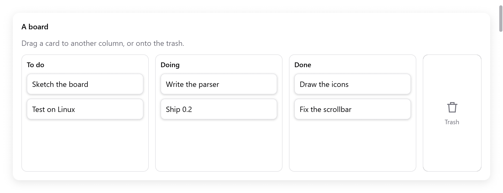

# Drag and drop

`ui.DragDrop` drags data within a window of native UI: from boxes that
drag data (`draggable`) to boxes that take it (`target`).

<!-- demo: drag-and-drop height=386 -->



*Draggable task cards in To do, Doing and Done columns, beside a trash target.*

- A drag starts when the pointer pressing a draggable moves 4 points. A
  translucent copy of the box follows the pointer, and the press is no
  longer a click.
- On release, the innermost target under the pointer that takes one of
  the data's formats gets it. The effect is one both ends allow: copy,
  move or link.
- Escape gives up a drag.
- The data is a `myzig.transfer.Data`: items in typed formats, the same
  data the clipboard and the system's drag and drop carry (see
  [Data transfer](../data-transfer.md)).
- A drag that leaves the window goes on in the system's drag and drop,
  to other windows and other apps, where myzig has one (Windows, OLE).

## A board of cards

```zig
const std = @import("std");
const myzig = @import("myzig");
const ui = myzig.ui;
const transfer = myzig.transfer;

const Task = struct { id: u32, title: []const u8, column: u8 };
const columns = [_][]const u8{ "To do", "Doing", "Done" };

const Board = struct {
    gpa: std.mem.Allocator,
    tasks: [32]Task = undefined,
    count: usize = 0,
    dnd: ui.DragDrop = .{},

    fn deinit(b: *Board) void {
        b.dnd.deinit();
    }

    fn view(b: *Board, c: *ui.Context) void {
        const th = c.theme;
        const fmt = transfer.value_format(Task);
        ui.row(c, .{ .width = .fill, .height = .fill, .gap = 12, .padding = .all(16), .align_items = .stretch });
        defer ui.end(c);
        for (columns, 0..) |name, col| {
            // A target: a box opened before its children.
            const zone = c.open(.{ .grow = 1, .padding = .all(10), .gap = 8, .radius = 10, .border = th.border }, name);
            const t = b.dnd.target(c, zone, .{ .formats = &.{fmt}, .effects = .copy_move });
            if (t.over) c.node(zone).style.border = th.accent;
            ui.text(c, name, .{ .weight = .semibold });
            for (b.tasks[0..b.count]) |*task| {
                if (task.column != col) continue;
                ui.key(c, c.print("task-{d}", .{task.id}));
                var d = b.dnd.draggable(c, .{ .width = .fill, .padding = .all(10), .radius = 8, .background = th.surface }, .{ .effects = .copy_move });
                if (d.starting) if (transfer.valueData(b.gpa, Task, task)) |data| d.offer(data) else |_| {};
                ui.text(c, task.title, .{});
                _ = d.end();
            }
            c.end();
            if (t.dropped) |drop| if (drop.data.value(Task)) |task| {
                task.column = @intCast(col);
            };
        }
        b.dnd.preview(c); // last: the copy that follows the pointer
    }
};
```

The app keeps one `ui.DragDrop` per window, and frees it with `deinit()`.

## Sources

`dnd.draggable(c, style, opts)` opens a box styled with `style`. Its
children follow, then `end()`.

- `starting` is true in the frame the pointer pressing it has moved far
  enough. `offer(data)` then starts the drag with the data, which the
  drag owns from then on.
- A draggable that offers nothing stays a press, so a row can drag only
  some of the time.

`ui.DraggableOptions`:

| Field | Default | |
|---|---|---|
| `effects` | copy | what a drop may do with the data: `transfer.Effects` (`.copy`, `.move`, `.link`, or `.copy_move`) |
| `count` | 1 | how many values the drag holds, shown beside the pointer when several (the rows chosen in a list, dragged together) |
| `dim` | true | dims the box while its data drags |

`end()` returns:

| Field | |
|---|---|
| `dragging` | whether its data drags now |
| `finished` | a `ui.DragFinished`, in the frame its drag ended |

`ui.DragFinished` has:

- `effect`: what the target did. `.move` means the source removes its
  value.
- `canceled`: Escape, or let go over nothing that takes it.
- `escaped`: tells a drag given up (Escape, `cancel()`) from one let go
  over no target.
- `screen`: where a drag that went on in the system's ended, in screen
  points ([Data transfer](../data-transfer.md#drags-that-leave-the-window)).

```zig
if (d.end().finished) |f| {
    if (f.effect == .move) s.remove(task.id);
}
```

Key draggables in a loop with `ui.key`, so that a drag keeps its source
as items above it come and go.

## Targets

`dnd.target(c, index, opts)` makes the box `index` (from `c.open`) a
target, before its children are built. It returns a
`ui.DropTargetResult`:

- `over`: while data it would take drags over it. Highlight it then.
- `dropped`: a `ui.Drop`, in the frame data was let go on it.

`ui.DropTargetOptions` has `formats` (the formats it takes; empty takes
any), `effects` (copy) and `disabled`.

A `ui.Drop` has:

- `data`, valid until the next frame. Read it, or `clone` it to keep it.
- `effect`, the effect agreed. When both ends allow several, copy is
  preferred, and holding Shift asks for a move. A target can also read
  the modifiers (`c.input.ctrl`, `c.input.shift`) to decide itself.
- `at`, where the pointer let go, in window points.

The data can be read in any of its formats:

- `data.value(T)` returns the `*T` a `transfer.valueData` drag carries,
  for drags within the app, matched by `transfer.value_format(T)`.
- `data.read(allocator, format)` returns the bytes of a format, made
  when asked for those offered lazily.
- `data.files(allocator)` returns the paths of `transfer.file_list` and
  `transfer.uri_list` data.
- `data.preferred(&wanted)` picks the first format of `wanted` it has.

## The preview

- `dnd.preview(c)` draws the copy of the source that follows the
  pointer, over everything. Call it once, last in the view.
- `dnd.dragging()` is true while data drags.
- `dnd.cancel()` gives the drag up from code.

## Out of the window, and into it

A drag leaves the window in the system's drag and drop when the
`DragDrop` has an `external`. `myzig.systemDrag(window)` returns one
where myzig has the system's drag (Windows, through OLE). Elsewhere it
returns null, and drags stay in the window.

```zig
const win = try app.newWindow(.{
    .title = "Board",
    .on_drop = .of(&board, Board.droppedFiles),
    .content = .{ .view = .init(&board, Board.view) },
});
board.dnd.external = myzig.systemDrag(win);
```

- Data dragged out can offer several formats, some made only when a
  target asks (`transfer.lazy`). For example, a note as text for a text
  editor, and as JSON for another window of the app.
- `transfer.fileData(gpa, paths)` drags files to a file manager.
- Files dropped on a window from a file manager or another app come to
  the window's `on_drop` callback,
  `fn (ctx, *myzig.Window, paths: []const []const u8) void`. Wrap them
  in `transfer.fileData` to hand them to the same code as drops within
  the window.

See `examples/drag-drop` for two windows that drag notes, text, URLs and
files between each other and other apps, and
[Data transfer](../data-transfer.md) for the formats.

## Testing

- `ui.Tester.drag(x1, y1, x2, y2)` presses at one point, moves past the
  threshold to the other and lets go.
- `moveTo` moves the pointer step by step, to check a target's highlight
  on the way (see [Testing](testing.md)).
- Drags in tests never touch the system's drag and drop.
