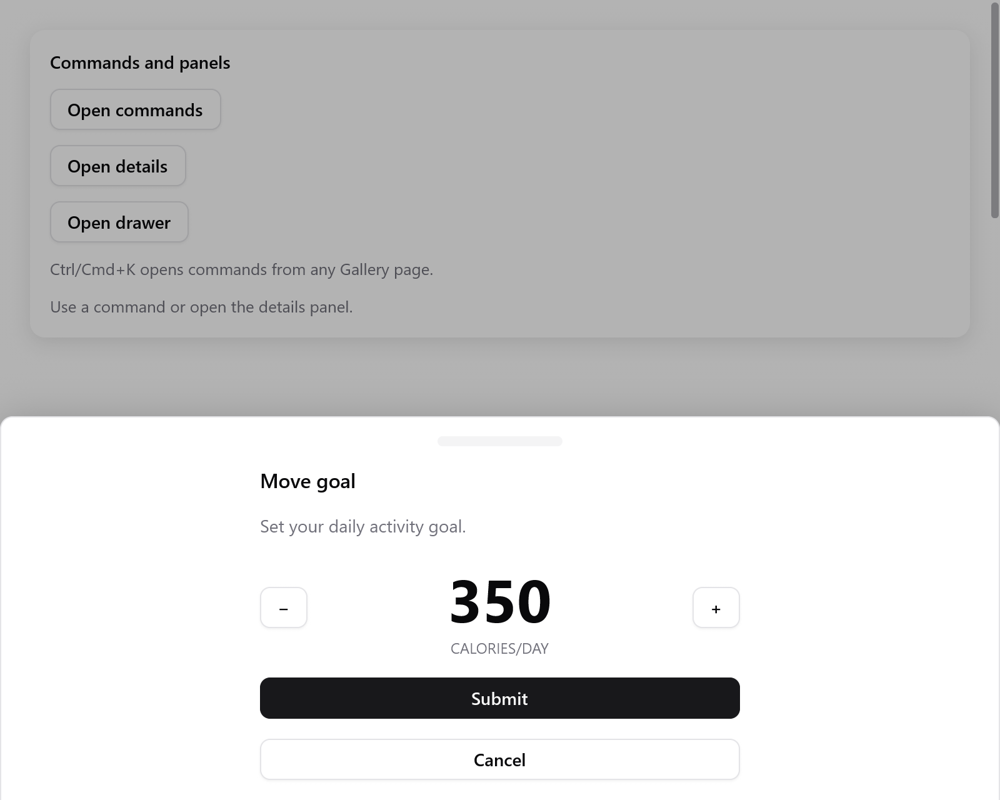

# Drawer

A panel from an edge of the window that you drag to close: a port of
[vaul](https://vaul.emilkowal.ski), shadcn/ui's drawer.

<!-- demo: drawer height=420 -->



*The Move goal drawer up from the bottom over the dimmed window.*

```zig
// In app state: goal: ui.DrawerState = .{},
if (ui.button(c, "Move goal", .{}).clicked) s.goal.show();
if (ui.drawer(c, &s.goal, .{ .label = "Move goal" })) |d| {
    defer d.end();
    ui.text(c, "Set your daily activity goal.", .{});
    if (ui.button(c, "Submit", .{ .variant = .primary }).clicked) s.goal.close();
}
```

`show`, `close` and `toggle` open and close it; it slides by itself.
`visible()` is true until it has slid away.

| `DrawerOptions` | Default | |
|---|---|---|
| `side` | `.bottom` | `.bottom`, `.top`, `.left` or `.right` |
| `snap_points` | none | where it rests, least open first: `.{ .fraction = 0.5 }` or `.{ .px = 148 }` |
| `fade_from` | the last | the snap point from which the window is dimmed |
| `snap_to_sequential` | `false` | a throw moves one snap point, never straight to the end |
| `dismissible` | `true` | Escape, a press beside it and a drag close it |
| `close_threshold` | 0.25 | how much of its size a drag must cover to close it |
| `handle`, `handle_only` | `true`, `false` | the bar to grab it by; only the bar drags it |
| `size`, `max` | its content, 0.8 | its height (or width: 384); at most this part of the window |
| `modal` | `true` | dims the window and keeps the keyboard; `false` leaves the window usable |
| `parent` | `null` | the drawer it opens from, which it pushes back |
| `padding`, `gap`, `label` | 16, 12, `"Drawer"` | of the panel; its name for screen readers |

**Dragging**

- Drag the panel or its handle, not its controls.
- Let go fast (0.4 points a millisecond) or past `close_threshold` and it
  closes; otherwise it settles back. Past open it holds back.
- With snap points it settles at the nearest one, and a throw goes to the
  next. The position alone never closes it. `DrawerState.snap` says
  where it rests.
- A click on the handle goes to the next snap point, or closes it from the
  last. A long press does nothing.

**The window behind.** Open `ui.drawerBackground` around the rest of the
view to shrink it back behind an open drawer, as iOS does:

```zig
const back = ui.drawerBackground(c, &s.goal);
// ... the window's content ...
back.end();
if (ui.drawer(c, &s.goal, .{})) |d| { ... }
```

**Nested drawers.** Build the second in the first's content with
`.parent`. The first shrinks back 16 points while the second is open, and
follows its drag. Escape closes the top one first.

```zig
if (ui.drawer(c, &s.outer, .{})) |d| {
    defer d.end();
    if (ui.button(c, "Open another", .{}).clicked) s.inner.show();
    if (ui.drawer(c, &s.inner, .{ .parent = &s.outer })) |n| {
        defer n.end();
    }
}
```

A modal drawer works like a [dialog](overlays.md#dialogs): Tab stays in
it, and the focus goes back where it was when it closes. With reduced
motion it appears at once.

See `Feedback` in the [Gallery](../../examples/gallery/feedback.zig).
