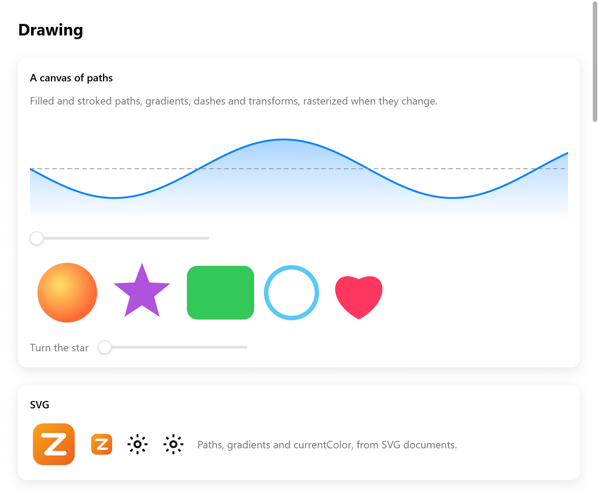

# Drawing

When boxes, text and icons aren't enough, draw.

- `ui.canvas` gives a draw function a `ui.Painter`. It fills and strokes
  paths with colors and gradients, through transforms and clips.
- `ui.svg` draws SVG documents the same way.
- Charts are drawn on canvases too ([Charts](chart.md)).
- For per-pixel effects, see [Shaders](shaders.md).

The gallery's Drawing page has the examples below
(`examples/gallery/drawing.zig`, `zig build run-gallery`).

<!-- demo: drawing height=520 -->



*Canvas paths, gradients, dashed strokes, shapes and SVG images.*

## A canvas

```zig
const Wave = struct {
    phase: f32 = 0,

    fn draw(s: *Wave, p: *ui.Painter) void {
        var line = p.path();
        for (0..101) |i| {
            const x = p.size.w * @as(f32, @floatFromInt(i)) / 100;
            const y = p.size.h / 2 + 30 * @sin(@as(f32, @floatFromInt(i)) / 8 + s.phase);
            if (i == 0) line.moveTo(x, y) else line.lineTo(x, y);
        }
        p.stroke(&line, .color(.hex(0x0a84ff)), .{ .width = 2, .join = .round });
    }

    fn view(s: *Wave, c: *ui.Context) void {
        _ = ui.canvas(c, .{ .w = 300, .h = 120 }, .{ .radius = 8 }, s, draw);
        _ = ui.slider(c, &s.phase, .{ .min = 0, .max = 6.28, .label = "Phase" });
    }
};
```

`ui.canvas(c, size, options, ctx, draw)` makes a box `size` points large.
It calls `draw(ctx, painter)` to record what it shows.

- A side of 0 fills the parent along it.
- The canvas is drawn at the size it had in the last layout. `p.size` tells
  it.

| `ui.CanvasOptions` | |
|---|---|
| `key` | an id that survives reordering |
| `opacity` | |
| `radius` | rounds the picture's corners and clips what is drawn there |

**The part in view.** `p.visible()` is the part of the canvas in view, in
the coordinates it draws in. A drawing taller than the window, as a long
document or a chart's many points, skips what falls outside it:

```zig
const v = p.visible();
for (s.lines, 0..) |l, i| {
    const y = @as(f32, @floatFromInt(i)) * 20;
    if (y + 20 < v.y or y > v.y + v.h) continue;
    p.fillRect(.{ .x = 4, .y = y, .w = l.width, .h = 14 }, th.text);
}
```

- A frame that scrolled it draws once more, with the part as it now is.
- Until a frame painted it, it is the whole canvas.
- Outside the painter, `ui.canvasVisibility(c, id, whole)` answers the same
  for the canvas that will take box id `id` (`c.peekId`). An animation can
  pause while its canvas is scrolled out of view, as the
  [loading plugin](../plugins/loading.md) does.

<details>
<summary>How the part in view is found</summary>

It is the canvas's box within the scrolling boxes and clips around it and
the window, as the last frame painted it. It is taken back through the
transforms of its boxes and the painter's own. So a canvas zoomed in sees
as much less of itself as shows.

</details>

**The pointer.** The canvas returns its box's index, so it can take the
pointer like any box:

```zig
const box = ui.canvas(c, .{ .w = 0, .h = 200 }, .{}, s, draw);
const it = c.interact(box, .{});
if (it.clicked) if (it.rect) |r| s.addPoint(c.input.mouse.x - r.x, c.input.mouse.y - r.y);
```

### How it is drawn

The Painter records commands; it draws nothing itself.

- The recording is rasterized on the CPU (`src/ui/canvas_render.zig`),
  with antialiasing, at the window's scale.
- It goes into a picture in the image atlas. Every renderer draws that as
  it draws `ui.image`.
- The picture is keyed by a hash of the recording. A canvas is rasterized
  again only when what it records changes.
- A frame that draws the same thing costs only the recording and the hash.
- A canvas that changes every frame, as an animation, is rasterized every
  frame. Keep those small, or move the animated part to a box's transform
  ([Transforms](transforms.md)).
- Paths, gradient stops and dashes given to the Painter are copied. Pass
  any memory, even the stack.

## Paths

`p.path()` makes a `ui.Path` in the frame's memory. Coordinates are points
from the canvas's top left, y going down.

| method | draws |
|---|---|
| `moveTo(x, y)` | starts a new subpath |
| `lineTo(x, y)` | a straight segment |
| `quadTo(cx, cy, x, y)` | a quadratic Bézier |
| `cubicTo(c1x, c1y, c2x, c2y, x, y)` | a cubic Bézier |
| `close()` | closes the subpath |
| `arc(cx, cy, r, a0, a1, ccw)` | an arc of a circle, angles in radians |
| `svgArc(rx, ry, rotation, large, sweep, x, y)` | SVG's elliptical arc to a point |
| `rect(x, y, w, h)` | a rectangle |
| `roundRect(x, y, w, h, rx, ry)` | a rounded rectangle |
| `ellipse(cx, cy, rx, ry)`, `circle(cx, cy, r)` | ellipses |
| `polyline(points, closed)` | `[2]f32` points joined |
| `append(data, transform)` | another path's `ui.PathData`, transformed |

A path made with its own allocator (`ui.Path.init(gpa)`) can be kept
across frames and reused:

- `reset()` empties it;
- `deinit()` frees it;
- `data()` gives its `ui.PathData` (verbs and points) for `p.fillData`.

## Filling and stroking

```zig
p.fill(&path, .color(.hex(0xaf52de)));
p.fillRule(&path, .color(c.theme.text), .evenodd); // holes where subpaths overlap
p.stroke(&path, .color(accent), .{ .width = 2.5, .join = .round, .cap = .round });
```

`ui.FillRule` is `.nonzero` (the default of `fill`) or `.evenodd`.

| `ui.Stroke` | Default | |
|---|---|---|
| `width` | 1 | in points |
| `join` | `.miter` | `ui.LineJoin`: `.miter`, `.round`, `.bevel` |
| `cap` | `.butt` | `ui.LineCap`: `.butt`, `.round`, `.square` |
| `miter_limit` | 4 | longest a miter may be, in widths, before it is beveled |
| `dash` | none | lengths on and off, repeated (an odd count is taken twice) |
| `dash_offset` | 0 | where the dashes start |

Shorthands: `fillRect(rect, color)`, `fillRoundRect(rect, radius, paint)`,
`fillCircle(cx, cy, r, paint)`, `strokeCircle(cx, cy, r, width, color)` and
`line(x0, y0, x1, y1, width, color)`.

## Paints and gradients

A `ui.Paint` is `.color(c)` (`.solid`), `.linear` or `.radial`, as SVG's
gradients and Canvas 2D's:

```zig
p.fill(&area, .{ .linear = .{
    .from = .{ 0, 0 }, .to = .{ 0, h },
    .stops = &.{ .{ .offset = 0, .color = accent.alpha(0.45) }, .{ .offset = 1, .color = accent.alpha(0) } },
} });
p.fillCircle(50, 50, 40, .{ .radial = .{
    .center = .{ 40, 40 }, .radius = 48,
    .stops = &.{ .{ .offset = 0, .color = .hex(0xffe066) }, .{ .offset = 1, .color = .hex(0xff6b35) } },
} });
```

- `ui.LinearGradient` goes `from` one point `to` another.
- `ui.RadialGradient` goes out from `focal` to the circle of `radius`
  around `center`. `focal` is the center unless given.

Both take:

- `stops`, of `ui.GradientStop`: `offset` 0 to 1 and `color`;
- `spread`, what happens past the ends: `.pad`, `.reflect` or `.repeat`;
- `transform`, from the gradient's space to the drawing's (SVG's
  `gradientTransform`).

## Transforms, clips and layers

The Painter keeps a current transform, clip and opacity:

```zig
p.save();
p.rotate(s.turn * std.math.pi / 180, 150, 50); // radians, about (150, 50)
p.fill(&star, .color(.hex(0xaf52de)));
p.restore();
```

- `save()` and `restore()` keep and bring back the transform, clip and
  opacity.
- `transform(t)` draws what follows through a `ui.Transform`, after the
  transforms already set.
- `translate(x, y)`, `scaleBy(sx, sy)` and `rotate(radians, cx, cy)` are
  shorthands.
- `ui.Transform` has `translation`, `scaling`, `rotation` (radians),
  `skewX`, `skewY`, `then`, `apply` and `invert`.
- `clip(path, rule)` and `clipRect(rect)` keep what follows inside, within
  the clips already set.
- `setAlpha(a)` fades what follows, until `restore`.
- `beginLayer(opacity)` and `endLayer()` draw a group apart, then blend it
  with `opacity`. The result is a translucent group whose overlaps don't
  show.

Boxes are transformed with `ui.Affine`, in degrees. Canvases use
`ui.Transform`, in radians, as Canvas 2D does.

## SVG

```zig
const logo = @embedFile("logo.svg");

_ = ui.svg(c, logo, .{ .height = 32 });
_ = ui.svg(c, gear, .{ .width = 16, .color = c.theme.accent }); // its currentColor
```

`ui.svg(c, bytes, options)` draws an SVG document as a canvas does, at the
window's scale. It returns false, and draws nothing, if the bytes aren't
one.

| `ui.SvgOptions` | |
|---|---|
| `width`, `height` | its size in points; a side of 0 keeps the document's proportions, both 0 its own size |
| `color` | what `currentColor` is; null is the theme's text color, so icons follow light and dark |
| `opacity` | its opacity |
| `key` | an id among its siblings |

The picture is kept. A frame showing the same bytes at the same size and
color draws it without parsing them again.

`ui.rasterizeSvg(gpa, bytes, w, h, current_color)` draws a document into
premultiplied BGRA pixels, `w` × `h`, without a window. It is for icons
made ahead of time, and for tests. Free the result with `gpa`.

<details>
<summary>What of SVG is drawn</summary>

From `src/ui/svg_draw.zig`:

- the root's `viewBox`, fitted with `preserveAspectRatio`;
- groups and nested `svg`s;
- paths and the basic shapes;
- `use` of elements and symbols;
- transforms;
- fills and strokes in colors and gradients: linear and radial, by
  reference, in either unit system;
- their opacities, group opacity, and clip paths.

Colors may be hex, `rgb()`, `hsl()`, names or `currentColor`. Styles may
come from attributes, `style`, or simple CSS rules in `<style>`, with
selectors by element, class and id.

Text, masks, filters, markers and patterns are left out. Convert text to
paths when you export the file.

</details>

## Images

Pictures from files are not drawn on a canvas but shown with `ui.image`.
That is PNG, and on macOS whatever ImageIO reads. See [Text](text.md) and
[Buttons and media](buttons.md).

## Testing drawings

A canvas draws in the Tester as in a window, through the same rasterizer.
A test can render the view and look at pixels:

```zig
var t: ui.Tester = undefined;
try t.init(gpa, .init(&s, Wave.view), .{ .width = 320, .height = 160, .scale = 1 });
defer t.deinit();
const px = try t.render(gpa);
defer px.deinit(gpa);
```

See [Testing](testing.md).
