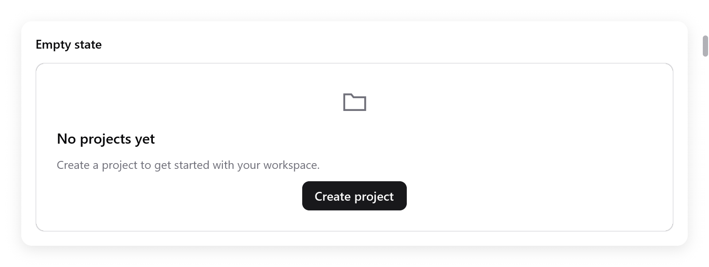
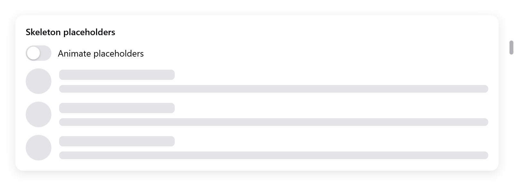
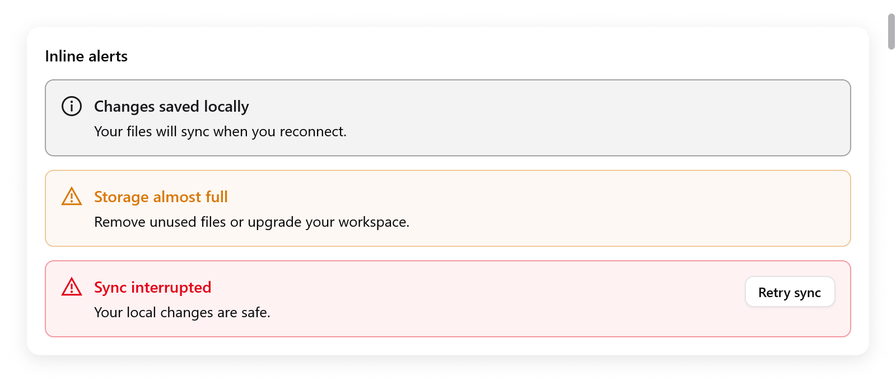

# Empty, loading and alerts

Widgets for the states around content: nothing to show yet, still
loading, or a notice for the user. They use the shared theme and renderer
on every backend.

## Empty content

<!-- demo: empty-state height=326 -->



```zig
const state = ui.empty(c, "No projects yet", "Create your first project.", .{
    .icon = "folder",
    .outline = true,
});
defer state.end();
if (ui.button(c, "Create project", .{ .variant = .primary }).clicked) s.createProject();
```

`ui.empty` opens a column: add actions or your own content, then call
`end`.

| `EmptyOptions` | Default |
|---|---|
| `width` | `.fill` |
| `icon` | `""` |
| `outline` | `false` |

- The title and description wrap.
- The group is named for accessibility.
- Its buttons keep their own focus and actions.
- The app decides when it has no data, and when to replace this state
  with content.

## Skeleton placeholders

<!-- demo: skeleton height=315 -->



```zig
ui.skeleton(c, .{ .width = .{ .px = 40 }, .height = 40, .radius = 20 });
ui.skeleton(c, .{ .width = .{ .px = 180 } });
ui.skeleton(c, .{ .width = .fill, .height = 12 });
```

| `SkeletonOptions` | Default | Meaning |
|---|---|---|
| `width` | `.fill` | Placeholder width |
| `height` | `16` | Height in points |
| `radius` | `6` | Corner radius; half the size for a circle |
| `animated` | `true` | A gentle pulse while waiting |

- The pulse uses the UI clock and asks for frames at 30 Hz.
- It stops when `animated` is false or [reduced motion](motion.md) is
  requested.
- Replace the placeholders once data arrives.
- They take no focus and expose no made-up text to assistive technology.
  Name the surrounding group when it needs an accessible loading status.

## Inline alerts

<!-- demo: alerts height=366 -->



```zig
const notice = ui.alert(c, "Sync interrupted", "Your local changes are safe.", .{
    .kind = .danger,
});
defer notice.end();
if (ui.button(c, "Retry", .{}).clicked) s.retry();
```

`ui.alert` opens a row with an icon and a wrapping title and description.
Add trailing actions, then call `end`.

| `AlertOptions` | Default | |
|---|---|---|
| `width` | `.fill` | |
| `kind` | `.info` | `.info`, `.success`, `.warning` or `.danger` |

- Colors follow the theme.
- An alert is an accessibility status group.
- It leaves focus where the user put it.
- For a one-time screen-reader announcement, call `c.announce` when the
  app's state changes.

Use [dialogs](overlays.md) when a decision blocks further work, and
[toasts](overlays.md#toasts) for passing notices. The **Feedback** page in
[Gallery](../../examples/gallery/feedback.zig) shows all three widgets.
