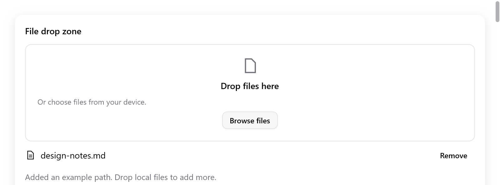

# File drop zone

<!-- demo: file-drop height=321 -->



A target for dropped files and URI lists, with a list of the paths. It
never reads or uploads the files.

```zig
// Initialize app state once:
files: ui.FileList, // initialize with .init(gpa)
drag: ui.DragDrop = .{},

// View:
const result = ui.fileDropZone(c, &s.drag, &s.files, .{ .max_files = 8 });
if (result.browse) requestFileDialog();
if (result.err) |err| reportError(err);
// Last in the view, if this controller also has drag sources:
s.drag.preview(c);
```

On teardown call `files.deinit()` and `drag.deinit()`.

| `FileDropOptions` | Default | |
|---|---|---|
| `title` | `"Drop files here"` | the heading |
| `description` | `"Or choose files from your device."` | the line under it |
| `browse_label` | `"Browse files"` | the button |
| `width` | `.fill` | |
| `disabled` | `false` | blocks browsing, removal and drops |
| `max_files` | no limit | drops past it are rejected |

| `FileDropResult` | |
|---|---|
| `changed` | the list changed |
| `browse` | the Browse button was pressed |
| `over` | a drag is over the zone |
| `rejected` | paths turned away by `max_files` |
| `err` | an allocation or decoding error, or `null` |

**Behavior**

- `FileList` owns copies of the paths, so they outlive the drop data.
- Paths accepted before a failure stay in the list.
- A duplicate path takes no room under `max_files`.
- Each path has a Remove action.
- It uses the `DragDrop` target mechanism. External drags work as the
  backend allows; see [drag and drop](drag-and-drop.md).

**Your own file dialog.** Add the paths it returns with
`try files.add(path)`, and request a redraw when the asynchronous result
arrives.

- `add` copies the string.
- It returns false for an empty path or a duplicate.
- `max_files` does not limit `add`.

The Gallery's Browse action adds a sample path, to keep its example
deterministic. A real app handles `browse` itself.
