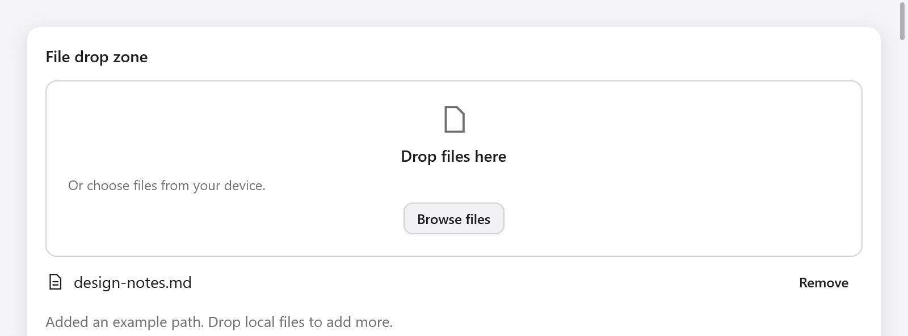

# File drop zone



`fileDropZone` uses the existing `DragDrop` target mechanism for local file
lists and URI lists. `FileList` owns copies of paths, so they survive after
the drop data expires. Neither type reads file contents or uploads files.

```zig
// Initialize app state once:
files: ui.FileList, // initialize with .init(gpa)
drag: ui.DragDrop = .{},

// View:
const result = ui.fileDropZone(c, &s.drag, &s.files, .{ .max_files = 8 });
if (result.browse) requestFileDialog();
if (result.err) |err| reportError(err);
// Last in the view, if this controller also has drag sources:
s.drag.preview(c);
```

On teardown call `files.deinit()` and `drag.deinit()`. Add paths returned
by your app's file dialog with `try files.add(path)`; request a redraw
after the asynchronous result arrives. `add` copies the string and returns
false for empty paths or duplicates. Programmatic additions are not
limited by the drop zone's `max_files`.

The widget returns `changed`, `browse`, `over`, the number of paths rejected
by `max_files`, and an optional allocation/decoding `err`. Earlier accepted
paths remain if a later one fails. Duplicate paths do not consume capacity.
The list has a Remove action per path; `disabled` blocks browsing, removal
and drops. Customize `title`, `description`, `browse_label` and `width`.

The Gallery's Browse action adds a sample path to keep its example
deterministic. Production apps handle the `browse` event themselves.
External drag capabilities remain those of the existing backend; see
[drag and drop](drag-and-drop.md).
