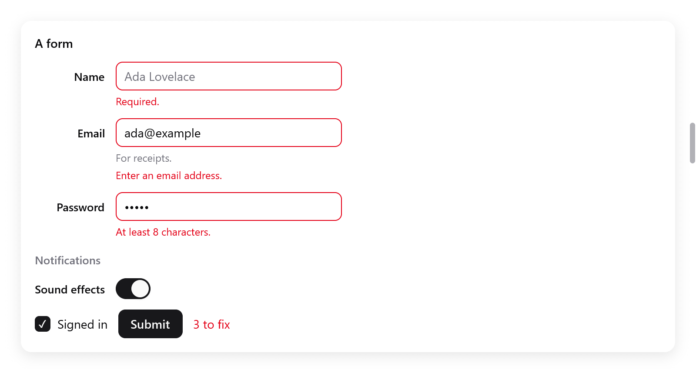

# Forms

Labels, descriptions, errors and checks for the controls of a form.

- A **field** labels a control, shows a description or an error below
  it, and names it for assistive technology.
- A **form** lines up its fields' labels in a column of their own.
- A **fieldset** groups fields under a legend and can disable them
  together.
- `ui.validate` checks values.

<!-- demo: forms height=453 -->



*A submitted form showing required-field, email and password validation errors.*

## Fields

```zig
const f = ui.field(c, "Email", .{ .description = "For receipts.", .err = ui.validate.email(s.email.text()) });
_ = ui.textField(c, &s.email, .{ .width = .{ .px = 260 } });
f.end();
```

`ui.field(c, title, options)` labels the control built next, with the
label above it as on the web. It returns a `ui.Field`: end it once the
control is built.

`ui.FieldOptions`:

| field | what it shows |
|---|---|
| `description` | a text below the control, in the muted color |
| `err` | what is wrong with the value, below the control in the danger color, which the control's border takes; empty is valid |

- A click on the label focuses the control.
- The control's accessible name is the label. Its accessible description
  is the error, or else the description.
- The control is marked invalid while there is an error.
- Any control works: a text field, a select, a switch, a date input. The
  field finds the first control built after its label.

## Forms

```zig
var fm = ui.form(c, .{});
{
    defer fm.end();
    const n = fm.field("Name", .{});
    _ = ui.textField(c, &s.name, .{ .placeholder = "Ada Lovelace", .width = .{ .px = 260 } });
    n.end();
    const p = fm.field("Password", .{ .err = ui.validate.minLength(c, s.password.text(), 8) });
    _ = ui.textField(c, &s.password, .{ .password = true, .width = .{ .px = 260 } });
    p.end();
    const snd = fm.field("Sound effects", .{});
    _ = ui.toggle(c, "", &s.sounds);
    snd.end();
}
```

`ui.form(c, options)` puts its fields' labels in a column beside the
controls, as macOS's settings do. Keep the form in a variable, since its
fields change it. Make the fields with its own `field`.

The labels:

- are aligned to the right, in a column as wide as the widest label;
- are level with the first line of their control's text;
- are level with the middle of a control without text, such as a switch,
  with or without a description below it;
- are level with the text of a row that has a dot or an icon beside its
  text (`Style.baselines`).

`ui.FormOptions`:

| Field | Default | |
|---|---|---|
| `gap` | 12 | between fields |
| `label_gap` | 12 | between the labels' column and the controls' |

The labels' width is measured as the form is built. When it changes, the
frame is built again at once, so no frame shows the labels unaligned.

## Fieldsets

```zig
const set = ui.fieldset(c, "Notifications", .{ .disabled = !s.signed_in });
const snd = fm.field("Sound effects", .{});
_ = ui.toggle(c, "", &s.sounds);
snd.end();
set.end();
```

`ui.fieldset(c, legend, options)` groups fields under a legend. End it
with `end`.

- With `disabled`, its fields are dimmed and take no input. A box over
  them takes every press, and the keyboard focus leaves them.
- `ui.FieldsetOptions`: `disabled` and `gap` (12).
- It can hold a form's fields, between the form's `field` calls as above,
  or plain `ui.field`s.

## Validation

`ui.validate` has checks that return the error to show, ready for a
field's `err`. An empty error means the value is valid.

| check | error |
|---|---|
| `required(s)` | "Required." for an empty or blank value |
| `email(s)` | "Enter an email address." unless it looks like one (empty is valid) |
| `minLength(c, s, n)` | "At least n characters." for fewer than `n` characters (empty is valid) |
| `number(c, s, lo, hi)` | "Enter a number." or "Between lo and hi." (empty is valid) |
| `first(errors)` | the first non-empty one of several checks |

Combine `required` with another check for a value that must be given:

```zig
.err = ui.validate.first(&.{ ui.validate.required(s.email.text()), ui.validate.email(s.email.text()) }),
```

`ui.Validation` counts a form's errors, to enable its submit button or to
say how many are left. `check(err)` passes an error through and counts
it. `ok()` says whether there were none.

```zig
fn form(s: *State, c: *ui.Context) void {
    var v: ui.Validation = .{};
    var fm = ui.form(c, .{});
    {
        defer fm.end();
        const n = fm.field("Name", .{ .err = if (s.submitted) v.check(ui.validate.required(s.name.text())) else "" });
        _ = ui.textField(c, &s.name, .{ .width = .{ .px = 260 } });
        n.end();
        const e = fm.field("Email", .{ .err = v.check(ui.validate.email(s.email.text())) });
        _ = ui.textField(c, &s.email, .{ .width = .{ .px = 260 } });
        e.end();
    }
    ui.row(c, .{ .gap = 12, .align_items = .center });
    defer ui.end(c);
    if (ui.button(c, "Submit", .{ .variant = .primary }).clicked) s.submitted = true;
    if (s.submitted) ui.text(c, if (v.ok()) "All good." else c.print("{d} to fix", .{v.errors}), .{
        .color = if (v.ok()) c.theme.success else c.theme.danger,
    });
}
```

- Show the errors of empty required fields only once the user tried to
  submit, as above. Show the errors of what was typed at once.
- The errors are English strings. For other languages, write your own
  checks with messages from [i18n](../i18n.md): any function that returns
  a string works.
