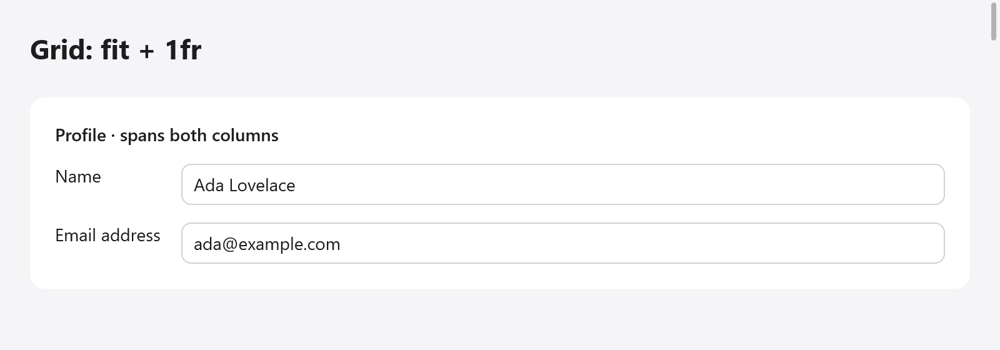

# Grid

`ui.grid` lays its children out in rows and columns, after CSS grid and
mygo's `ui.Grid`: children fill its cells row by row, or go where they
are put, spanning columns and rows. Use it for forms (labels in one
column, fields in the other), dashboards and settings panes. A grid
builds all its children; for many items built only as they show, use
[`ui.gridView`](lists.md#grid-views).



*A profile form laid out with fit and fractional tracks; the heading spans both columns.*

```zig
var g = ui.grid(c, .{ .columns = &.{ .fit, .{ .fr = 1 } }, .gap_x = 16, .gap_y = 8 });
g.cell(.{ .col_span = -1 }); // across every column
ui.text(c, "Profile", .{ .weight = .bold });
ui.end(c);
ui.text(c, "Name", .{}); // a child outside a cell takes the next one
_ = ui.textField(c, &s.name, .{});
ui.text(c, "Email", .{});
_ = ui.textField(c, &s.email, .{});
g.end();
```

`ui.grid(c, opts)` opens the grid; its children follow, then `end()`.

## Tracks

Columns and rows are `ui.GridTrack`s:

| Track | Size |
|---|---|
| `.fit` | as large as its content |
| `.{ .px = 220 }` | exactly that many points |
| `.{ .fr = 1 }` | a share of the room the other tracks leave (CSS's `minmax(0, 1fr)`); where the grid's size is not set, as large as its content |

`.{ .fr = 2 }` takes twice the room of `.{ .fr = 1 }`. `rows` gives the
first rows; those after them fit their content, so most grids give only
`columns`. A grid has at most 32 columns and 32 given rows.

`ui.GridOptions`:

| Field | Default | |
|---|---|---|
| `columns` | `&.{.{ .fr = 1 }}` | the column tracks |
| `rows` | `&.{}` | the first rows' tracks |
| `gap_x`, `gap_y` | 0 | between columns, between rows |
| `justify_items` | `.stretch` | where children go across their cells: `.stretch`, `.start`, `.center` or `.end` |
| `align_items` | `.stretch` | where children go down their cells, or `.baseline`: the first lines of text of each row's items line up, as in a [row](layout.md#alignment), the row as high as that takes |
| `style` | `.{ .width = .fill }` | the grid's own box: padding, background, size |

## Cells

A child built straight in the grid takes the next free cell. To place a
child, span tracks or align it on its own, open a cell with
`Grid.cell(opts)`: its children follow, then `ui.end(c)`. A cell is a
column box filling its place as its grid aligns it.

`ui.GridCell`:

| Field | Default | |
|---|---|---|
| `col`, `row` | 0 | the column and row it starts in, from 1; 0 places it in the next free cell |
| `col_span`, `row_span` | 1 | how many columns and rows it spans; negative spans to the last column (or the last row the grid gives) |
| `justify`, `align` | null | its own alignment, over the grid's `justify_items` and `align_items` |
| `style` | none | the cell's box |

```zig
var g = ui.grid(c, .{ .columns = &.{ .fit, .{ .px = 50 }, .{ .fr = 1 } }, .gap_x = 4 });
g.cell(.{ .col_span = -1 }); // a header across the three columns
ui.text(c, "Totals", .{ .weight = .bold });
ui.end(c);
ui.text(c, "Apples", .{});
ui.text(c, "12", .{});
g.cell(.{ .justify = .end, .@"align" = .center }); // pushed to its cell's end
ui.text(c, "$4.80", .{ .mono = true });
ui.end(c);
g.cell(.{ .col = 3, .row = 3, .row_span = 2 }); // given a place, two rows tall
ui.text(c, "Notes", .{});
ui.end(c);
g.end();
```

Cells placed with `col` and `row` keep their place, and the children
after them flow around the cells they take.

## Sizing

The grid is as wide as its `style` says (`.fill` by default) and as tall
as its rows: what follows it in its column comes after. Columns of `.fit`
are as wide as their widest child, `px` columns are fixed, and `fr`
columns share what is left. A child spanning several tracks spreads what
it lacks over the fitting tracks it spans (or, where it spans `fr`
tracks, over their shares). Where the grid's size is unknown, `fr` tracks
fit their content, in proportion to their shares. Only the children the
columns read are measured at the grid's width: those in fixed columns, or
in `fr` columns of a width known (as CSS's `minmax(0, 1fr)`), are measured
once, at the width their cell gives.

Right to left, a grid's columns go from the right (see
[Right to left](right-to-left.md)).

## Flexbox or grid

Rows and columns of [layout](layout.md) are one-dimensional: each row
sizes its children on its own, so labels in separate rows do not line up
unless each has a fixed width. A grid sizes every row's cells by the same
tracks: a `.fit` column of labels is as wide as the longest label, in
every row.
