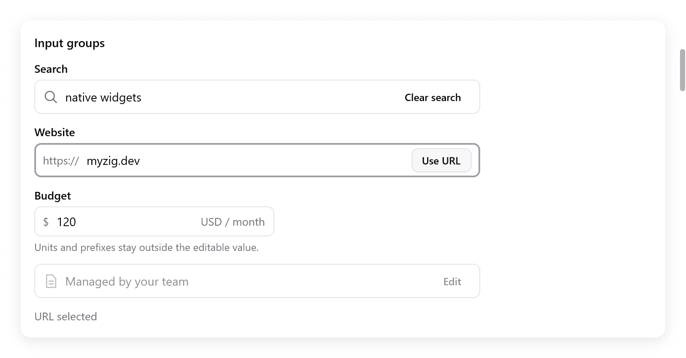

# Input groups

`ui.inputGroup` puts one text field, icons, prefixes, suffixes and action
buttons inside a shared frame. Its input edits, selects, takes input
methods and handles passwords as [text fields](text-input.md) do.

<!-- demo: input-groups height=442 -->



```zig
var group = ui.inputGroup(c, .{ .width = .{ .px = 420 } });
defer group.end();
group.text("https://");
const result = group.input(&s.url, .{ .placeholder = "example.com", .label = "Website" });
if (result.submitted) s.openUrl();
if (group.button("Open", .{ .variant = .primary })) s.openUrl();
```

- Keep the `ui.TextBuffer` in app state.
- Call `input` exactly once between `inputGroup` and `end`.
- The input fills the space left by its affixes and buttons. The group
  controls its `width` and `bare` options.

## Parts and state

| Method | Meaning |
|---|---|
| `text(value)` | Muted prefix or suffix, outside the editable value |
| `icon(name)` | Decorative icon |
| `input(buffer, options)` | Text field; returns `ui.TextFieldResult` |
| `button(title, options)` | Action button; returns true on activation |
| `end()` | Close the group and update its shared focus/error border |

| `InputGroupOptions` | Default | |
|---|---|---|
| `width` | 320 points | |
| `disabled` | false | removes the input and buttons from keyboard navigation, and prevents editing and activation |
| `invalid` | false | colors the border and marks the input for assistive technology |

To show an error message, use a [field](forms.md):

```zig
const field = ui.field(c, "Budget", .{ .err = s.budget_error });
defer field.end();
var group = ui.inputGroup(c, .{ .invalid = s.budget_error.len > 0 });
defer group.end();
group.text("$");
_ = group.input(&s.amount, .{});
group.text("USD / month");
```

**Behavior**

- Clicking the frame or a decorative affix focuses the input.
- Tab moves between the input and its enabled action buttons.
- Enter in the input reports `submitted`. Enter or Space on a button
  activates only that button.
- The border shows focus when any control inside has focus.
- A form's label names and focuses the text field, even when a prefix
  comes first. Without a form label, set `label` in the input options.
- Use descriptive button titles.
- Prefixes and suffixes follow the interface's
  [direction](right-to-left.md). The editable text keeps normal
  text-field behavior.

See the **Composition** page in
[Gallery](../../examples/gallery/composites.zig) for search, URL, unit
and disabled examples.
