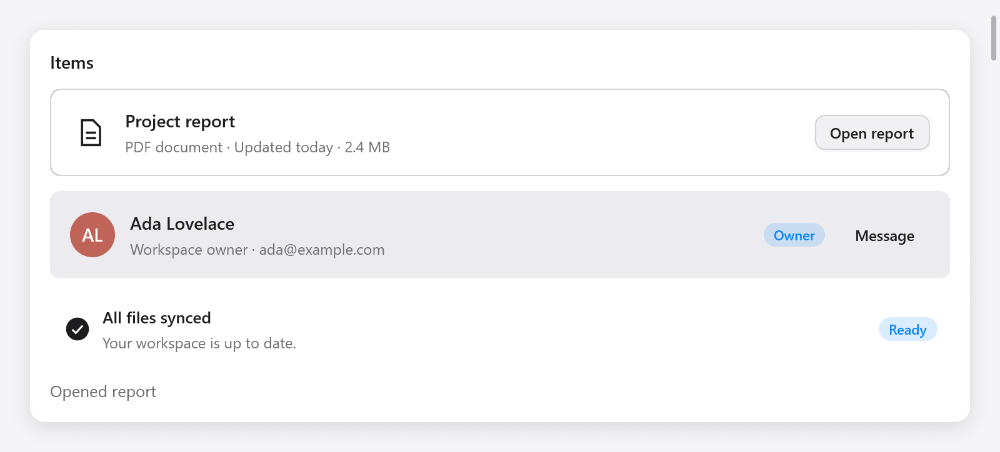

# Items

`ui.item` groups media, a title, a description and trailing actions into a
content row. Use it for files, people, notifications and settings.



```zig
const row = ui.item(c, .{ .label = "Project report" });
defer row.end();
row.icon("doc.text");
row.content("Project report", "PDF document · Updated today");
if (ui.button(c, "Open", .{}).clicked) s.openReport();
```

The content takes the remaining width and wraps; actions keep their own
width. Add ordinary widgets before or after `content` for custom media,
badges or multiple buttons. A row is an accessibility group. Its controls
are separate keyboard stops, so clicking an action does not activate the
whole row.

## Options and methods

| `ItemOptions` | Default | Meaning |
|---|---|---|
| `width` | `.fill` | Width of the row |
| `variant` | `.outline` | `.plain`, `.outline` or `.muted` |
| `size` | `.normal` | `.normal` or `.small`, controlling spacing and title size |
| `label` | `""` | Accessible name of the group |

| Method | Meaning |
|---|---|
| `icon(name)` | A theme-colored icon in a fixed media slot |
| `avatar(name, options)` | An existing `ui.avatar`, including image and initials fallback |
| `content(title, description)` | A title and optional muted description; both wrap |
| `end()` | Close the row after its trailing widgets |

```zig
const member = ui.item(c, .{ .variant = .muted, .size = .small });
defer member.end();
member.avatar("Ada Lovelace", .{ .size = 32 });
member.content("Ada Lovelace", "Workspace owner");
ui.badge(c, "Owner", c.theme.accent);
```

Give repeated items stable keys with `ui.keyed(c, record.id)` before
`ui.item`, as for other [list content](lists.md). Row order follows the
interface's [text direction](right-to-left.md). The widget uses the shared
layout and theme on macOS, Linux, Windows and browsers.

The **Composition** page in [Gallery](../../examples/gallery/composites.zig)
contains interactive examples. Combine items with [pagination](pagination.md)
when the app loads data in pages.
