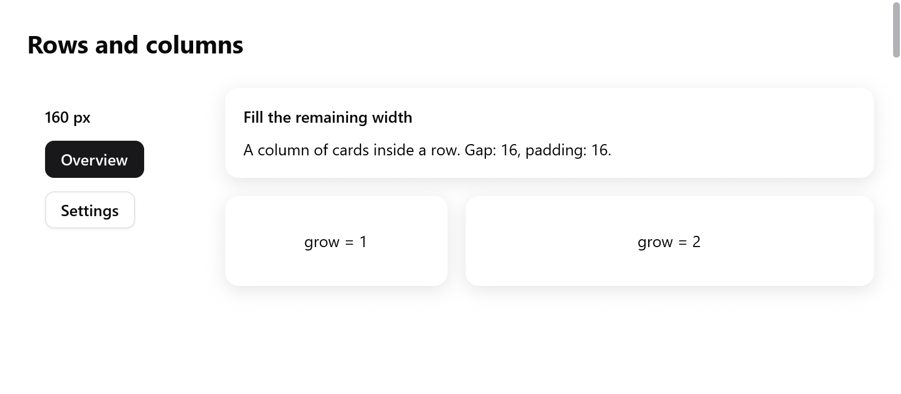

# Layout

Layout is flexbox, as in CSS. A box lays out its children in a row or a
column. It sizes them from their content, shares the free room among
those that grow, and aligns them along both axes. One `ui.Style`
describes every box. Pass it to `ui.row`, `ui.column` and the other
containers, or set it with the methods of `ui.div`.

Layout runs every frame, in two passes:

- `measure` sizes boxes from their content, bottom up;
- `arrange` places them, top down.

Text layouts are cached across frames. A frame that changes nothing in a
box costs little to lay out again.

<!-- demo: layout height=374 -->



*A fixed-width sidebar beside a flexible column of cards, with gaps and padding.*

## Containers

| function | what it opens |
|---|---|
| `ui.column(c, style)` | children top to bottom |
| `ui.row(c, style)` | children left to right (right to left in [RTL](right-to-left.md)) |
| `ui.card(c, style)` | a column on the surface color, rounded 12, padded 16, with a soft shadow, unless the style says otherwise |
| `ui.scroll(c, style)` | a column whose children scroll vertically |
| `ui.pressable(c, style, hover)` | a box that reports the pointer (see [custom widgets](custom-widgets.md)) |
| `ui.div(c)` | a column styled by a chain of methods, see below |

```zig
ui.row(c, .{ .width = .fill, .padding = .xy(16, 10), .gap = 8, .align_items = .center });
defer ui.end(c);
ui.text(c, "Inbox", .{ .weight = .semibold });
ui.spacer(c);
_ = ui.button(c, "Compose", .{ .variant = .primary });
```

- `ui.end(c)` closes each. A `ui.Div` closes by its own `end`.
- `ui.spacer(c)` takes the free room along its parent's main axis. It
  pushes what follows to the end.
- `ui.divider(c)` draws a one-point line across its parent, in the
  border color.

## Sizes

`width` and `height` are a `ui.Length`:

- `.auto`, the default: as large as the content, plus padding.
- `.{ .px = 120 }`: exactly that many points.
- `.fill`: all the room the parent gives. Along the parent's main axis it
  grows from its padding, as `grow = 1` does. Across it, it stretches.

`min_width`, `min_height`, `max_width` and `max_height` bound the size.

- A `max_width` keeps prose readable in a wide window.
- A `max_height` on a scrolling box makes it as tall as its content, up
  to that height. Then it scrolls, as a chat's answer or a popover's
  list.

`grow` is a box's share of the free room along its parent's main axis.
Two siblings with `grow = 1` and `grow = 2` take a third and two thirds
of it.

- The room is shared as CSS flexbox shares it, and as Chrome lays it out.
- Each box grows from its size: its flex base size, before its minimum
  and maximum.
- A box that its `max_width` or `min_width` stops keeps that size. The
  others share what is left.
- A box is never smaller than its padding, whatever its size says.

When a row has too little room, boxes holding wrapping text give theirs
back. They give in proportion to their widths less their padding, down
to their `min_width`. Their text wraps onto more lines. Other boxes keep
their size.

A box whose final width differs from the width it was measured at is
measured again. So wrapped text always gets the right number of lines.

## Spacing

- `padding` is a `ui.Edges` (`top`, `right`, `bottom`, `left`).
  `ui.Edges.all(12)` and `ui.Edges.xy(16, 8)` (horizontal, vertical)
  cover the common cases. In a struct literal, write
  `.padding = .all(12)`.
- `gap` is the room between children along the main axis.
- There are no margins. Space boxes with their parent's gap and padding,
  or a `ui.spacer`.

## Alignment

`align_items` places children across the main axis:

| `align_items` | |
|---|---|
| `.start` | the default |
| `.center`, `.end` | |
| `.stretch` | children whose cross size is `.auto` become as wide (in a column) or as tall (in a row) as the box |
| `.baseline` | lines up the first lines of text of a row's children, as a large price beside its small unit |

```zig
ui.row(c, .{ .align_items = .baseline, .gap = 4 });
defer ui.end(c);
ui.text(c, "$42", .{ .size = 40, .weight = .bold });
ui.text(c, "/month", .{ .color = c.theme.muted });
```

With `.baseline`:

- The row is as high as the alignment takes.
- A box's baseline is that of its first child, as it starts the box. For
  a row lining up its children, it is that of their line.
- A child without text lines up its bottom, as in CSS.
- Across a column, `.baseline` is `.start`.

A form's rows line up their labels with their controls' text by
`baselines = true` (see [forms](forms.md)).

`justify` places children along the main axis when none grows: `.start`,
`.center`, `.end`, or `.space_between`, which spreads the free room
between them.

```zig
// Centered both ways in the window.
ui.column(c, .{ .width = .fill, .height = .fill, .align_items = .center, .justify = .center, .gap = 12 });
defer ui.end(c);
```

## Scrolling

`scroll = true` makes a box scroll. `ui.scroll` sets it.

```zig
ui.scroll(c, .{ .grow = 1, .width = .fill, .padding = .all(16), .gap = 8 });
defer ui.end(c);
for (s.messages) |m| messageRow(c, m);
```

- It clips its children and scrolls them vertically with the wheel and
  the trackpad.
- A thin scroll bar shows at its right while its content overflows. Drag
  its thumb to scroll. `scrollbar = false` scrolls without one.
- A notch of a mouse wheel glides there over a short ease out, as
  browsers scroll. Notches in a row add up.
- A box at its end leaves the notches to the box around it.
- A touchpad follows the fingers. With reduced motion, a notch scrolls
  at once.
- It takes the room it is given, not its content's height, as CSS's
  `min-height: 0`. Give it a size or let it grow.

**Sideways.** A row with `scroll = true` scrolls sideways instead, as a
strip of tabs. It takes the width it is given rather than its content's.
The wheel moves it along. A thin bar shows along its bottom while its
content overflows.

**From the app:**

- Set `c.scroll` for its id to bring a child into view.
- `c.scroll_limit.get(id)` is how far each scrolling box laid out in the
  last frame can scroll. It is 0 where its content fits or it is empty.
  It holds whether layout measured the texts anew or kept them.
- `c.scroll_max` is kept only for boxes that follow their end (below).
  Read `scroll_limit` for the others.
- `c.glideBy(id, dy)` glides box `id` by `dy` points (up positive), as a
  notch over it would. Use it for what scrolls a box from elsewhere: a
  minimap, an overview.

**Following the end.** With `follow_end = true` a scrolling box stays at
its end as its content grows, while the reader left it there. Use it for
logs, chats and terminals.

- Scrolled up, it stays put. Scrolled back down, it follows again.
- `c.capScroll(id, offset)` lets it follow no further than an offset,
  for a frame.
- `c.scrollMoved(id)` tells whether the reader or the app moved it,
  rather than following.

`follow_glide` makes it glide to its end as its content grows, as an
animation says, rather than show the end at once. What is added comes up
from below, as the chat apps scroll.

```zig
const glide: ui.FollowGlide = .of(.smooth);
ui.column(c, .{ .scroll = true, .follow_end = true, .follow_glide = &glide, .grow = 1, .gap = 8 });
```

- On the frame the content changes, the children that stay show where
  they showed. Then they go to their place.
- A glide on its way goes on from where it is as more comes.
- The reader scrolling stops it. With reduced motion, the end shows at
  once.
- Nothing moves when the content fits the box with `justify = .start`,
  or when the box is as tall as its content (`max_height`).
- A box whose height changes by itself moves its children at once. That
  is a window resized, or a composer below that grew.

For thousands of rows, use the virtual list `ui.list`, which builds only
the rows in view; see [lists](lists.md).

## Positioning

`offset` moves a box after layout, without moving its siblings: a nudge,
a press that sinks a button by half a point, a drag.

`absolute = true` takes a box out of the flow:

- It is placed at its parent's content origin, plus `offset`.
- It has its own size. `.fill` fills the parent's content box.
- It sits over or under its siblings by the order built.

Badges on icons and handles over pictures are absolute boxes:

```zig
ui.column(c, .{ .width = .{ .px = 48 }, .height = .{ .px = 48 } });
defer ui.end(c);
ui.icon(c, "folder", .{ .size = 40 });
{
    ui.row(c, .{ .absolute = true, .offset = .{ .x = 30, .y = -4 } });
    defer ui.end(c);
    ui.badge(c, "3", c.theme.danger);
}
```

Things that float over everything (popovers, menus, toasts) are overlays,
laid out above the view; see [overlays](overlays.md).

`transform` moves, scales and turns a box as drawn, about
`transform_origin`, after layout. Its place in the flow stays. See
[transforms](transforms.md).

## Clipping and opacity

- `clip = true` clips a box's children to it, following its rounded
  corners.
- `opacity` fades a box and everything in it together.

## The chain of `ui.div`

`ui.div(c)` opens a column and returns a `ui.Div`. Each of its methods
sets one field of its style and returns it, so they chain, as GPUI's
elements do. Style methods come first, then the children, then `end`:

```zig
const item = ui.div(c).row().wFull().px(10).py(6).gap(8).itemsCenter().rounded(7).hover(c.theme.surface_hover);
defer item.end();
if (item.clicked()) s.page = .settings;
ui.icon(c, "wrench.and.screwdriver", .{ .size = 14 });
ui.text(c, "Settings", .{ .weight = .medium });
```

| methods | style |
|---|---|
| `row()`, `column()` | `direction` |
| `gap(v)` | `gap` |
| `p(v)`, `px(v)`, `py(v)`, `pt(v)`, `pr(v)`, `pb(v)`, `pl(v)` | `padding`: all, horizontal, vertical, one side |
| `w(v)`, `h(v)`, `size(w, h)` | `width`, `height` in points |
| `wFull()`, `hFull()`, `sizeFull()` | `.fill` |
| `grow()` | `grow = 1` |
| `minW(v)`, `maxW(v)`, `maxH(v)` | bounds |
| `itemsStart()`, `itemsCenter()`, `itemsEnd()`, `itemsStretch()` | `align_items` |
| `justifyCenter()`, `justifyEnd()`, `justifyBetween()` | `justify` |
| `center()` | both, centered |
| `bg(color)`, `border(color)`, `borderW(v)` | background, border |
| `rounded(v)`, `roundedFull()` | `radius` |
| `shadow(s)`, `shadowSm()`, `shadowMd()`, `shadowLg()` | `shadow` |
| `opacity(v)` | `opacity` |
| `clip()`, `scrollY()`, `absolute()`, `offset(x, y)` | overflow and position |
| `control()` | `control`: its texts do not select |
| `hover(color)` | the background eases to `color` under the pointer |

`interaction()`, `clicked()` and `hovered()` read how the pointer relates
to the box, from the last layout. `clicked()` also sets `c.changed`, so
what the click changes shows in this frame.

## Grids

Rows and columns that line up across each other (a form of labels and
fields, a dashboard of cards) are a grid of tracks; see
[grid layout](grid.md).
