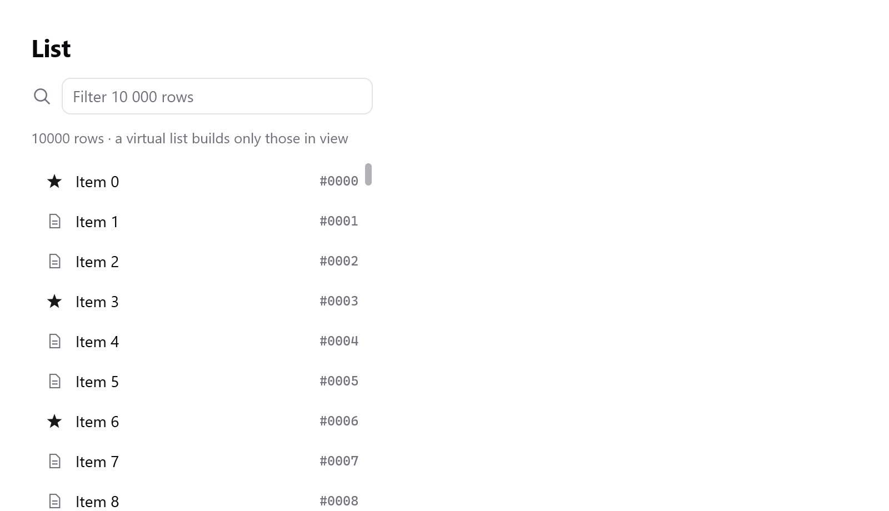
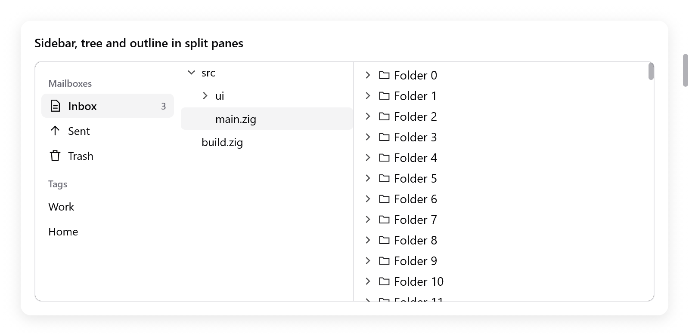
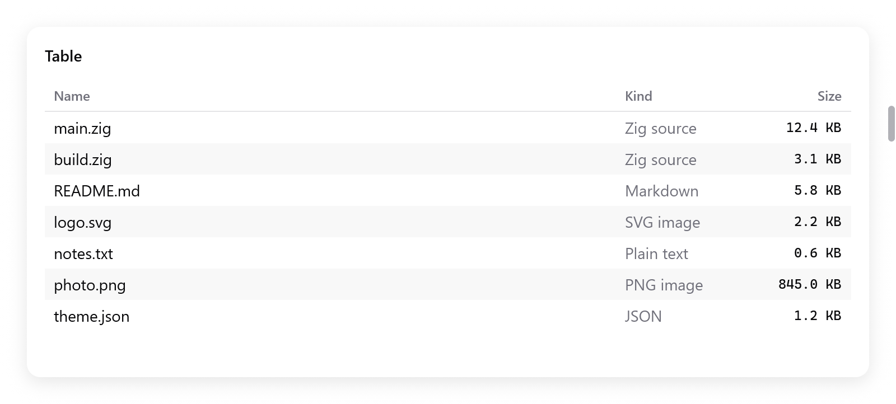
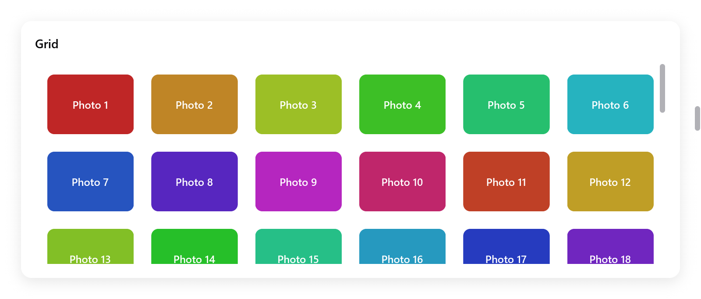

# Lists, trees, tables and grid views

Collections of items.

- All but the tree build only the rows in view, and a few around them: a
  hundred thousand rows cost what a screenful does.
- The choice they make is the app's, kept in its state.
- Their `end` returns what happened in this frame.

| Widget | For | Builds |
|---|---|---|
| `ui.list` | rows of one height | the rows in view |
| `ui.measuredList` | rows of any height: a chat, a feed | the rows in view |
| `ui.tree` | a small tree, each item inside its parent | every item shown |
| `ui.outline` | a tree of any size, as Finder's list view | the rows in view |
| `ui.table` | rows in sortable columns under a header | the rows in view |
| `ui.gridView` | items in a wrapping grid, as Photos' library | the rows in view |

For a layout of cells in rows and columns that holds every child, as a
form or a dashboard, use [`ui.grid`](grid.md) instead.

<!-- demo: virtual-list height=360 -->



*A virtual list of 10,000 rows; only the visible rows are built.*

## Lists

```zig
var rows = ui.list(c, .{ .count = s.items.len, .row_height = 36 });
while (rows.next()) |i| {
    const row = ui.div(c).row().wFull().h(36).px(12).gap(10).itemsCenter().rounded(6).hover(c.theme.surface_hover);
    defer row.end();
    ui.icon(c, "doc.text", .{ .size = 13, .color = c.theme.muted });
    ui.text(c, s.items[i].name, .{});
}
rows.end();
```

`ui.list(c, opts)` is a virtualized list, in the manner of GPUI's
`uniform_list`: rows of one height, only those in view built. It
scrolls. `next()` gives each row's index to build; `end()` closes it.

- Each row must be `row_height` tall: build it with that height.
- Each row's id comes from its index, so it keeps its hover and
  animations as the list scrolls.
- When rows are filtered or reordered and their state must follow the
  item, key the row's content with `ui.key` (see [Views](views.md)).

| `ui.ListOptions` | Default | |
|---|---|---|
| `count` | | how many rows |
| `row_height` | | each row's height, in points |
| `width`, `height` | `.fill` | the list's box |
| `gap` | 0 | between rows |
| `padding` | none | |
| `overscan` | 4 | rows built beyond each edge of the view, for smooth scrolling |
| `scroll_to` | null | scrolls the list to this offset, in points, in this frame |
| `follow_end`, `follow_glide` | false, null | starts at the end and keeps it in view as rows come, gliding there ([layout](layout.md)) |
| `choice` | null | the rows are chosen (below) |

- To show row `i`, scroll to `i * (row_height + gap)`.
- Empty boxes stand for the rows out of view, so the scroll bar is the
  whole list's.

### Choosing rows

With `choice`, a `*ui.ListChoice` the app keeps, the rows are chosen. The
list opens each row's box itself, `row_height` tall, for its content.

- A click chooses a row.
- While the list has the focus, the arrows, Home, End and Page Up and Down
  move `choice.selected`.
- Enter or a double click submits it.
- `rows.result`, read after `end()`, has `changed`, `submitted`, `focused`
  and `menu_row`, the row right-clicked in the frame.
- `rows.textColor()` is the color of text on the row being built.

**Several rows.** With `choice.selection`, a `*ui.Selection` (a set of the
rows' keys), the user chooses several, as in Finder:

- Shift-clicks, and Shift with the arrows, extend the choice from the row
  it began on.
- Cmd-clicks (Ctrl-clicks off the Mac) add a row or take it out.
- Cmd+A chooses every row.
- A press on a row not chosen chooses it as the pointer goes down. A press
  on a chosen row waits for the release.

**Right-clicks.**

- A right-click on a row not chosen chooses it before its context menu
  opens, so the menu acts on that row.
- On a chosen row, the choice stays.
- `choice.menu_keeps_selection` leaves the choice as it is; the menu acts
  on `menu_row` alone.
- A list without a selection never chooses on a right-click.

**Keys.** `choice.key` (`ui.SelectionKey.of(ctx, keyOf)`) gives each row's
item an identity.

- The selection holds the items' keys.
- While the selection holds the cursor's item, the cursor follows it as
  rows come, go and move.
- So when the app chooses another row at the cursor's index (a file
  pasted or sorted there, an item renamed in place), that choice is kept.

```zig
s.choice = .{ .selection = &s.chosen, .key = .of(s, State.keyOf) };
var rows = ui.list(c, .{ .count = s.files.len, .row_height = 28, .choice = &s.choice });
while (rows.next()) |i| {
    const name = c.leaf(.{ .padding = .xy(8, 0) }, .{ .text = .{ .str = s.files[i].name, .style = .{}, .color = rows.textColor() } }, null);
    if (ui.rowDoubleClicked(c, name)) s.rename(i);
}
rows.end();
```

`ui.rowDoubleClicked(c, index)` tells that a row's double click landed on
the element `index`, without taking the click from the row. Tables' cells
use it too.

## Rows of any height

```zig
var rows = ui.measuredList(c, &s.messages, .{ .count = s.items.len, .estimate = 60, .gap = 8, .follow_end = true });
while (rows.next()) |i| ui.text(c, s.items[i].text, .{ .wrap = true });
rows.end();
```

`ui.measuredList(c, &state, opts)` is a virtualized list whose rows are as
tall as their content, in the manner of GPUI's `list`: messages that wrap,
a feed. `next()` opens each row's box, as wide as the list, until the
view is full.

- The app keeps a `ui.MeasuredListState` and frees it with `deinit(gpa)`.
- Each row is measured in the frame that builds it, so what shows is never
  a guess.
- Rows not built yet count as `estimate` tall. Only the scroll bar and
  jumps use it: the closer to a usual row, the steadier the bar.
- The reader's place is a row, not an offset: when rows above turn out
  taller or shorter, nothing on screen moves.

| `ui.MeasuredListOptions` | Default | |
|---|---|---|
| `count` | | how many rows |
| `estimate` | 44 | about how tall a row is, in points |
| `width`, `height` | `.fill` | the list's box |
| `gap` | 0 | between rows |
| `padding` | none | |
| `overscan` | 2 | rows built beyond each edge of the view |
| `follow_end` | false | starts at the end and keeps it in view as rows come or grow, until the reader scrolls away |

- `state.reveal = i` brings row `i` to the top of the view in the next
  frame, unless all of it shows.
- A row keeps its height until it is built again or the list's width
  changes; one that changed out of view corrects itself when it is back.
- When rows are filtered, sorted or inserted above, call `state.reset()`.
  It forgets the heights; the place stays by index.
- A row costs more than one of `ui.list`, which never measures: use that
  for rows of one height.
- Rows are not chosen here; a row's content can be pressable.

## Trees

<!-- demo: tree height=415 -->



*A file tree beside an outline of folders.*

```zig
var tr = ui.tree(c, &s.chosen, .{});
if (tr.item("src", "src", &s.src_open)) {
    defer tr.endChildren();
    if (tr.item("src/ui", "ui", &s.ui_open)) {
        defer tr.endChildren();
        _ = tr.item("src/ui/list.zig", "list.zig", null);
        _ = tr.item("src/ui/tree.zig", "tree.zig", null);
    }
    _ = tr.item("src/main.zig", "main.zig", null);
}
_ = tr.item("build.zig", "build.zig", null);
if (tr.end().submitted) s.open(s.chosen);
```

`ui.tree(c, &chosen, opts)` is a tree whose items are built inside their
parent, and show while it is open. Items are named by keys the app keeps,
as paths or ids; `chosen.*` is the chosen item's key.

`item(key, label, open)` adds an item; a null `open` makes a leaf. It
returns true while the item's children show: build them, then
`endChildren()`.

- A click on an item's arrow opens or closes it; elsewhere, chooses it.
- With the keyboard focus, Up and Down choose the items around.
- Right opens the item or goes to its first child. Left closes it or goes
  to its parent.
- Enter, or a double click, submits the choice.
- The result has `changed`, `submitted` and `focused`.

| `ui.TreeOptions` | Default | |
|---|---|---|
| `width` | `.fill` | |
| `height` | `.auto` | |
| `row_height` | 26 | |
| `indent` | 16 | what each level adds before an item's arrow |

A tree builds every item it shows. For thousands of items, use an outline.

## Outlines

`ui.outline(T, c, &state, roots, provider, opts)` shows a tree of items of
type `T`, as AppKit's outline view and Finder's list view do: each open
item's children below it, indented, and an arrow to open and close it. It
builds only the rows in view.

- The app keeps a `ui.OutlineState(T)`: the items open and the one chosen
  (`selected`).
- `provider.children(item)` returns an item's children, empty for one
  without any.
- `provider` is any value with that method, usually the app's state.

```zig
const Files = struct {
    folders: ui.OutlineState(u32) = .{},
    roots: []const u32 = &.{ 0, 1, 2, 3 },
    kids: [20]u32 = undefined,

    pub fn children(s: *Files, item: u32) []const u32 {
        if (item >= 1_000_000) return &.{};
        for (&s.kids, 0..) |*v, f| v.* = 1_000_000 + item * 100 + @as(u32, @intCast(f));
        return &s.kids;
    }

    fn view(s: *Files, c: *ui.Context) void {
        var rows = ui.outline(u32, c, &s.folders, s.roots, s, .{ .row_height = 24 });
        while (rows.next()) |r| {
            const folder = r.item < 1_000_000;
            ui.icon(c, if (folder) "folder" else "doc", .{ .size = 12, .color = c.theme.muted });
            ui.text(c, if (folder) c.print("Folder {d}", .{r.item}) else "A file", .{});
        }
        if (rows.end().submitted) s.openItem(s.folders.selected.?);
    }
};
```

`next()` opens each row in view, with its indent and arrow, and returns a
`ui.OutlineRow(T)`: `item`, `depth`, `has_children` and the `parent` row.
Add the row's content; the next `next()` closes it.

- Items are compared by value, strings (`[]const u8`) by their bytes, so
  paths work as items.
- The state's `isOpen(item)`, `setOpen(gpa, item, open)` and
  `isSelected(item)` open folders from code, to reveal a file.
- Free the state with `deinit(gpa)`.

**Keyboard and pointer.**

- With the focus, Up, Down, Home, End and Page Up and Down choose rows.
- Right opens the item chosen or goes to its first child. Left closes it
  or goes to its parent.
- Enter, or a double click, submits it.
- Closing an item whose child was chosen chooses the item.
- Rows keep their identity and hover as items above open and close.

| `ui.OutlineOptions` | Default | |
|---|---|---|
| `row_height` | 26 | |
| `indent` | 16 | |
| `width`, `height` | `.fill` | |
| `padding` | `.all(4)` | |

## Tables

<!-- demo: table height=385 -->



*A file table with sortable Name, Kind and Size columns.*

```zig
const columns: []const ui.TableColumn = &.{
    .{ .title = "Name", .sortable = true },
    .{ .title = "Kind", .width = 120, .sortable = true },
    .{ .title = "Size", .width = 90, .alignment = .end, .sortable = true },
};

var tb = ui.table(c, &s.table, columns, files.len, .{});
while (tb.next()) |row| {
    const f = files[s.order[row]];
    while (tb.cell()) |col| switch (col) {
        0 => ui.text(c, f.name, .{ .color = tb.textColor() }),
        1 => ui.text(c, f.kind, .{ .color = c.theme.muted }),
        else => ui.text(c, c.print("{d} KB", .{f.size / 1000}), .{ .mono = true, .size = 12 }),
    };
}
if (tb.end().sorted) s.sortFiles(); // by s.table.sort
```

`ui.table(c, &state, columns, count, opts)` shows `count` rows in
`columns` under a header, built as they show. `next()` opens each row in
view, `cell()` each of its columns, then `end()` closes it.

A `ui.TableColumn` has:

- a `title`;
- a `width` in points; 0 shares the room the other columns leave;
- an `alignment`: `.start`, `.center` or `.end`;
- `sortable`.

The app keeps a `ui.TableState`:

- `selected`, the row chosen;
- `sort`, a `ui.TableSort` (`column`, `descending`) or null.

**Sorting.**

- A click on a sortable column's header sorts by it, ascending; a second
  click reverses it. The header shows an arrow and `end()` reports
  `sorted`.
- The app sorts its rows as `state.sort` says. The table never reorders
  the app's data: `row` is a place in the app's order.

**Choosing.**

- A click chooses a row, as do the arrows, Home, End and Page Up and Down
  with the focus.
- Enter, or a double click, submits it.
- `textColor()` is the color of text on the row being built, chosen or
  not.

| `ui.TableOptions` | Default | |
|---|---|---|
| `row_height` | 28 | |
| `header_height` | 28 | |
| `width`, `height` | `.fill` | |
| `striped` | true | every other row tinted |
| `drag_select`, `cells`, `cell_menu` | false, false, null | below |
| `sideways`, `frozen` | false, 0 | below |

The result has `changed`, `sorted`, `submitted`, `focused`,
`drag_selecting`, and `menu_row` and `menu_col`: the row and the column
right-clicked in the frame.

### Choosing rows and cells

**`drag_select`.** A drag chooses the rows it goes over, from the row it
pressed, scrolling the table as the pointer nears or passes an edge.

- A Shift-click, or Shift with the arrows, extends the choice.
- The rows chosen are those from `state.anchor` to `state.selected`
  (`state.rows()`, `state.rowChosen(i)`).
- A press on a row not chosen chooses it at once, as a spreadsheet does.
  A press on a chosen row waits for the release, so dragging the choice
  keeps it.
- `drag_selecting` reports a drag under way, so work that follows the
  choice (a sum of what is chosen) can wait for its end.

**`cells`.** The table chooses a block of cells: the rows chosen times the
columns from `state.cols[0]` to `state.cols[1]`, in the order shown.

- A click chooses a cell, a Shift-click extends the block to it, a drag
  chooses the cells it goes over.
- Left and Right move the cursor's column; Shift with them extends the
  columns.
- The keys that move the rows leave one column, unless with Shift.
- Cmd+A (Ctrl+A) chooses every row and column.
- The block's cells show in a chosen row's gray; chosen rows are not
  tinted whole.
- `t.cellSelected(row, col)` tells a cell builder whether its cell is
  chosen; `textColor()` is the text's color in it.

```zig
var tb = ui.table(c, &s.sheet, columns, rows.len, .{ .cells = true });
while (tb.next()) |row| {
    while (tb.cell()) |col| ui.text(c, rows[row][col], .{ .color = tb.textColor() });
}
_ = tb.end();
```

**`state.selection`.** With a `*ui.Selection`, and `state.key` as a
list's, the rows chosen are a set.

- Cmd-clicks add rows and take them out, and keep the columns.
- Shift extends from the row the last click was on.
- Cmd+A chooses every row.
- A right-click outside the choice, on a row or with `cells` on a cell,
  chooses it before its menu opens. Inside, the choice stays.
- `state.menu_keeps_selection` leaves the choice as it is.

**Row headers.** A `row_header` column, as a spreadsheet's row numbers,
chooses whole rows with `cells`.

- A click or a drag on its cells chooses rows with every column.
- A click on its header chooses every row.
- It does not sort.

**`cell_menu`.** A `ui.TableCellMenu` (`ctx` and
`build(ctx, menu, row, col)`) gives the cells a context menu, built as a
[context menu](menus.md)'s is.

- It covers the whole cell, padding included.
- A menu built without items does not open.
- A context menu of what a cell holds takes the right-click over it.

```zig
const cols: []const ui.TableColumn = &.{ .{ .title = "#", .width = 48, .row_header = true }, .{ .title = "Name" } };
var tb = ui.table(c, &s.grid, cols, rows.len, .{ .cells = true, .cell_menu = .{ .ctx = s, .build = State.cellMenu } });
```

### Scrolling sideways and frozen columns

```zig
const cols: []const ui.TableColumn = &.{
    .{ .title = "#", .width = 48, .row_header = true },
    .{ .title = "Name", .width = 160 },
    .{ .title = "Email", .width = 260 },
    .{ .title = "City", .width = 200 },
};
var tb = ui.table(c, &s.grid, cols, rows.len, .{ .cells = true, .frozen = 2 });
```

- With `sideways`, columns wider than the table scroll inside it, under
  one header.
- With `frozen`, the first columns (hidden ones count) stay in view as the
  others scroll, as a spreadsheet's do. It makes the table `sideways`.
- A line runs along them once something has gone under them.

- The table scrolls by its bar, by a drag choosing cells past either end
  and, with `cells`, by Left and Right. These keep the cursor's column out
  from under the frozen ones.
- Columns of width 0 share the room left, at least their `min_width`
  each.
- `cell()` gives the columns in order with their usual indices, so cell
  builders change nothing.
- A table too narrow to show another column beside the frozen ones
  scrolls them too.
- Keep `sideways` the same as `frozen` comes and goes, or the offset starts
  over: pass `.sideways = true` where the reader can freeze columns.

### Revealing a row

`TableState.reveal` names a row to show. In the next frame the table
scrolls it into view, as little as it takes, and clears the field. Use it
for a row just added past the end, or chosen from elsewhere (a search):
`s.table.reveal = s.rows.items.len - 1;`.

## Grid views

<!-- demo: grid-view height=365 -->



*A virtual grid of selectable photo tiles.*

```zig
var g = ui.gridView(c, &s.grid, .{ .count = s.photos.len, .min_item_width = 96, .row_height = 80 });
while (g.next()) |i| {
    ui.column(c, .{ .width = .fill, .height = .fill, .radius = 8, .align_items = .center, .justify = .center, .background = c.theme.surface });
    ui.text(c, s.photos[i].name, .{ .size = 12 });
    ui.end(c);
}
if (g.end().submitted) s.openPhoto(s.grid.selected.?);
```

`ui.gridView(c, &state, opts)` shows items in a wrapping grid, as Photos'
library and Finder's icon view.

- It has as many columns as fit items at least `min_item_width` wide,
  sharing the width left, in rows `row_height` tall.
- `next()` opens each item in view, its cell ready for its content.

The app keeps a `ui.GridState`, whose `selected` is the item chosen.

- A click chooses an item.
- With the focus, the arrows move the choice both ways, Home and End to
  the ends, Page Up and Down a screenful.
- Enter, or a double click, submits it.

| `ui.GridViewOptions` | Default | |
|---|---|---|
| `count` | | how many items |
| `min_item_width` | 120 | |
| `row_height` | 120 | |
| `gap` | 8 | between items, both ways |
| `padding` | `.all(8)` | |
| `width`, `height` | `.fill` | |

## Dragging items

Rows and items become draggable with [drag and drop](drag-and-drop.md):
build the row's content inside a `DragDrop.draggable` box, and give the
list a target.
