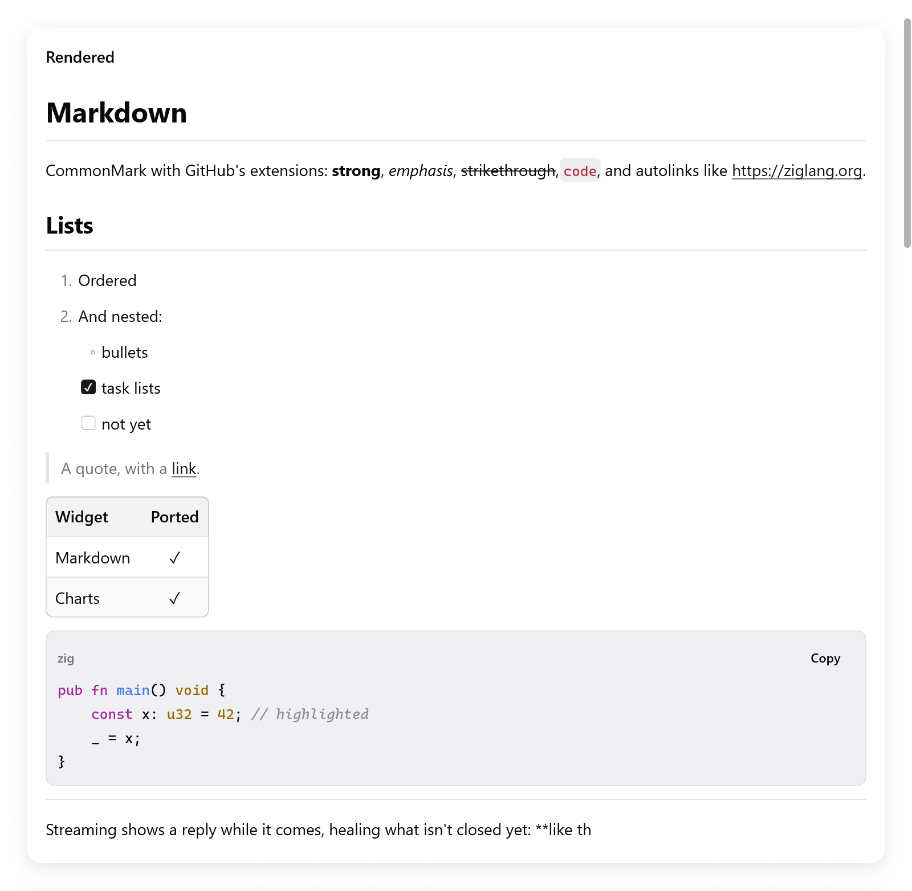

# Markdown

`ui.markdown` shows Markdown in the window's fonts and colors: CommonMark
with GitHub's tables, task lists, strikethrough and autolinks.

- Its text is selectable, and links report their clicks.
- Code blocks are highlighted, in the monospaced font, with a Copy button.
- It is made for replies streaming in from a model. A token appended at
  the end of a long reply costs what it costs at its start.

<!-- demo: markdown height=520 -->



*Rendered Markdown with lists, a quote, a table and highlighted Zig code.*

```zig
const Message = struct {
    text: []const u8,
    md: ui.Markdown,
    done: bool,
};

fn bubble(m: *Message, c: *ui.Context) void {
    ui.column(c, .{ .width = .fill, .max_width = 700 });
    defer ui.end(c);
    const res = ui.markdown(c, m.text, .{ .state = &m.md, .streaming = !m.done });
    if (res.link) |url| _ = myzig.shell.openUrl(url);
}
```

`zig build run-markdown-chat` shows replies streaming in
(`examples/markdown-chat`). Headless:
`zig-out/bin/markdown-chat --myzig-snapshot=chat.png --myzig-script="wait:3"`.

## Keeping a state

Give `ui.markdown` a `ui.Markdown` kept in the app's state, one per
document shown, and the source on every frame. Make it with
`ui.Markdown.init(gpa)` and free it with `deinit()`.

The state keeps the parsed document and what was made of its blocks:
their boxes and ids, their inlines, rendered text and highlighted lines.

- When the source grows, only the text appended is parsed. So is the
  outermost block still open before it, if there is one.
- The blocks before it are left as they were, so the view keeps what it
  made of them.
- Any other change of the source, such as an edit in the middle, parses
  it all again. So does a change of `extensions`.

Without a state (`.state = null`), the source is parsed whole on every
frame. That is fine for a short, fixed text.

## Streaming

While `streaming` is set, the end of the text shows what its half-written
syntax will most likely become:

- `**bol` shows bold.
- An open code fence shows as code.
- A link being written shows as its text.
- Lines that could still turn into something else wait for what follows
  them, as a `---` that may be a heading's underline.

Set `streaming` to false once the reply is done, and the end is read
exactly.

## Options

`ui.MarkdownOptions`:

| field | default | meaning |
|---|---|---|
| `state` | null | the `ui.Markdown` kept across frames |
| `streaming` | false | the text is still being written |
| `extensions` | all on | `ui.MarkdownExtensions` (below) |
| `size` | 14 | the size of body text; headings, code and spacing scale with it |
| `leading` | 1.45 | line height, in sizes |
| `selectable` | true | text can be selected and copied |
| `wrap_code` | true | code blocks wrap long lines rather than clipping them |
| `syntax` | true | color code blocks in the languages the highlighter knows |
| `highlighter` | null | a `ui.MarkdownHighlighter` of your own |
| `max_column_width` | 320 | a table's columns are at most this wide; their text wraps |
| `key` | null | the key of the view's box |
| `images` | null | a `ui.MarkdownImageReader` that shows images ([below](#what-is-shown)) |

`ui.MarkdownExtensions` has `tables`, `task_lists`, `strikethrough` and
`autolinks`, all on by default (`.gfm`). `.commonmark` turns them all
off, for strict CommonMark.

## What it returns

A `ui.MarkdownResult`:

- `link`: the destination of a link clicked this frame.
- `hovered_link`: the link under the pointer, as a status bar shows it.
- `copied`: the code a code block's Copy button put on the clipboard (for a
  toast saying so).

Links are not opened for you. Open them with `myzig.shell.openUrl`, or
route them within the app.

## Code blocks

The fence's info string (` ```zig `) chooses the language. The built-in
highlighter colors keywords, strings, numbers, comments, functions and
types of:

- Zig, JavaScript and TypeScript, Go, Python, JSON and shell;
- C-like languages: C, C++, C#, Java, Kotlin, Swift, Rust;
- scripting languages: Ruby, PHP, Lua, Perl, R, Julia, PowerShell, SQL;
- functional ones: Haskell, Elm, OCaml, F#, Elixir, Erlang, Lisps, Nix;
- config formats: YAML, TOML, HCL, CMake, INI;
- and more.

Some languages color other things:

- Markup (HTML, XML, SVG, Vue, Svelte): tags, attributes and their
  values. The code of `<script>` is colored as JavaScript, the rules of
  `<style>` as CSS.
- Markdown: its headings, quotes, lists, emphasis, code and links.
- A diff: its added, removed and hunk lines.

It works a line at a time, from the state the line before left (inside a
block comment, a multiline string). So a block streaming in highlights
only its new lines.

```zig
fn highlight(_: ?*anyopaque, gpa: std.mem.Allocator, language: []const u8, code: []const u8, dark: bool, out: *std.ArrayList(ui.Span)) bool {
    if (!std.mem.eql(u8, language, "ini")) return false;
    if (std.mem.indexOfScalar(u8, code, '=')) |eq| {
        out.append(gpa, .{ .start = 0, .end = @intCast(eq), .color = if (dark) .hex(0x9cdcfe) else .hex(0x0451a5) }) catch {};
    }
    return true;
}

_ = ui.markdown(c, src, .{ .state = &s.md, .highlighter = .{ .func = highlight } });
```

A highlighter of your own is a function that appends `ui.Span`s for a
line in a language. Spans are offsets into the line, with a `color`,
`weight`, `italic`, ... It returns false for a language it doesn't know,
which falls back to plain text. `Highlighter.ctx` is passed back to the
function, for a highlighter with state of its own.

## What is shown

- Headings (ATX and setext), paragraphs, hard and soft breaks.
- Emphasis, strong emphasis, strikethrough, code spans.
- Links and images by destination or reference, and autolinks. With
  `autolinks`, also GitHub's `www.` and bare URLs.
- Block quotes, ordered and bullet lists, nested, tight and loose, and task
  lists with their checkboxes.
- Fenced and indented code blocks.
- Tables, with their columns' alignment.
- Thematic breaks. HTML blocks and inline HTML are shown as their text,
  so nothing hides in them.

**Images** show their description (their alternative text), in italics.
When the options' `images` (a `ui.MarkdownImageReader`) reads them:

- each shows under its paragraph, as a `ui.MarkdownImage`: bytes under a
  key, or an SVG;
- a paragraph of images alone leaves its descriptions out;
- the app resolves destinations itself, local files only, say.

The parser passes the examples of the CommonMark 0.31.2 specification and
GitHub's extensions. Each is parsed whole, appended a byte at a time and
in chunks (`src/ui/markdown/tests_spec_*.zig`).

<details>
<summary>Emphasis in Chinese, Japanese and Korean</summary>

These languages put no space around emphasis, so one rule is relaxed.
Next to a CJK character, full-width punctuation or a curly quote, `*` and
`~~` open and close even where punctuation would stop them in CommonMark.
So `**结论。**后文` is bold.

`_` and a single `~` keep CommonMark's rule. No example of the spec has
CJK text there, so all of them still pass.

</details>

## The document

`ui.MarkdownDocument` is the parsed document, for apps that want the
structure rather than the view. Free it with `deinit()`.

- `MarkdownDocument.parse(gpa, source, extensions)` parses a text whole.
- A document made with `init(gpa, extensions)` takes text with
  `set(source)` and `append(more)`.

Blocks are a flat array in document order, each followed by its children:

| Method | |
|---|---|
| `len()` | the number of blocks |
| `block(i)` | its `kind`, `level`, `parent`, `start` and `end` in the source, ... |
| `children(i)` | to iterate |
| `language(i)` | of a code block |
| `alignments(table)` | of a table's columns |
| `inlines(i)` | parsed the first time they are asked for |

## Testing

Markdown is text and boxes, so the Tester finds it as it finds any text:

```zig
// Chat's view calls ui.markdown and keeps a clicked link in s.clicked.
var s: Chat = .{ .md = .init(gpa) };
defer s.md.deinit();
var t: ui.Tester = undefined;
try t.init(gpa, .init(&s, Chat.view), .{});
defer t.deinit();
try std.testing.expect(t.hasText("LRU cache"));
try t.clickText("the docs"); // a link
try std.testing.expectEqualStrings("https://ziglang.org", s.clicked.?);
```

See [Testing](testing.md), and [Rich text](rich-text.md) for an editor that
reads and writes Markdown.
