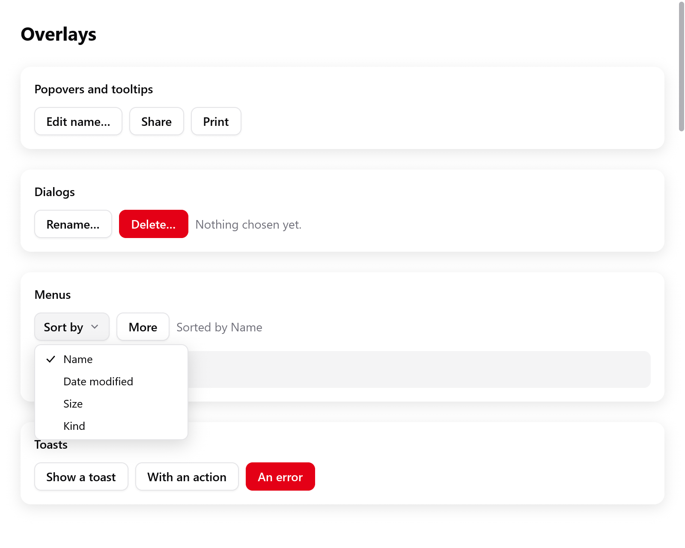
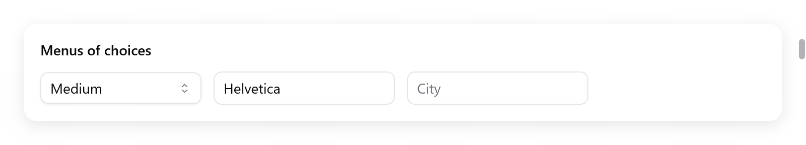

# Menus and selects

Menus that myzig draws in the window:

- context menus opened by a right click;
- menus of a button, and menu buttons;
- items with check marks, shown shortcuts, separators and submenus;
- selects: drop-downs that choose one of a list of strings.

For the app's menu bar and the system's own context and tray menus, see
[Menus](../menus.md). For commands an app offers as menu items, buttons
and shortcuts at once, see [Actions](navigation.md#actions).

<!-- demo: menu height=520 -->



*The Sort by menu is open, with Name selected.*

## A menu's state and items

A menu's state is a `ui.Menu` kept by the app, one per menu:

```zig
const State = struct {
    sort: ui.Menu = .{},
    more: ui.Menu = .{},
    ctx: ui.Menu = .{},
    sort_by: usize = 0,
    pinned: bool = false,
};
```

Every way of showing a menu returns a `*ui.MenuPanel` while it is open,
null while closed. Build its items while it is open, then call its `end`:

```zig
if (ui.contextMenu(c, &s.ctx, row)) |m| {
    defer m.end();
    if (m.item("Rename", .{ .shortcut = "F2" })) s.rename.show();
    if (m.item("Pinned", .{ .checked = s.pinned })) s.pinned = !s.pinned;
    if (m.submenu("Move to")) |sub| {
        defer sub.end();
        for (folders) |f| if (sub.item(f, .{})) s.moveTo(f);
    }
    m.separator();
    if (m.item("Delete", .{ .disabled = s.locked })) s.alert.show();
}
```

`MenuPanel.item(label, opts)` is true in the frame the item is chosen:
clicked, or Enter or Space on it. Choosing it closes the menu.

| `ui.MenuItemOptions` | Default | |
|---|---|---|
| `shortcut` | `""` | a key combination shown by it, as the shortcut that does the same: it only shows it |
| `checked` | null | a check mark by it when true, and room for one when false |
| `disabled` | false | grayed out: it cannot be chosen |
| `icon` | `""` | an SF Symbol (or myzig's line icon of that name off macOS) before the label |

**Shortcuts.** Write them with the Mac's symbols. `ui.keys.label` writes
them as the platform does: `ui.keys.label("⇧⌘S")` is `⇧⌘S` on macOS and
`Ctrl+Shift+S` on Linux and Windows.

An item only shows its shortcut. Answer the keys themselves with
`c.shortcut(...)`. Or name the command once as an
[action](navigation.md#actions): its menu item shows its shortcut and
answers it.

- `separator()` draws a line between groups of items.
- `submenu(label)` adds an item that opens a submenu. It opens as the
  pointer rests on it, or for Right or Enter. It returns the submenu's
  panel while it is open.
- Submenus go four deep (`max_depth` in `src/ui/menu.zig`).
- The keyboard moves among the first 64 items of a menu.

**Keys and pointer:**

- Up and Down move among the items, skipping disabled ones.
- Right and Left open and close submenus.
- Escape closes the innermost menu.
- An open menu takes a press outside it, as the system's menus do. The
  press closes it and goes no further.
- The pointer highlights an item only when it moves. So a menu opening
  under a resting pointer keeps the keyboard's highlight.

## Context menus

`ui.contextMenu(c, &menu, target)` gives the element `target` a menu.
`target` is an interaction of its box, built with its children. The menu
opens where it is right-clicked, or below it for Shift+F10 while it has
the focus:

```zig
const row = ui.pressable(c, .{ .width = .fill, .padding = .all(12), .radius = 8, .background = c.theme.surface_hover }, null);
ui.text(c, "A note (right click me)", .{});
ui.end(c);
if (ui.contextMenu(c, &s.ctx, row)) |m| {
    defer m.end();
    if (m.item("Rename", .{})) s.rename.show();
}
```

Call it after the elements inside `target`. Then the innermost element
with a menu takes the click: a list's row with a menu of its own, inside
a list with one for its background.

## Menus of a button

`ui.buttonMenu(c, &menu, button)` gives a button a menu.

```zig
const more = ui.button(c, "More", .{});
if (ui.buttonMenu(c, &s.more, more)) |m| {
    defer m.end();
    if (m.item("Duplicate", .{ .shortcut = ui.keys.label("⌘D") })) s.duplicate();
    if (m.item("Export…", .{})) s.exportIt();
}
```

- It opens below the button as the pointer goes down on it, as the
  system's pop-up buttons do.
- So a press, a drag to an item and a release choose that item.
- A second press closes it.

`ui.menuButton(c, title, &menu, opts)` is a button of its own, showing
`title` and an arrow. It opens the menu below it as the pointer goes down
on it, or for Enter, Space or Down while it has the focus.

```zig
if (ui.menuButton(c, "Sort by", &s.sort, .{})) |m| {
    defer m.end();
    for (sorts, 0..) |by, i| if (m.item(by, .{ .checked = s.sort_by == i })) {
        s.sort_by = i;
    };
}
```

`ui.MenuButtonOptions` has `size` (14), `disabled` and `width` (`.auto`).

## Opening a menu from code

`ui.menu(c, &menu)` builds the menu `menu` wherever it was opened. The
functions above call it.

- `Menu.openAt(point)` opens it with its top left corner at a point of
  the window.
- `Menu.openBelow(rect)` opens it below a rectangle, or above it where
  there is no room.
- `close()` closes it. `isOpen()` tells whether it is open.

```zig
if (c.shortcut(.{ .key = 'k', .cmd = true })) s.palette.openAt(.{ .x = 200, .y = 80 });
if (ui.menu(c, &s.palette)) |m| {
    defer m.end();
    if (m.item("New note", .{})) s.newNote();
}
```

## Selects

<!-- demo: selects height=168 -->



*Closed select, combobox and autocomplete controls.*

`ui.select(c, &selected, options, &state, opts)` is a drop-down. It
chooses one of `options` (strings) into `selected.*`, an index. Its state
is a `ui.SelectState` kept by the app:

```zig
const sizes = [_][]const u8{ "Small", "Medium", "Large" };
// In the app's state: size: usize = 1, size_box: ui.SelectState = .{},

if (ui.select(c, &s.size, &sizes, &s.size_box, .{ .width = .{ .px = 160 } }).changed) s.save();
```

- A click opens its options below it, above where there is no room. So
  do Enter, Space, Up or Down while it has the focus.
- The arrows, Home and End move among the options. Enter, Space or a
  click chooses one.
- Escape or a press outside closes them. The list takes that press, as
  the system's pop-up menus do.
- The focus comes back to the select.
- With more options than the window has room for, the list is as tall as
  the room on the larger side of the select. Its options scroll.

| `ui.SelectOptions` | Default | |
|---|---|---|
| `width` | `.{ .px = 200 }` | |
| `size` | 14 | the font size |
| `placeholder` | `"Choose…"` | shown when `selected.*` is past the options |
| `disabled` | false | |
| `label` | `""` | names it for assistive technology |

`ui.SelectResult` has `changed` (a new option was chosen in this frame),
`open` and `focused`.

For a field whose text filters the options as the user types, use
`ui.combobox`. For suggestions under a free text field, use
`ui.autocomplete`. Both are in [Text input](text-input.md).
