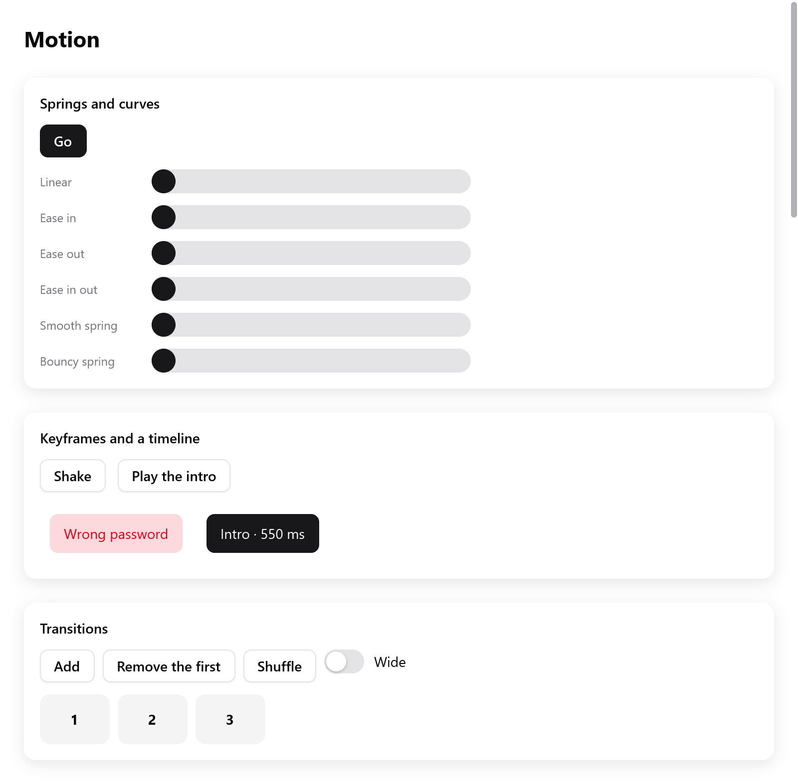

# Motion

The view says where things are; motion finds the way there.

- A value given to `ui.motion` animates toward the target the view gives
  it on every frame. It uses a spring that keeps its velocity, or a curve
  of a duration.
- Boxes can move smoothly where the layout puts them, and come and go
  (`motion.transition`).
- Everything runs on the context's clock (`c.time`, which `ui.Tester`
  advances).
- Frames are drawn only while something moves: an app at rest draws
  nothing.

<!-- demo: motion height=520 -->



*A still frame of the motion demo: easing, springs, keyframes and transitions.*

```zig
const motion = myzig.ui.motion;

fn view(s: *State, c: *ui.Context) void {
    const id = c.peekId("card");
    const x = motion.animateTo(c, id, "x", if (s.open) 200 else 0, .snappy);
    _ = c.open(.{ .width = .{ .px = 80 }, .height = .{ .px = 80 }, .radius = 12,
        .background = c.theme.accent, .transform = .translation(x, 0) }, "card");
    c.end();
}
```

When `s.open` changes, the card slides to its new place over the next
frames. `zig build run-gallery` shows every animation on its Motion page
(`examples/gallery/motion.zig`).

## Values and their ids

A value belongs to a box's id and a key that tells the box's values apart
(`"x"`, `"scale"`, ...).

- `c.peekId(key)` gives the id of the box you are about to open.
- `c.node(index).id` gives the id of a box already open.
- `motion.to(c, key, target, a)` uses the box open now.

A value starts at its first target, so a view shown the first time shows
no motion. A new target on the way takes over from where the value is. A
spring keeps its velocity: a card turned around mid-flight slows down and
comes back, rather than jumping.

## Animations

`motion.Animation` says how a value goes to a new target:

| field | meaning |
|---|---|
| `duration` | seconds of a curve; 0 (the default) uses `spring` |
| `ease` | the curve's `motion.Easing` (`.ease_out` by default) |
| `spring` | the `motion.Spring` used when `duration` is 0 |
| `delay` | seconds the value keeps going as it was before it moves |

Three springs are ready, after SwiftUI's: `.smooth` (no bounce),
`.snappy` (a little) and `.bouncy` (a visible one).
`motion.Animation.curve(seconds, ease)` makes a curve:

```zig
const a: motion.Animation = .curve(0.3, .ease_in_out);
const b: motion.Animation = .{ .spring = .{ .duration = 0.4, .bounce = 0.2 } };
```

`motion.animate(c, id, key, target, seconds)` is `animateTo` with a curve
of `seconds` easing out.

### Easing

`motion.Easing` is CSS's timing functions:

- `.linear`, `.ease_in`, `.ease_out`, `.ease_in_out`;
- `.cubic`, made with `Easing.cubicBezier(x1, y1, x2, y2)`, as CSS's
  `cubic-bezier()`;
- `.custom`: a function of your own from the time (0 to 1) to the
  progress.

### Springs

A `motion.Spring` is set as one perceives it:

| field | default | |
|---|---|---|
| `duration` | 0.5 s | about how long it takes to arrive |
| `bounce` | 0 | from 0 (no overshoot) toward 1 |
| `stiffness`, `damping` | `null` | set either to make it physical instead; unset, they are react-spring's 170 and 26 |
| `mass` | 1 | with `stiffness` and `damping` |
| `precision` | 0.001 | how close to its target, in the value's units, counts as arrived |
| `velocity` | `null` | a velocity given to the value when its target changes, such as a throw's |

Springs are solved exactly, not stepped. So they look the same at any
frame rate.

## Colors

`motion.animateColor(c, id, key, target, a)` moves a color toward
`target`. Colors are mixed with premultiplied alpha
(`motion.mixPremultiplied`). So a color fading in from transparent keeps
its hue, instead of passing through gray.

## Poses that only paint

`motion.pose(c, index, p, a)` animates box `index` toward a
`motion.Pose`. The box is open, or built this frame.

| `motion.Pose` | |
|---|---|
| `x`, `y` | moves it |
| `scale` | scales it; 0 keeps its size |
| `rotate` | turns it, in degrees |
| `fade` | 0 is opaque, 1 is gone |

The pose acts after the box's own transform, and multiplies its opacity.
It changes only how the box is drawn; the layout stays.

```zig
const card = c.open(.{ .padding = .all(16), .radius = 12, .background = c.theme.surface }, "card");
ui.text(c, "Hello", .{});
motion.pose(c, card, .{ .scale = if (s.pressed) 0.96 else 1, .fade = if (s.hidden) 1 else 0 }, .snappy);
c.end();
```

## When it is done

- `motion.settled(c, id, key)`: the value rests at its target.
- `motion.arrived(c, id, key)`: true in the one frame it came to rest
  after moving. The view can go on: remove what faded out, start the next
  step.
- `motion.velocity(c, id, key)`: how fast it goes, in units a second.

## Gestures

While a finger or the pointer drags something, set its value with
`motion.jump(c, id, key, value)`. It follows at once, and motion keeps
track of how fast it goes. When the drag ends, `animateTo` with a spring
takes over at that velocity. So the thing keeps going the way it was
thrown.

Two helpers, after iOS:

- `motion.project(value, velocity)`: where a throw carries a value. Use it
  to choose where it lands: the nearest page, a snap point.
- `motion.rubberband(value, lo, hi, dimension)`: a value held within `lo`
  and `hi`, as content dragged past its edges. The further it is pulled,
  the less far it goes.

## Keyframes

`motion.keyframes(c, id, key, frames, options)` plays a sequence of
`motion.Keyframe`s, then holds the last value. A `motion.Keyframe` has:

- `at`: seconds from the start;
- `value`;
- `ease`: the curve of the segment arriving there.

Change `options.run` to play it again. It starts from the value shown, so
a shake started during a shake doesn't jump.

```zig
const dx = motion.keyframes(c, c.peekId("shake"), "dx", &.{
    .{ .value = 0 },
    .{ .at = 0.08, .value = -12 },
    .{ .at = 0.16, .value = 12 },
    .{ .at = 0.24, .value = -8 },
    .{ .at = 0.32, .value = 8 },
    .{ .at = 0.4, .value = 0, .ease = .ease_out },
}, .{ .run = s.shakes });
_ = c.open(.{ .padding = .xy(14, 10), .transform = .translation(dx, 0) }, "shake");
```

`motion.KeyframeOptions` also has:

- `repeat`: how many more times; `-1` plays for ever;
- `alternate`: every other time backward;
- `delay` and `repeat_delay`.

## Timelines

A timeline places tweens one after another, together, or at times, as
GSAP's do. `motion.timeline(c, id, key, options)` gives a `Timeline`. Its
`tween` returns each tween's value now:

```zig
var tl = motion.timeline(c, c.peekId("intro"), "intro", .{ .run = s.intro });
const slide = tl.tween(.{ .from = -60, .to = 0, .duration = 0.4 }, .{});
const fade = tl.tween(.{ .from = 0, .to = 1, .duration = 0.3, .ease = .linear }, .with(0.1));
const grow = tl.tween(.{ .from = 0.8, .to = 1, .duration = 0.3 }, .after(-0.1));
_ = c.open(.{ .opacity = fade,
    .transform = ui.Affine.scaling(grow, grow).then(.translation(slide, 0)) }, "intro");
```

A `motion.Placement` says where a tween starts:

- `.after(offset)` (the default, offset 0): after the tween before ends; a
  negative offset overlaps it.
- `.with(offset)`: after the tween before starts.
- `.at(seconds)`: at a time of the timeline.
- `.atLabel(name, offset)`: after a label set with `tl.label(name, placement)`.

`motion.TimelineOptions` plays it:

| field | |
|---|---|
| `run` | change it to play over |
| `repeat`, `alternate`, `delay`, `repeat_delay` | as for keyframes |
| `paused`, `reverse` | |
| `seek` | holds the playhead at a time |
| `progress` | holds it at a part of the duration, for a scrubber |

The timeline tells `duration()`, `time()`, `progress()`, `settled()` and
`arrived()`.

## Transitions

`motion.transition(c, index, t)` gives a box a transition:

- it moves smoothly where the layout changes it, from where the last
  frame showed it;
- it comes from its `enter` as it appears;
- it goes to its `exit` as it leaves.

Call it once the box's children are built (a collapse measures them),
before closing it:

```zig
for (s.items[0..s.count]) |n| {
    const box = c.open(.{ .width = .{ .px = 70 }, .height = .{ .px = 50 }, .radius = 10,
        .background = c.theme.surface_hover }, c.print("item-{d}", .{n}));
    ui.text(c, c.print("{d}", .{n}), .{ .weight = .bold });
    motion.transition(c, box, .{
        .animation = .snappy,
        .enter = .{ .opacity = 0, .scale = 0.6, .y = 12 },
        .exit = .{ .opacity = 0, .scale = 0.6, .collapse = true },
    });
    c.end();
}
```

Give such boxes stable keys (`c.print("item-{d}", .{n})`, `ui.key`). Then
a box keeps its id as the list is reordered.

`motion.Transition`'s fields:

| field | meaning |
|---|---|
| `animation` | how it moves; else a curve of `duration` (0.2 s) along `ease` |
| `position` | animate its place in its parent |
| `size` | animate its size (sizes in points) |
| `colors` | animate its background and border |
| `enter` | the `motion.Motion` it comes from as it appears |
| `exit` | the `motion.Motion` it goes to as it leaves |

When none of `position`, `size` and `colors` is set, all three animate.

A `motion.Motion` is a pose relative to the box's place:

- `x`, `y`, `opacity`;
- `scale`: 0 keeps its size;
- `rotate`: degrees about its center;
- `collapse`: takes its height away in a column, or its width in a row.
  It clips its content, so its siblings close up.

**Behavior**

- A box leaving is drawn as the last frame drew it, under its siblings,
  taking no room, until its exit ends.
- A box appears with its `enter` only in a parent that was there the
  frame before. So a page shown all at once doesn't animate every box in
  it.
- `motion.transitioning(c, id)` tells whether box `id` is still on its
  way.
- The pointer follows boxes where their animation draws them.

## Without animation

`motion.disableAnimations(c)` makes this frame's values, colors, poses and
transitions go to their targets at once, as SwiftUI's
`disablesAnimations`. Use it for a change that shouldn't show as motion: a
window resized, a document switched. Keyframes and timelines play on.

## Less motion

When the desktop asks for reduced motion, `motion.reduced(c)` is true:

- values go to their targets at once;
- colors and fades still change smoothly;
- an enter or exit that fades without collapsing fades in place.

`motion.setReducedMotion(c, true)` overrides the desktop; `null` follows
it again. Tests never ask the desktop: reduced motion is off there unless
the test sets it.

## Loops and your own motion

- `motion.loop(c, seconds)` is where the clock is in a period, from 0 to
  1, for spinners and pulses. It asks for frames.
- A view animating from `c.time` by itself calls `c.animationFrame()` to
  ask for the next frame.
- `c.frameIn(seconds)` is for something that changes now and then, such
  as a clock's second. It doesn't draw every refresh in between.
- `c.animate(id, salt, target, speed)` is the simpler exponential approach
  the built-in widgets use for hover and press.

## Testing motion

The Tester's clock moves only when the test says. So animations are
tested without waiting:

```zig
s.target = 200;
t.frame();
t.advance(0.1); // a tenth of a second later
try std.testing.expect(s.shown > 20 and s.shown < 200);
t.settle(3);    // frames until nothing moves (at most 3 s)
try std.testing.expectEqual(@as(f32, 200), s.shown);
try std.testing.expect(!t.ctx.animating);
```

See [Testing](testing.md), and [Transforms](transforms.md) for what a
value can move.
