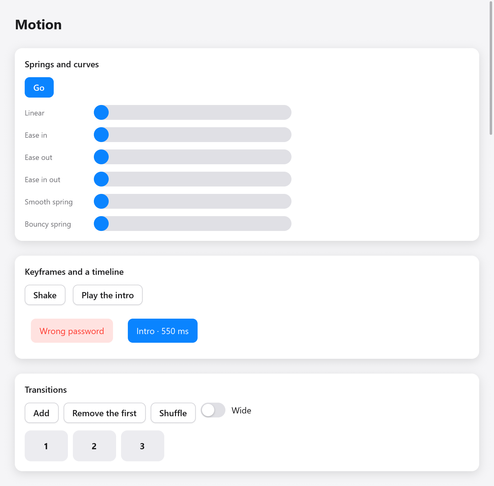

# Motion

The view says where things are; motion finds the way there. A value given
to `ui.motion` animates toward the target the view gives it on every frame,
with a spring that keeps its velocity or a curve of a duration. Boxes can
also move smoothly where the layout puts them, and come and go
(`motion.transition`). Everything runs on the context's clock
(`c.time`, which `ui.Tester` advances), and frames are drawn only while
something moves: an app at rest draws nothing.



*A still frame of the motion demo: easing, springs, keyframes and transitions.*

```zig
const motion = myzig.ui.motion;

fn view(s: *State, c: *ui.Context) void {
    const id = c.peekId("card");
    const x = motion.animateTo(c, id, "x", if (s.open) 200 else 0, .snappy);
    _ = c.open(.{ .width = .{ .px = 80 }, .height = .{ .px = 80 }, .radius = 12,
        .background = c.theme.accent, .transform = .translation(x, 0) }, "card");
    c.end();
}
```

`s.open` changes; on the next frames the card slides to its new place.
The example `zig build run-gallery` shows every animation on its Motion
page (`examples/gallery/motion.zig`).

## Values and their ids

A value belongs to a box's id and a key that tells the box's values apart
(`"x"`, `"scale"`, ...). Take the id of the box you are about to open with
`c.peekId(key)`, or of a box already open with `c.node(index).id`;
`motion.to(c, key, target, a)` uses the box open now.

A value starts at its first target, so a view shown the first time shows
no motion. A new target on the way takes over from where the value is: a
spring keeps its velocity, so a card turned around mid-flight slows down
and comes back, rather than jumping.

## Animations

`motion.Animation` says how a value goes to a new target:

| field | meaning |
|---|---|
| `duration` | seconds of a curve; 0 (the default) uses `spring` |
| `ease` | the curve's `motion.Easing` (`.ease_out` by default) |
| `spring` | the `motion.Spring` used when `duration` is 0 |
| `delay` | seconds the value keeps going as it was before it moves |

Three springs are ready, after SwiftUI's: `.smooth` (no bounce), `.snappy`
(a little) and `.bouncy` (a visible one). `motion.Animation.curve(seconds,
ease)` makes a curve:

```zig
const a: motion.Animation = .curve(0.3, .ease_in_out);
const b: motion.Animation = .{ .spring = .{ .duration = 0.4, .bounce = 0.2 } };
```

`motion.animate(c, id, key, target, seconds)` is `animateTo` with a curve
of `seconds` easing out.

### Easing

`motion.Easing` is CSS's timing functions: `.linear`, `.ease_in`,
`.ease_out`, `.ease_in_out`, `.cubic` (made with
`Easing.cubicBezier(x1, y1, x2, y2)`, as CSS's `cubic-bezier()`), and
`.custom`, a function of your own from the time (0 to 1) to the progress.

### Springs

A `motion.Spring` is set as one perceives it, by `duration` (about how
long it takes to arrive, 0.5 s by default) and `bounce` (from 0, no
overshoot, toward 1). Setting `stiffness` or `damping` makes it physical
instead (react-spring's 170 and 26 by default), with `mass`. `precision`
says how close to its target, in the value's units, it counts as arrived,
and `velocity` gives the value a velocity when its target changes (a
throw's). Springs are solved exactly, not stepped, so they look the same at
any frame rate.

## Colors

`motion.animateColor(c, id, key, target, a)` moves a color toward
`target`. Colors are mixed with premultiplied alpha
(`motion.mixPremultiplied`), so a color fading in from transparent keeps
its hue instead of passing through gray.

## Poses that only paint

`motion.pose(c, index, p, a)` animates box `index` (open, or built this
frame) toward a `motion.Pose`: moved by `x` and `y`, scaled by `scale` (0
keeps its size), turned by `rotate` degrees, and faded by `fade` (0 opaque,
1 gone). The pose acts after the box's own transform and multiplies its
opacity. It changes only how the box is drawn; the layout stays.

```zig
const card = c.open(.{ .padding = .all(16), .radius = 12, .background = c.theme.surface }, "card");
ui.text(c, "Hello", .{});
motion.pose(c, card, .{ .scale = if (s.pressed) 0.96 else 1, .fade = if (s.hidden) 1 else 0 }, .snappy);
c.end();
```

## When it is done

- `motion.settled(c, id, key)`: the value rests at its target.
- `motion.arrived(c, id, key)`: true in the one frame it came to rest after
  moving, for the view to go on (remove what faded out, start the next
  step).
- `motion.velocity(c, id, key)`: how fast it goes, in units a second.

## Gestures

While a finger or the pointer drags something, set its value with
`motion.jump(c, id, key, value)`: it follows at once, and motion keeps
track of how fast it goes. When the drag ends, `animateTo` with a spring
takes over at that velocity, so the thing keeps going the way it was
thrown. Two helpers, after iOS:

- `motion.project(value, velocity)`: where a throw carries a value, to
  choose where it lands (the nearest page, a snap point).
- `motion.rubberband(value, lo, hi, dimension)`: a value held within `lo`
  and `hi` as content dragged past its edges, going less far the further it
  is pulled.

## Keyframes

`motion.keyframes(c, id, key, frames, options)` plays a sequence of
`motion.Keyframe`s (`at` in seconds from the start, `value`, and the
`ease` of the segment arriving there), then holds the last value. Change
`options.run` to play it again: from the value shown, so a shake started
during a shake doesn't jump.

```zig
const dx = motion.keyframes(c, c.peekId("shake"), "dx", &.{
    .{ .value = 0 },
    .{ .at = 0.08, .value = -12 },
    .{ .at = 0.16, .value = 12 },
    .{ .at = 0.24, .value = -8 },
    .{ .at = 0.32, .value = 8 },
    .{ .at = 0.4, .value = 0, .ease = .ease_out },
}, .{ .run = s.shakes });
_ = c.open(.{ .padding = .xy(14, 10), .transform = .translation(dx, 0) }, "shake");
```

`motion.KeyframeOptions` also has `repeat` (how many more times;
`-1` plays for ever), `alternate` (every other time backward), `delay` and
`repeat_delay`.

## Timelines

A timeline places tweens one after another, together, or at times, as
GSAP's do. `motion.timeline(c, id, key, options)` gives a `Timeline` whose
`tween` returns each tween's value now:

```zig
var tl = motion.timeline(c, c.peekId("intro"), "intro", .{ .run = s.intro });
const slide = tl.tween(.{ .from = -60, .to = 0, .duration = 0.4 }, .{});
const fade = tl.tween(.{ .from = 0, .to = 1, .duration = 0.3, .ease = .linear }, .with(0.1));
const grow = tl.tween(.{ .from = 0.8, .to = 1, .duration = 0.3 }, .after(-0.1));
_ = c.open(.{ .opacity = fade,
    .transform = ui.Affine.scaling(grow, grow).then(.translation(slide, 0)) }, "intro");
```

A `motion.Placement` says where a tween starts:

- `.after(offset)` (the default, offset 0): after the tween before ends; a
  negative offset overlaps it.
- `.with(offset)`: after the tween before starts.
- `.at(seconds)`: at a time of the timeline.
- `.atLabel(name, offset)`: after a label set with `tl.label(name, placement)`.

`motion.TimelineOptions` plays it: `run` (change it to play over),
`repeat`, `alternate`, `delay`, `repeat_delay`, `paused`, `reverse`, and
`seek` (hold the playhead at a time) or `progress` (at a part of the
duration, for a scrubber). The timeline tells `duration()`, `time()`,
`progress()`, `settled()` and `arrived()`.

## Transitions

`motion.transition(c, index, t)` gives a box a transition: it moves
smoothly where the layout changes it, from where the last frame showed it,
comes from its `enter` as it appears, and goes to its `exit` as it leaves.
Call it once the box's children are built (a collapse measures them),
before closing it:

```zig
for (s.items[0..s.count]) |n| {
    const box = c.open(.{ .width = .{ .px = 70 }, .height = .{ .px = 50 }, .radius = 10,
        .background = c.theme.surface_hover }, c.print("item-{d}", .{n}));
    ui.text(c, c.print("{d}", .{n}), .{ .weight = .bold });
    motion.transition(c, box, .{
        .animation = .snappy,
        .enter = .{ .opacity = 0, .scale = 0.6, .y = 12 },
        .exit = .{ .opacity = 0, .scale = 0.6, .collapse = true },
    });
    c.end();
}
```

Give such boxes stable keys (`c.print("item-{d}", .{n})`, `ui.key`), so a
box keeps its id as the list is reordered.

`motion.Transition`'s fields:

| field | meaning |
|---|---|
| `animation` | how it moves; else a curve of `duration` (0.2 s) along `ease` |
| `position` | animate its place in its parent |
| `size` | animate its size (sizes in points) |
| `colors` | animate its background and border |
| `enter` | the `motion.Motion` it comes from as it appears |
| `exit` | the `motion.Motion` it goes to as it leaves |

When none of `position`, `size` and `colors` is set, all three animate. A
`motion.Motion` is a pose relative to the box's place: `x`, `y`,
`opacity`, `scale` (0 keeps its size), `rotate` (degrees about its center),
and `collapse`, which takes its height away in a column (its width in a
row), clipping its content, so its siblings close up.

A box leaving is drawn as the last frame drew it, under its siblings,
taking no room, until its exit ends. A box appears with its `enter` only in
a parent that was there the frame before, so a page shown all at once
doesn't animate every box in it. `motion.transitioning(c, id)` tells
whether box `id` is still on its way. The pointer follows boxes where their
animation draws them.

## Without animation

`motion.disableAnimations(c)` makes this frame's values, colors, poses and
transitions go to their targets at once, as SwiftUI's
`disablesAnimations`: for a change that shouldn't show as motion (a window
resized, a document switched). Keyframes and timelines play on.

## Less motion

When the desktop asks for reduced motion, `motion.reduced(c)` is true and
values go to their targets at once; colors and fades still change smoothly,
and an enter or exit that fades without collapsing fades in place.
`motion.setReducedMotion(c, true)` overrides the desktop (`null` follows it
again). Tests never ask the desktop: reduced motion is off there unless the
test sets it.

## Loops and your own motion

`motion.loop(c, seconds)` is where the clock is in a period, from 0 to 1,
for spinners and pulses; it asks for frames. A view animating from `c.time`
by itself calls `c.animationFrame()` to ask for the next frame, or
`c.frameIn(seconds)` for something that changes now and then (a clock's
second) without drawing every refresh in between. `c.animate(id, salt,
target, speed)` is the simpler exponential approach the built-in widgets
use for hover and press.

## Testing motion

The Tester's clock moves only when the test says, so animations are tested
without waiting:

```zig
s.target = 200;
t.frame();
t.advance(0.1); // a tenth of a second later
try std.testing.expect(s.shown > 20 and s.shown < 200);
t.settle(3);    // frames until nothing moves (at most 3 s)
try std.testing.expectEqual(@as(f32, 200), s.shown);
try std.testing.expect(!t.ctx.animating);
```

See [Testing](testing.md), and [Transforms](transforms.md) for what a
value can move.
