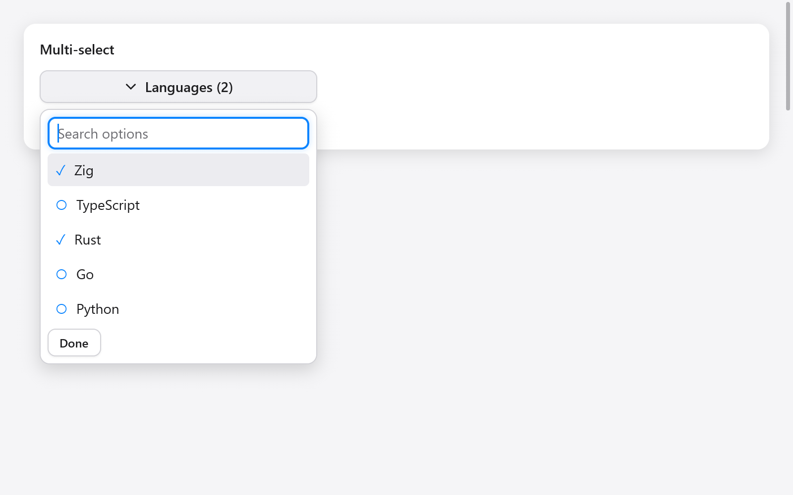

# Multi-select



`multiSelect` combines a search field with a persistent list of checked
choices. Search changes the visible options, preserving original indices
and choices outside the current filter.

```zig
// App state:
languages: [3]bool = .{ true, false, false },
language_picker: ui.MultiSelectState = .{},

// View:
if (ui.multiSelect(c, &s.language_picker,
    &.{ "Zig", "TypeScript", "Rust" }, &s.languages,
    .{ .label = "Languages" },
)) savePreferences();
```

Keep the state and boolean flags between frames. The options and flags
must have equal lengths; indices identify options, so remap the flags if
you reorder the options. No allocator or deinitialization is required.

`MultiSelectOptions` includes `label`, search `placeholder`, `empty_label`,
`width`, `max_height`, `disabled`, and optional `disabled_items` flags
parallel to the options. Existing disabled choices stay selected but
cannot be changed through the widget.

Typing filters without case sensitivity. Up/Down skip disabled options;
Home/End move to the edges; Enter toggles the active option. Clicking an
option keeps the popup open and returns focus to search. Done, Escape or
a press outside closes it. Closing with Escape restores the trigger's
focus. The return value is true only when a selection changes.

See **Actions & choices** in Gallery, and
[single-choice comboboxes](menus.md).
