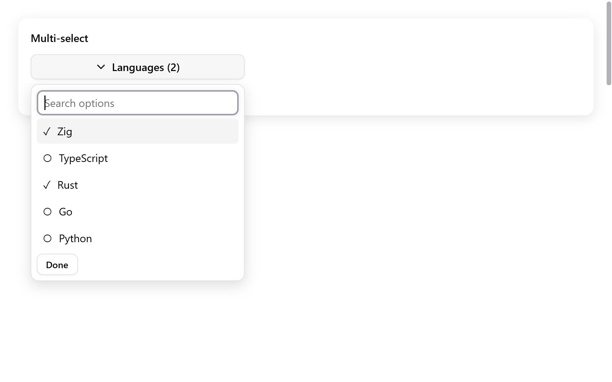

# Multi-select

A search field over a list of checkboxes, for picking several options.

<!-- demo: multi-select height=520 -->



```zig
// App state:
languages: [3]bool = .{ true, false, false },
language_picker: ui.MultiSelectState = .{},

// View:
if (ui.multiSelect(c, &s.language_picker,
    &.{ "Zig", "TypeScript", "Rust" }, &s.languages,
    .{ .label = "Languages" },
)) savePreferences();
```

- Keep the state and the flags between frames. No allocator or deinit is
  needed.
- The options and the flags have the same length.
- Indices identify options: reorder the flags with the options.
- It returns true only when the selection changes.

| `MultiSelectOptions` | Default | |
|---|---|---|
| `label` | `"Choose options"` | the trigger's text, followed by the count chosen |
| `placeholder` | `"Search options"` | of the search field |
| `empty_label` | `"No matching options"` | shown when nothing matches |
| `width`, `max_height` | 280, 240 | |
| `disabled` | `false` | |
| `disabled_items` | `null` | flags parallel to the options; disabled choices stay selected but cannot change |

**Behavior**

- Typing filters, ignoring case. Choices outside the filter stay
  selected, and indices stay the original ones.
- Up and Down skip disabled options. Home and End go to the ends. Enter
  toggles the active option.
- Clicking an option keeps the popup open and puts focus back in the
  search field.
- Done, Escape or a press outside closes it. Escape gives focus back to
  the trigger.

See **Actions & choices** in Gallery, and
[single-choice comboboxes](menus.md).
