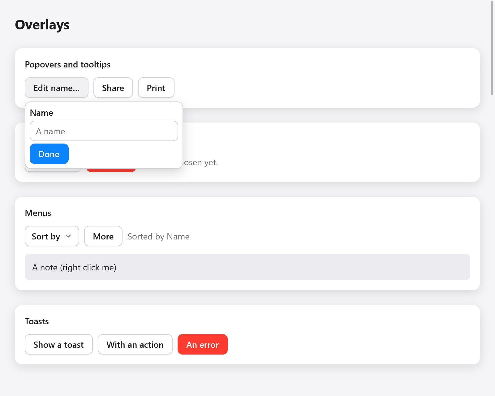
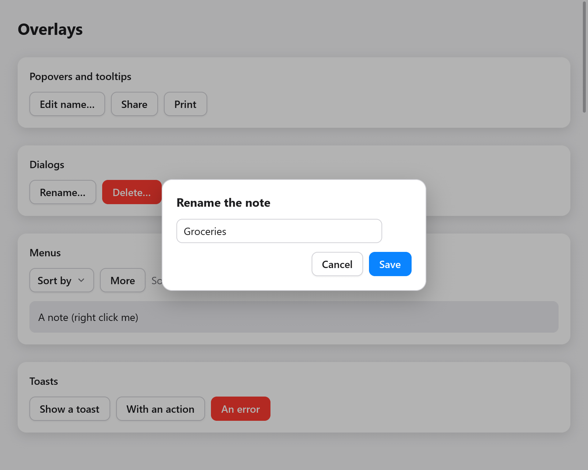
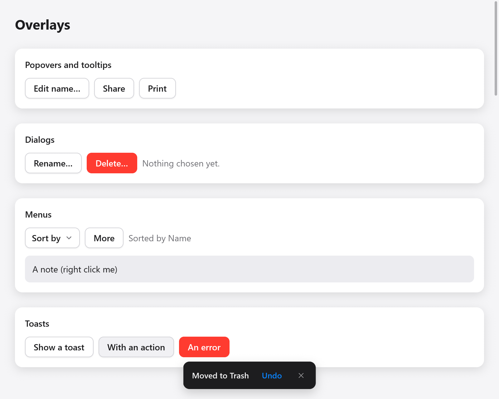

# Overlays

Overlays are boxes drawn over everything else in the window: popovers
beside an element, tooltips, dialogs over the dimmed window, alert dialogs
and toasts. Menus and selects are overlays too; they have
[a page of their own](menus.md).

An overlay is built where it belongs in the view, next to what opens it,
but it is laid out over the window (`Context.openOverlay`), and it takes
the pointer before the boxes under it. Whether one shows is the app's
state: an `ui.OverlayState` kept in the app's struct, which the app opens
and the widget closes when the user dismisses it.



*An open popover anchored to the Edit name button.*

```zig
const State = struct {
    pop: ui.OverlayState = .{},
    rename: ui.OverlayState = .{},
    alert: ui.OverlayState = .{},
    toasts: ui.Toasts = .{},
    name: ui.TextBuffer = .{},
};
```

`OverlayState` has `show`, `close` and `toggle`, and the field `open`. In
the frame the user closed it (Escape, a press outside) its `dismissed`
flag is set: an overlay that must stay open sets `open` back to `true`
then. As it opens it remembers the keyboard focus, and gives it back as it
closes, so Tab goes on from the button that opened it.

## Popovers

`ui.popover(c, &state, anchor, opts)` shows a panel beside the element
`anchor` (any `ui.Interaction`: a button's, a `ui.pressable`'s) while
`state.open`, and returns null while it is closed. Its children follow,
then the panel's `end`:

```zig
const more = ui.button(c, "Edit name…", .{});
if (more.clicked) s.pop.toggle();
if (ui.popover(c, &s.pop, more, .{})) |p| {
    defer p.end();
    ui.text(c, "Name", .{ .weight = .semibold });
    _ = ui.textField(c, &s.name, .{ .placeholder = "A name" });
    if (ui.button(c, "Done", .{ .variant = .primary }).clicked) s.pop.close();
}
```

A press outside the popover or Escape closes it, and the press goes on to
what is under the pointer, as the web's popovers do: a press on another
button closes the popover and presses that button, and a press on the
anchor closes it as the anchor toggles it. Escape goes first to what is
inside the panel (a select's open list, a field's own popover), then to
the panel.

`ui.PopoverOptions`:

| Field | Default | |
|---|---|---|
| `side` | `.below` | `.below`, `.above`, `.right` or `.left` of the anchor |
| `align` | `.start` | `.start` (lined up with the anchor's start) or `.center` |
| `gap` | 6 | points between the anchor and the panel |
| `padding` | `.all(8)` | the panel's padding |
| `gap_children` | 4 | the gap between the panel's children |
| `width` | `.auto` | the panel's width |
| `max_width` | 360 | |
| `bare` | false | no look of its own: style it with `Panel.style()` |

Where there is no room on `side`, the panel goes on the other side; along
it, it lines up at the start (or the end, where the start would leave the
window) and is then moved inside the window, 4 points from its edges. The
panel fades in over its first frames.

A bare popover has no background, border, radius or shadow. Its
`Panel.style()` returns the panel box's `*ui.Style`, to give it your own:

```zig
if (ui.popover(c, &s.pop, more, .{ .bare = true })) |p| {
    defer p.end();
    const st = p.style();
    st.background = c.theme.accent;
    st.radius = 12;
    st.padding = .all(12);
    ui.text(c, "Saved", .{ .color = .white });
}
```

## Tooltips

`ui.tooltip(c, anchor, tip)` shows `tip` above the element `anchor`
(below it where there is no room above), centered, once the pointer has
rested on it for `0.6` seconds, or at once when it has the keyboard focus
or another tip went less than `0.4` seconds ago, so moving along a
toolbar shows each tip at once. It goes as the pointer leaves; a press on
the element or Escape hides it until the pointer leaves and comes back.
The pointer goes through it.

```zig
const share = ui.button(c, "Share", .{});
ui.tooltip(c, share, "Share with others");
```

The tip is read to assistive technology after the element's name, shown
or not. Its time is the context's clock, so a test advances the Tester's
clock rather than waiting (see [Testing](testing.md)).

A tip of your own: `ui.tooltipBase(c, anchor)` opens the tip's box and
returns its node index while it shows, null otherwise; add its content,
then `ui.tooltipEnd(c, anchor)`, which places it by its element.

```zig
const info = ui.button(c, "Shortcuts", .{});
if (ui.tooltipBase(c, info)) |box| {
    c.node(box).style.background = c.theme.surface;
    c.node(box).style.border = c.theme.border;
    ui.text(c, "Open", .{ .weight = .semibold });
    ui.kbd(c, ui.keys.label("⌘O"));
    ui.tooltipEnd(c, info);
}
```

## Dialogs



*The Rename dialog above a dimmed view.*

`ui.dialog(c, &state, opts)` shows a panel centered over the dimmed
window while `state.open`, and returns a `ui.Dialog` (null while closed),
whose children follow, then `end`:

```zig
if (ui.button(c, "Rename…", .{}).clicked) s.rename.show();
if (ui.dialog(c, &s.rename, .{})) |d| {
    defer d.end();
    ui.text(c, "Rename the note", .{ .weight = .bold, .size = 16 });
    if (ui.textField(c, &s.name, .{ .width = .{ .px = 280 } }).submitted) s.rename.close();
    ui.row(c, .{ .gap = 8, .justify = .end, .width = .fill });
    defer ui.end(c);
    if (ui.button(c, "Cancel", .{}).clicked) s.rename.close();
    if (ui.button(c, "Save", .{ .variant = .primary }).clicked) s.rename.close();
}
```

A dialog keeps the window to itself: its backdrop takes the pointer, a
press on the backdrop closes the dialog unless `dismissible` is false,
and Escape closes it (unless `escape` is false) once nothing inside took
Escape first. The focus behind it is dropped as it opens and given back
as it closes.

`ui.DialogOptions`:

| Field | Default | |
|---|---|---|
| `width` | `.{ .px = 360 }` | the panel's width |
| `padding` | `.all(20)` | |
| `gap` | 12 | between the panel's children |
| `dismissible` | true | a press on the backdrop closes it |
| `escape` | true | Escape closes it |
| `bare` | false | no look: style it with `Dialog.backdropStyle()` and `Dialog.panelStyle()` |

## Alert dialogs

`ui.alertDialog(c, &state, title, message, buttons)` asks about something
important, as AppKit's alerts do: a title, a message and a row of
buttons, the last of which is the default, drawn in the accent color,
which Enter clicks. Escape closes it choosing none; a press outside does
nothing. Choosing a button closes it. It answers a `ui.AlertResult`:

```zig
if (ui.button(c, "Delete…", .{ .variant = .danger }).clicked) s.alert.show();
switch (ui.alertDialog(c, &s.alert, "Delete “Groceries”?", "You can't undo this.", &.{ "Cancel", "Delete" })) {
    .none => {},
    .chosen => |i| if (i == 1) s.deleteNote(),
    .dismissed => {},
}
```

`.chosen` carries the index of the button clicked (the last one, for
Enter); `.dismissed` means Escape closed it, as canceling does.

For the system's own message boxes, which block until answered and are
drawn by the operating system, see `myzig.dialog` in [System](../system.md).

## Toasts



*A toast with an Undo action at the bottom of the view.*

Toasts are short messages near the bottom of the window, the outcome of
what the user just did, which go after a few seconds. The app keeps one
`ui.Toasts` per window and adds to it from anywhere in the view:

```zig
if (ui.button(c, "Save", .{}).clicked) _ = s.toasts.show("Saved");
if (ui.button(c, "Delete", .{}).clicked) s.undo = s.toasts.showAction("Moved to Trash", "Undo");
if (ui.button(c, "Connect", .{}).clicked) _ = s.toasts.add(.{ .title = "Couldn't connect", .kind = .@"error" });
```

and builds them once, last in the view, so that they are over the other
overlays:

```zig
const r = ui.toasts(c, &s.toasts);
if (r.action) |id| if (id == s.undo) s.restore();
```

`ui.Toast`, what `add` takes (its strings are copied, so `c.print` is
fine):

| Field | Default | |
|---|---|---|
| `title` | | |
| `description` | `""` | a second line |
| `kind` | `.info` | `.info`, `.success` or `.@"error"`, which sets its icon and color |
| `timeout` | 0 | seconds it shows: 4 when 0 (8 with an action), until closed when negative |
| `action` | `""` | a button that closes it, reported by `ui.toasts` |
| `key` | `""` | names it: adding a toast with the key of one showing changes that one, which shows anew (its title when empty) |

`add`, `show` and `showAction` return the toast's id; `close(id)`,
`closeAll()`, `has(id)` and `count()` do what they say. `ui.toasts`
returns a `ui.ToastResult` whose `action` is the toast whose button was
clicked in this frame, and `closed` the one closed by its close button.

The newest three show, stacked above one another; older ones wait hidden,
their time running. Their time is the context's clock (`Context.time`),
not the wall's, and it stops while the pointer rests on them. The pointer
goes through the room around them.

## Building overlays of your own

Popovers, menus, selects and comboboxes are made of the pieces in
`ui.overlays` (`overlay_base.zig`), which a widget of your own can use:

- `overlays.overlay(c, style, seed)` opens a box over the window
  (`Context.openOverlay`) whose id comes from `seed`, so that the boxes
  built after it keep their ids while it comes and goes: a tip showing
  must not change the id of the button beside it. `overlays.seedOf(&state)`
  makes a seed of the state's address.
- `OverlayState.sync(c)` notes the frame it opens in and gives the focus
  back as it closes; it returns whether it shows. `justOpened(c)` is true
  in its first frame, `record(c, lo)` notes the boxes it built, and
  `pressedOutside(c, anchor_id)` says whether this frame's press landed
  outside them and outside the anchor; `dismiss(c)` closes it as the user
  did.
- `overlays.attach(anchor, size, window, side, align, gap)` computes where
  a panel goes, and `overlays.place(c, index, anchor, side, align, gap)`
  measures the overlay box and moves it there, as a panel does as it ends;
  one that scrolls is first cut to the room on the anchor's larger side
  (`overlays.roomAlong`), where it scrolls.
- `overlays.takeKey(c, key)` takes a key from this event, so what is built
  later does not see it: the overlay on top takes Escape first.
- `overlays.fadeIn(c, id, opened)` is the opacity of a panel fading in.

See [Custom widgets](custom-widgets.md) for the boxes, interactions and
animated values they are built of.
