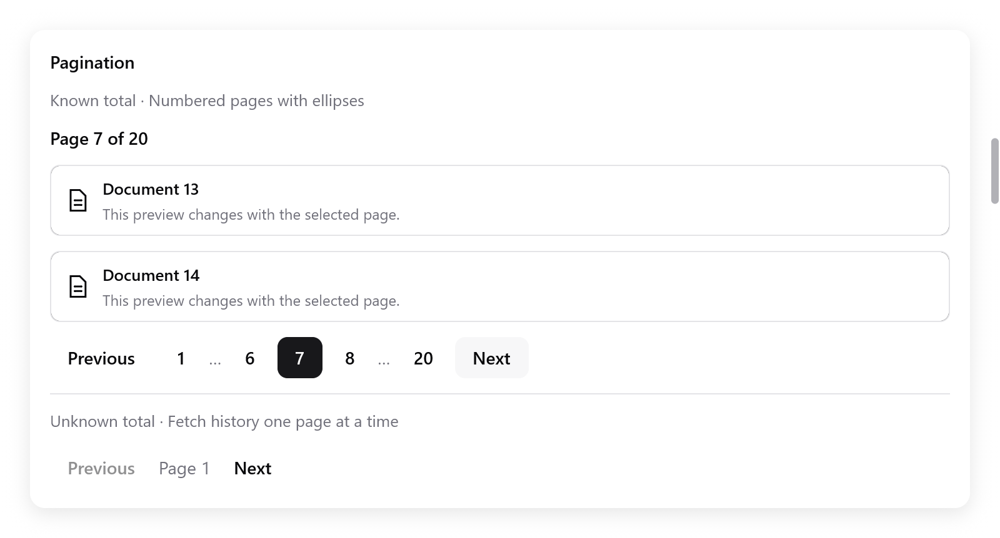

# Pagination

`ui.pagination` picks a page, apart from any table, list or grid. The app
owns the page number, and loads or slices its data when it changes.
Virtualization limits the rows rendered; pagination limits the data
loaded.

<!-- demo: pagination height=455 -->



```zig
// In app state: page: usize = 1,
if (ui.pagination(c, &s.page, .{ .page_count = 20 })) {
    s.loadPage(s.page);
}
```

- `page` is **one-based**.
- A known total of zero pages sets it to zero and disables both buttons.
  Otherwise it is clamped into the valid range.
- It returns true whenever the value changes, including when it is
  clamped after the total shrinks.
- Load asynchronously: never block the main thread in a view.

## Known and unknown totals

Numbered mode shows the first, last and current page, the current page's
neighbors, and ellipses for skipped ranges. Small ranges show every page.
Its work does not grow with the number of pages.

For an API without a total, leave `page_count` null and set `has_next`
from the response:

```zig
_ = ui.pagination(c, &s.history_page, .{
    .has_next = s.next_cursor != null,
    .disabled = s.loading,
    .label = "History pages",
});
```

- This mode shows Previous, the current page's label and Next.
- The app keeps the cursors or cached pages it needs to go back. The
  widget only navigates.
- `has_next` is ignored when `page_count` is known.

| `PaginationOptions` | Default | Meaning |
|---|---|---|
| `page_count` | `null` | Known total, or null for unknown total |
| `has_next` | `false` | Another unknown-total page is available |
| `siblings` | `1` | Numbered neighbors on each side, from 0 to 3 |
| `disabled` | `false` | Disable all navigation, for example during loading |
| `label` | `"Pagination"` | Accessible name of the group |
| `previous_label` | `"Previous"` | Previous button text |
| `next_label` | `"Next"` | Next button text |
| `page_label` | `"Page"` | Prefix for accessible page names and the unknown-total label |

## Keyboard and accessibility

- Tab enters the group at the current page the first time, and leaves it
  in one step. Coming back returns to the last focused control.
- Left/Right move focus between enabled controls; Home/End go to the first
  or last. They load no page until one is activated.
- Enter/Space activate the focused control. Disabled controls and
  ellipses are skipped.
- Right-to-left layout reverses the horizontal arrows.
- Number buttons expose names such as “Page 6”, and the selected state.
  Override the labels to localize the widget.
- If a change of total or `siblings` removes the focused button, focus
  moves to the current page. In unknown-total mode it moves to the first
  enabled control.
- An empty or disabled pager clears its own focus.

It does not wrap its controls. In a narrow layout, use fewer `siblings`,
or put the pager in a row that scrolls horizontally.

See [Gallery](../../examples/gallery/composites.zig), [items](items.md)
and [lists, trees and tables](lists.md).
