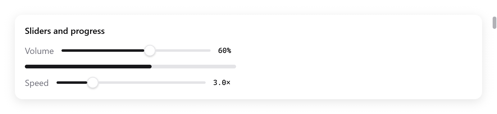
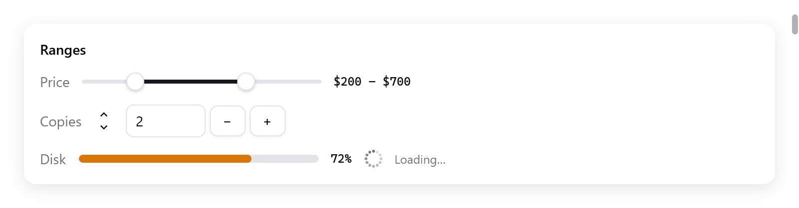

# Ranges

Controls of a number:

- sliders and range sliders set one;
- steppers and number inputs step it;
- meters, progress bars and spinners show one, or show that work goes on.

<!-- demo: sliders height=130 -->



*Two sliders with numeric values and a progress bar.*

## Sliders

```zig
ui.row(c, .{ .gap = 12, .align_items = .center });
defer ui.end(c);
ui.text(c, "Volume", .{ .color = c.theme.muted });
_ = ui.slider(c, &s.volume, .{ .width = .{ .px = 240 }, .label = "Volume" });
ui.textf(c, .{ .mono = true, .size = 12 }, "{d:.0}%", .{s.volume * 100});
```

`ui.slider(c, &value, options)` sets an `f32` between bounds. Drag its
knob or press its track. It returns true while it changes the value.

| `ui.SliderOptions` | Default | |
|---|---|---|
| `min`, `max` | 0, 1 | the bounds |
| `width` | 200 points | a `ui.Length` |
| `label` | `""` | names it for assistive technology |
| `held` | `null` | a `*bool` set each frame to whether a drag holds it |

- The knob takes the keyboard focus. Left and Right then move it by a
  twentieth of its range.
- Assistive technology reads it as a slider with its value and bounds, and
  can step it.

## Range sliders

<!-- demo: ranges height=233 -->



*A price range, stepper, number input, meter and loading spinner.*

```zig
_ = ui.rangeSlider(c, &s.low, &s.high, .{ .min = 0, .max = 1000, .step = 10, .width = 240 });
ui.text(c, c.print("${d:.0} – ${d:.0}", .{ s.low, s.high }), .{ .mono = true, .size = 12 });
```

`ui.rangeSlider(c, &low, &high, options)` sets two `f64`s with two knobs,
as for a price range. It returns true when a value changes.

- Each knob takes the keyboard focus. The arrows, Home and End move it.
- A press on the track moves the knob nearest to it.
- The knobs never cross.

| `ui.RangeSliderOptions` | Default | |
|---|---|---|
| `min`, `max` | 0, 1 | the bounds |
| `width` | 200 points | an `f32` |
| `step` | 0 | above 0, values snap to `min` plus multiples of it, and the track shows tick marks |

## Steppers

```zig
_ = ui.stepper(c, &s.copies, .{ .min = 1, .max = 20 });
```

`ui.stepper(c, &value, options)` is a pair of arrows that change an `f64`
by a step, as AppKit's stepper beside a field. It returns true when the
value changes.

- A click steps once.
- Holding an arrow keeps stepping, faster after a while.
- With the keyboard focus, Up, Down, Home and End step.

`ui.StepperOptions`: `min` (0), `max` (100) and `step` (1).

## Number inputs

```zig
const State = struct {
    copies: f64 = 2,
    copies_text: ui.TextBuffer = .{},
};

_ = ui.stepper(c, &s.copies, .{ .min = 1, .max = 20 });
_ = ui.numberInput(c, &s.copies, &s.copies_text, .{ .min = 1, .max = 20 });
```

`ui.numberInput(c, &value, &text, options)` is a text field that edits an
`f64` between bounds, with − and + buttons beside it. `text` is the
field's `ui.TextBuffer`, kept in your state beside the value. It returns
true when the value changes.

- Up and Down, and the buttons, change it by the step.
- What is typed applies as soon as it is a number in range.
- When the field loses the focus, the value shows rounded to the step's
  decimals.
- A stepper and a number input over the same value stay in step, as above.

| `ui.NumberInputOptions` | Default | |
|---|---|---|
| `min`, `max` | 0, 100 | the bounds |
| `step` | 1 | |
| `width` | 80 points | a `ui.Length` |

## Meters

```zig
ui.meter(c, s.disk_used, .{ .warning = 0.7, .critical = 0.9, .width = .{ .px = 240 } });
// A battery: low values are the bad ones, since critical is below warning.
ui.meter(c, s.battery, .{ .warning = 0.2, .critical = 0.1 });
```

`ui.meter(c, value, options)` shows a value between bounds, as AppKit's
level indicator and the web's `<meter>`. It is in the success color, or in
the warning (orange) and danger colors from the levels given.

| `ui.MeterOptions` | Default | |
|---|---|---|
| `min`, `max` | 0, 1 | the bounds |
| `warning`, `critical` | `null` | the levels; none by default |
| `width` | 160 points | |

A `critical` below `warning` makes low values the bad ones.

## Progress bars

```zig
ui.progress(c, s.downloaded, .{ .px = 340 });
ui.progress(c, s.done, .fill);
```

`ui.progress(c, value, width)` is a bar filled to `value`, from 0 to 1. It
eases toward the value as it changes.

- Assistive technology reads it as a progress indicator with its value.
- For a window's progress on its taskbar button, see
  [`Window.setProgress`](../windows.md). That works on Windows, and on
  Linux launchers that show it.

## Spinners

```zig
ui.row(c, .{ .gap = 8, .align_items = .center });
defer ui.end(c);
ui.spinner(c, .{});
ui.text(c, "Loading…", .{ .size = 12, .color = c.theme.muted });
```

`ui.spinner(c, options)` shows work of unknown length, as AppKit's spinning
indicator. Dots go round a circle and fade behind the leading one.

- It steps a twelfth of a turn every twelfth of 0.9 seconds, on the
  context's clock.
- It asks for a frame only at each step (`c.frameIn`), not at every
  refresh. A window showing one stays nearly idle.
- In tests, advance the Tester's clock to step it.

`ui.SpinnerOptions`: `size` (18 points) and `color` (the muted text color by
default).
