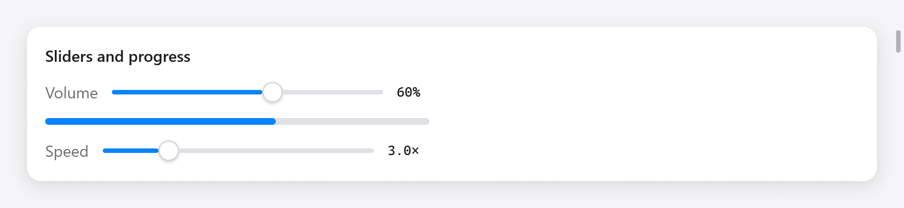
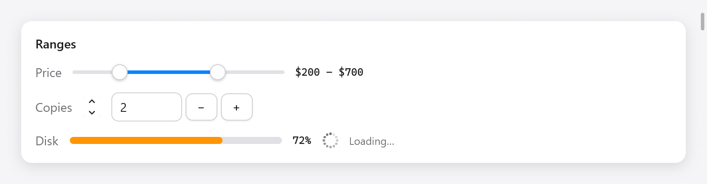

# Ranges

Controls of a number: sliders and range sliders that set one, steppers and
number inputs that step it, and meters, progress bars and spinners that
show one (or show that work goes on).



*Two sliders with numeric values and a progress bar.*

## Sliders

`ui.slider(c, &value, options)` sets an `f32` between bounds by dragging its
knob or pressing its track. It returns true while it changes the value:

```zig
ui.row(c, .{ .gap = 12, .align_items = .center });
defer ui.end(c);
ui.text(c, "Volume", .{ .color = c.theme.muted });
_ = ui.slider(c, &s.volume, .{ .width = .{ .px = 240 }, .label = "Volume" });
ui.textf(c, .{ .mono = true, .size = 12 }, "{d:.0}%", .{s.volume * 100});
```

`ui.SliderOptions`:

| field | default | what it does |
|---|---|---|
| `min`, `max` | 0, 1 | the bounds |
| `width` | 200 points | a `ui.Length` |
| `label` | `""` | names it for assistive technology |

The knob takes the keyboard focus; while focused, Left and Right move it by
a twentieth of its range. Assistive technology reads it as a slider with
its value and bounds, and can step it.

## Range sliders



*A price range, stepper, number input, meter and loading spinner.*

`ui.rangeSlider(c, &low, &high, options)` sets two `f64`s with two knobs, as
a price range. Each knob takes the keyboard focus, and the arrows, Home
and End move it; a press on the track moves the knob nearest to it. The
knobs never cross. It returns true when a value changes:

```zig
_ = ui.rangeSlider(c, &s.low, &s.high, .{ .min = 0, .max = 1000, .step = 10, .width = 240 });
ui.text(c, c.print("${d:.0} – ${d:.0}", .{ s.low, s.high }), .{ .mono = true, .size = 12 });
```

`ui.RangeSliderOptions`: `min` and `max` (0 and 1), `width` (200 points,
an `f32`), and `step`: above 0, values snap to `min` plus multiples of it,
and the track shows tick marks.

## Steppers

`ui.stepper(c, &value, options)` is a pair of arrows changing an `f64` by a
step, as AppKit's stepper beside a field. A click steps, holding an arrow
keeps stepping (faster after a while), and Up, Down, Home and End step with
the keyboard focus. It returns true when the value changes:

```zig
_ = ui.stepper(c, &s.copies, .{ .min = 1, .max = 20 });
```

`ui.StepperOptions`: `min` (0), `max` (100) and `step` (1).

## Number inputs

`ui.numberInput(c, &value, &text, options)` is a text field editing an
`f64` between bounds, with − and + buttons beside it. Up and Down, and the
buttons, change it by the step. What is typed applies as soon as it is a
number in range, and shows rounded to the step's decimals once the field
loses the focus. `text` is the field's `ui.TextBuffer`, kept in your state
beside the value:

```zig
const State = struct {
    copies: f64 = 2,
    copies_text: ui.TextBuffer = .{},
};

_ = ui.stepper(c, &s.copies, .{ .min = 1, .max = 20 });
_ = ui.numberInput(c, &s.copies, &s.copies_text, .{ .min = 1, .max = 20 });
```

A stepper and a number input over the same value stay in step, as above.
`ui.NumberInputOptions`: `min` (0), `max` (100), `step` (1) and `width`
(80 points, a `ui.Length`). It returns true when the value changes.

## Meters

`ui.meter(c, value, options)` shows a value between bounds, as AppKit's
level indicator and the web's `<meter>`: in the success color, or the
warning (orange) and danger colors from the levels given:

```zig
ui.meter(c, s.disk_used, .{ .warning = 0.7, .critical = 0.9, .width = .{ .px = 240 } });
// A battery: low values are the bad ones, since critical is below warning.
ui.meter(c, s.battery, .{ .warning = 0.2, .critical = 0.1 });
```

`ui.MeterOptions`: `min` and `max` (0 and 1), `warning` and `critical`
(null: none), and `width` (160 points). A `critical` below `warning` makes
low values the bad ones.

## Progress bars

`ui.progress(c, value, width)` is a bar filled to `value`, from 0 to 1,
easing toward it as it changes:

```zig
ui.progress(c, s.downloaded, .{ .px = 340 });
ui.progress(c, s.done, .fill);
```

Assistive technology reads it as a progress indicator with its value. For a
window's progress on its taskbar button (Windows, and Linux launchers that
show it), see [`Window.setProgress`](../windows.md).

## Spinners

`ui.spinner(c, options)` shows work of unknown length, as AppKit's spinning
indicator: dots round a circle, fading behind the one leading, stepping a
twelfth of a turn every twelfth of 0.9 seconds on the context's clock:

```zig
ui.row(c, .{ .gap = 8, .align_items = .center });
defer ui.end(c);
ui.spinner(c, .{});
ui.text(c, "Loading…", .{ .size = 12, .color = c.theme.muted });
```

`ui.SpinnerOptions`: `size` (18 points) and `color` (the muted text color by
default). A spinner asks for a frame only at each step (`c.frameIn`), not at
every refresh, so a window showing one stays nearly idle. In tests, advance
the Tester's clock to step it.
