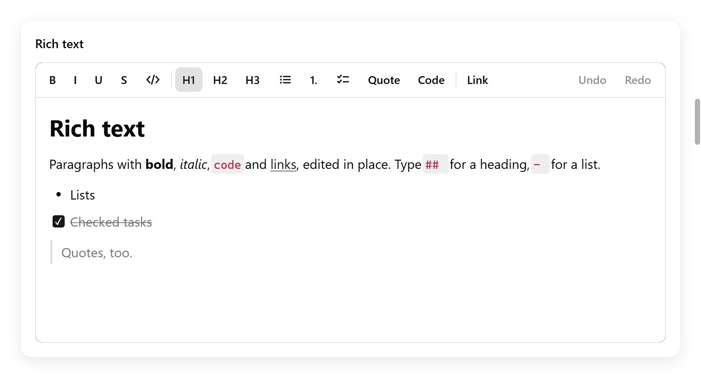

# Rich text editor

`ui.richTextEditor` edits text with formats, as Notes and Google Docs do.
`ui.richTextToolbar` is a toolbar of its formats.

- Paragraph styles: headings, quotations, code, and bulleted, numbered and
  task lists nested by levels.
- Marks on text: bold, italics, underline, strikethrough, code, links,
  colors and highlights.
- Undo, input methods and Markdown shortcuts as you type.
- The clipboard: its own rich copy, plain text and Markdown.
- It builds only the blocks in view.

<!-- demo: rich-text height=456 -->



*The rich text editor and toolbar, with headings, inline formatting, tasks and a quote.*

```zig
const Note = struct {
    rt: ui.RichText,

    fn view(n: *Note, c: *ui.Context) void {
        ui.column(c, .{ .width = .fill, .height = .fill });
        defer ui.end(c);
        _ = ui.richTextToolbar(c, &n.rt, .{});
        if (ui.richTextEditor(c, &n.rt, .{ .placeholder = "Write" }).changed) n.save();
    }
};

var note: Note = .{ .rt = .initMarkdown(gpa, "# Groceries\n\n- [ ] Milk") };
defer note.rt.deinit();
```

`zig build run-notes` is a notes app built on it (`examples/notes`). It has
notes in a sidebar, links asked for in a bar, and the clipboard as plain
text or Markdown.

## The state

A `ui.RichText` holds:

- the document (`doc`) and the selection (`sel`);
- the history;
- the composition of an input method;
- what the view keeps between frames.

Make it with `ui.RichText.init(gpa)` (empty) or `initMarkdown(gpa, md)`.
Free it with `deinit()`.

| method | does |
|---|---|
| `setMarkdown(md)` | replaces the document with Markdown read |
| `markdown(gpa)` | the document written as Markdown |
| `text(gpa)` | its plain text, blocks on lines of their own |
| `selectedText(gpa)` | the selection's plain text |
| `takeChanged()` | whether it was edited since the last call |
| `select(anchor, caret)`, `collapse(pos)`, `selectAll()` | the selection |
| `insert(s)` | types `s` at the caret, with the marks typing has there |
| `deleteBackward()`, `deleteForward()`, `deleteSelection()` | |
| `newline()` | Enter: splits the block (or leaves an empty list item) |
| `undo()`, `redo()`, `canUndo()`, `canRedo()` | |
| `toggle(t)` | toggles a `ui.richtext.Toggle` (`.bold`, `.italic`, `.underline`, `.strike`, `.code`) on the selection |
| `setMark(m)` | sets a `ui.richtext.Mark` (`.{ .color = c }`, `.{ .highlight = null }`, ...) on the selection |
| `setLink(url)` | links the selection (or the link at the caret); `""` removes it |
| `setKind(kind)` | the style of the selected blocks |
| `indent(delta)` | a list's level, or a paragraph's indentation, by `delta` |
| `toggleChecked(block)` | checks or unchecks a task |
| `formatting()` | the selection's `ui.richtext.Formatting`, for a toolbar |
| `pasteMarkdown(md)` | pastes Markdown at the caret |

- `version` is bumped by every edit, undo and redo.
- Positions are `ui.richtext.Pos`: a `block` index and a byte offset `off`
  in it.
- A selection (`ui.richtext.Sel`) has an `anchor` and a `caret`.

## The document

`ui.richtext.Doc` is a list of blocks. A block (`ui.richtext.Block`) has a
style, and text in runs of marks.

| type | holds |
|---|---|
| `ui.richtext.BlockStyle` | `kind`; `indent`, a list item's level or a paragraph's indentation, up to 6; `checked`, a task's |
| `ui.richtext.Kind` | `.paragraph`, `.heading1`, `.heading2`, `.heading3`, `.quote`, `.code`, `.bullet`, `.numbered`, `.task` |
| `ui.richtext.Marks` | `bold`, `italic`, `underline`, `strike`, `code`; `link`, the index of its URL in the document plus one (0 none); `color` and `highlight`, optional colors |

- Read and build it with `doc.count()`, `doc.block(i)` (its `str()` and
  `marksAt(i)`), `doc.append(style, text, marks)`, `doc.url(link)` and
  `doc.text(gpa)`.
- Convert it with `ui.richtext.parseMarkdown(gpa, md)` and
  `ui.richtext.writeMarkdown(gpa, doc)`.
- Text typed right after a link or code doesn't extend them, as in
  NSTextView.
- A format toggled with nothing selected applies to what is typed next,
  until the caret moves.

## Options

| `ui.RichTextOptions` | Default | |
|---|---|---|
| `width`, `height` | `.fill` | |
| `size` | 15 | the body's size; headings and code scale from it |
| `placeholder` | `""` | shown while empty |
| `read_only` | false | selectable, copyable and its links clickable, not editable |
| `bare` | false | no box of its own (border, fill, focus ring) |
| `padding` | 16 × 12 | around the text |
| `markdown_shortcuts` | true | typing `# `, `- `, `**bold**` formats |
| `clipboard` | `.plain` | what copy writes besides the rich copy, and what text from elsewhere pastes as: `.plain` or `.markdown` |

It returns a `ui.RichTextResult`:

- `changed` and `focused`;
- `first_block` and `last_block`, the blocks built;
- `link_clicked`: the URL of a link clicked, with Command or Control while
  editable;
- `link_requested`: Command-K or Control-K asked for a link. Show a field,
  then call `setLink`.

`ui.richTextEditorBase(c, rt, box, options)` is the editor in a box you
style yourself (a `ui.Style`).

## Links

The editor doesn't ask for URLs itself: it tells the app. Here is a bar
under the toolbar, as in the notes example:

```zig
const tb = ui.richTextToolbar(c, &n.rt, .{});
const r = ui.richTextEditor(c, &n.rt, .{ .bare = true });
if (tb.link_requested or r.link_requested) {
    s.asking_link = true;
    s.link.set(n.rt.formatting().link orelse "https://");
}
if (s.asking_link) {
    const f = ui.textField(c, &s.link, .{ .width = .fill, .placeholder = "https://" });
    if (ui.button(c, "Set", .{ .variant = .primary }).clicked or f.submitted) {
        n.rt.setLink(s.link.text());
        s.asking_link = false;
        c.focus = n.rt.id; // back to the editor
    }
}
if (r.link_clicked) |url| _ = myzig.shell.openUrl(url);
```

## The toolbar

`ui.richTextToolbar(c, rt, options)` has buttons for:

- bold, italics, underline, strikethrough and code;
- headings, lists, quotations and code blocks;
- a link;
- undo and redo, with `history`.

Its buttons show the selection's formats, from `formatting()`. A click
formats the editor and gives it back the keyboard.

- `ui.RichTextToolbarOptions`: `border` and `history`, both true.
- It returns `changed` (a format was applied) and `link_requested`.

## Keys

Command on macOS, Control elsewhere, as word processors bind them:

| keys | does |
|---|---|
| Mod+B, Mod+I, Mod+U | bold, italics, underline |
| Mod+Shift+X | strikethrough |
| Mod+E (macOS), Ctrl+Shift+E | code |
| Mod+K | asks for a link |
| Mod+Option+1, 2, 3, 0 | heading 1 to 3, paragraph |
| Mod+Shift+7, 8, L, 9 | numbered list, bulleted list, tasks, quotation |
| Mod+Option+C | code block |
| Mod+], Mod+[, Tab, Shift+Tab | indent and outdent (Tab in lists) |

Moving, deleting, selecting, the clipboard and undo work as in a
[text area](text-area.md#editing). A click on a task's box checks it.

## Markdown shortcuts

What is typed formats itself.

| typed | makes |
|---|---|
| `# ` to `### ` | headings |
| `- `, `* `, `+ ` | a bulleted list |
| `1. ` | a numbered list |
| `[ ] `, `[x] ` | tasks |
| `> ` | a quotation |
| ```` ``` ```` then Enter | a code block |
| `**bold**`, `*italic*`, `_italic_`, `` `code` ``, `~~struck~~` | the format, as the closing mark is typed |

- The block shortcuts work at a paragraph's start.
- An underscore inside a word, as in `snake_case`, stays an underscore.
- Each shortcut is a step of undo of its own. Undo takes it back to what
  was typed.

## The clipboard

- Copying puts plain text on the system clipboard, or Markdown with
  `clipboard = .markdown`.
- It also keeps the selection itself, with its styles and marks.
- Pasting that text again within the app pastes the copy whole, so text
  moves with its formats.
- Text from elsewhere pastes plain, or read as Markdown.

## Testing

```zig
var n: Note = .{ .rt = .init(gpa) };
defer n.rt.deinit();
var t: ui.Tester = undefined;
try t.init(gpa, .init(&n, Note.view), .{});
defer t.deinit();
try t.clickText("Write");
t.typeText("# Title");
try std.testing.expectEqual(ui.richtext.Kind.heading1, n.rt.doc.block(0).style.kind);
```

See `src/ui/tests_richtext*.zig` and [Testing](testing.md).
