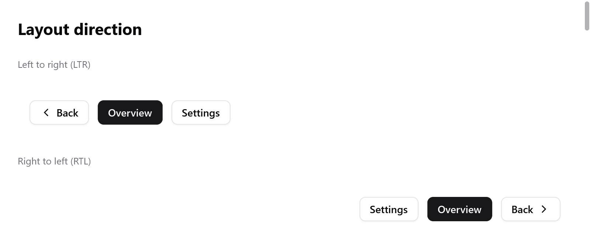

# Right to left

Arabic, Hebrew, Persian and Urdu read from right to left, and so do the
interfaces of apps in those languages. A row starts at the right, a
sidebar is on the right, a back arrow points right.

Native UI lays a window out this way once it is told to, as Flutter's
`TextDirection`, SwiftUI's `LayoutDirection` and CSS's `direction` do
(`src/ui/direction.zig`, after mygo's).

As in Godot, the coordinates are not mirrored: x still grows to the right
in rectangles, in canvases and in the pointer's position. Only the layout
is.

<!-- demo: right-to-left height=344 -->



*The same controls laid out from left to right and from right to left.*

## The direction

```zig
fn view(s: *App, c: *ui.Context) void {
    ui.direction.fromLocale(c, myzig.i18n.locale());
    // ...
}
```

`ui.Direction` is `.ltr` or `.rtl`. A window is left to right until the
view sets a direction:

- `ui.direction.set` sets it.
- `ui.direction.fromLocale` sets it from the app's language. It gives
  right to left for Arabic, Hebrew, Persian and Urdu (it reads
  `i18n.direction` of the tag).

The window keeps the direction. Setting it again each frame costs a
lookup. Changing it builds the frame again, so that widgets built before
the change read the new one.

### A direction of its own

```zig
const player = c.open(.{ .direction = .row, .gap = 8 }, "player");
ui.direction.scope(c, player, .ltr);
_ = ui.button(c, "", .{ .icon = "backward.fill" });
_ = ui.button(c, "", .{ .icon = "play.fill" });
_ = ui.button(c, "", .{ .icon = "forward.fill" });
c.end();
```

Every box takes the direction of the box it is built in. To give it one
of its own, call `ui.direction.scope` right after opening it, before its
children. A phone number, a code sample or a media player's controls stay
left to right in a right-to-left window.

### Reading the direction

```zig
const forward = if (ui.direction.current(c) == .rtl) "chevron.left" else "chevron.right";
ui.icon(c, forward, .{});
```

Widgets of your own that draw what points along a line read the direction
of what is built now:

| Function | |
|---|---|
| `ui.direction.current(c)` | `.ltr` or `.rtl` |
| `ui.direction.isRtl(c)` | the same, as a `bool` |
| `ui.direction.arrows(c)` | the keys that go back and forth along a line: `.back` and `.forth` are Left and Right, swapped right to left |
| `ui.direction.alongLine(c, t)` | turns a fraction from a line's start into one from its left, as a slider's value under the pointer |

## What mirrors

Layout first places the tree left to right. Then `ui.direction.mirror`
(which `layout.arrange` runs) moves each box of a right-to-left box to
the other side of it, with everything inside:

- A row lays its children out from the right; `align_items` and `justify`
  start at the right.
- Padding given on the left goes to the right, and an absolute box offset
  from the left is offset from the right.
- [Grids](grid.md) place their columns from the right.
- [Focus groups](navigation.md) move to their next item with Left.
- A [router](navigation.md)'s pages pushed slide in from the left.

Overlays keep the place their widget gave them, in window coordinates.
Their insides are laid out in the window's direction.

## What does not

- Text, icons, pictures and what a [canvas](drawing.md) paints are not
  mirrored: a check mark, a magnifying glass and a chart read as they do
  left to right. Draw what must point the other way after reading
  `ui.direction.current`.
- Sliders, progress bars and switches draw along a line by themselves.
  Their fills and knobs follow the mirrored layout of their boxes. They
  do not yet read the direction for their fill side and arrow keys, as
  mygo's do. Code that needs it reads `alongLine` and `arrows`.
- The [inspector](inspector.md) reads left to right.

## Trying it

The [inspector](inspector.md)'s **RTL** button lays its window out right
to left, or back. It tries an interface before it is translated.

A [Tester](testing.md) lays its window out right to left after
`ui.direction.set(&t.ctx, .rtl)`, as a test of the layout would:

```zig
var t: ui.Tester = undefined;
try t.init(gpa, .init(&page, Page.view), .{ .width = 400, .height = 300 });
defer t.deinit();
ui.direction.set(&t.ctx, .rtl);
t.frame();
const back = t.findText("Back").?;
try std.testing.expect(back.x > 200); // the row starts at the right
```

`src/ui/tests_direction.zig` tests:

- rows, alignment, padding and offsets;
- a box kept left to right inside;
- overlays;
- the direction from a locale;
- the arrows widgets read.

The direction of an app's language comes from [i18n](../i18n.md):
`i18n.direction(tag)`. The pseudo locale `ar-XB` (`i18n.pseudo_bidi`)
also reads right to left.
