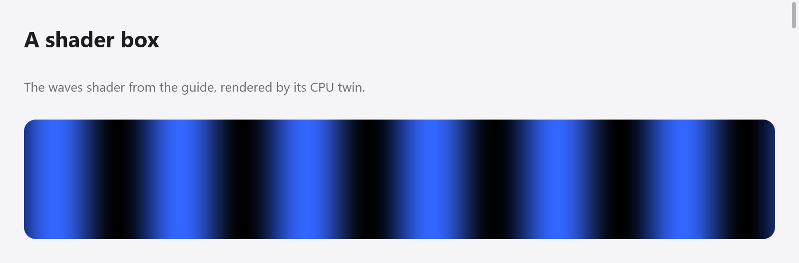

# Shaders

A view can fill a box with a shader of its own: a function from a point of
the box to a color, run for every pixel. You write it once, in ZSL, a small
language in Zig's syntax, and `ui.shader.compile` compiles it at compile
time into HLSL (Direct3D 11), GLSL (OpenGL 3.3, OpenGL ES 3.0 and WebGL 2),
Metal, and a CPU twin of Zig code that draws the same pixels, within
rounding, where no GPU draws: the CPU renderer and `ui.Tester`. So a shader
works on every platform and in tests, and a mistake in it is a compile
error of the app.



*The waves shader from this guide, rendered by myzig's CPU twin.*

```zig
const waves = ui.shader.compile("waves",
    \\uniform time: f32;
    \\pub fn fragment(pos: vec2) vec4 {
    \\    const v = 0.5 + 0.5 * sin(pos.x / 20 + time);
    \\    return vec4(v * 0.2, v * 0.4, v, 1);
    \\}
);

fn view(_: *State, c: *ui.Context) void {
    _ = ui.shaderBox(c, &waves, .{}, .{ .width = .fill, .height = .{ .px = 120 }, .radius = 12 });
    c.end();
}
```

Longer shaders live in files of their own, `.zsl`, embedded:

```zig
pub const shader = ui.shader.compile("wind", @embedFile("wind.zsl"));
```

The examples are made of shaders: `blackhole` (light traced through
gravity, a drag orbits the camera), `wind` (a texture of characters
stirred by the wind), `chat-glow` (an orb, a ring, an edge glow and a
shimmer, sharing a palette), `effort-slider`, `mayoi`, and the gallery.
Run them with `zig build run-blackhole` and so on.

## Shader boxes

`ui.shaderBox(c, &shader, values, style)` opens a box styled by `style`,
filled by the shader; its children follow until `c.end()`. The shader
replaces the box's background, and is clipped to its rounded corners.
`values` is a struct whose fields set the shader's uniforms (below).
`ui.shaderBoxWith(c, &shader, values, style, options)` takes
`ui.ShaderBoxOptions`, whose `blur` blurs what is under the box before the
shader reads it with `backdrop(p)`.

`ui.shaderEffect(c, &shader, values, last_rect, options)` makes the shader
an effect for any box's `Style.effect`, allocated for this frame: a box
drawn from what is under it, as frosted glass is ([Transforms and
effects](transforms.md#backdrop-effects)). `last_rect` is the box's rect in
the last layout, for the `pointer` uniform.

```zig
const id = c.peekId("lens");
const fx = ui.shaderEffect(c, &lens, .{ .strength = 0.4 }, c.rects.get(id), .{ .blur = 2 });
_ = c.open(.{ .width = .{ .px = 200 }, .height = .{ .px = 120 }, .radius = 16, .effect = fx }, "lens");
c.end();
```

## The fragment function

```zig
pub fn fragment(pos: vec2) vec4 { ... }
```

`pos` is the point in the box, in points from its top left corner. The
function returns the pixel's color, premultiplied (`vec4(r * a, g * a, b *
a, a)`), drawn over what is under the box: alpha 0 leaves it as it is.

## Uniforms

`uniform name: type;` at the top declares a value the view gives each
frame:

```zig
const root = ui.shaderBox(c, &shader, .{
    .seed = w.seed,                               // u32
    .time = t,                                    // f32
    .heading = [2]f32{ @cos(w.heading), @sin(w.heading) }, // vec2
    .tap = s.tap,                                 // vec3, as [3]f32
}, .{ .width = .fill, .height = .fill });
defer c.end();
```

Fields are numbers for `f32`, `i32` and `u32`, `bool`s, and arrays or
vectors of floats for vectors; a `ui.Color` sets a `vec3` or `vec4`, a
`ui.Point` a `vec2`. A field naming no uniform is a compile error; a
uniform left out is zero, with two exceptions:

- `time`, an `f32` left out, is the context's clock (`c.time`), and the
  box then draws every frame. Give `time` yourself to freeze it (as tests
  do) or to start it at zero.
- `pointer`, a `vec2` left out, is where the pointer is, in the box's
  points. Set `c.wants_moves = true` for frames as the pointer moves.

Uniforms share the effect's sixteen floats: fifteen are theirs (a `vec3`
takes three), and the last holds the pixels in a point.
`ui.shader.params(&shader, values, scale)` packs values into an effect's
parameters, for an `ui.Effect` built by hand.

## The language

ZSL is Zig's syntax for what a shader needs:

- At the top: `uniform name: type;`, `const name = value;`, and functions
  (`fn name(a: f32, b: vec2) f32 { ... }`, at most eight parameters), with
  `pub fn fragment` among them. Functions may call each other in any
  order, but not themselves: shaders don't recurse.
- Types: `bool`, `i32`, `u32`, `f32`, `vec2`, `vec3`, `vec4`.
- Statements: `const` and `var` locals, assignments (`=`, `+=` and the
  others, components as `v.xy = ...`), `if` / `else`, `while (c) : (i +=
  1)`, `for (0..n) |i|`, `break`, `continue`, `return`.
- Numbers without a type take the one their use needs, as Zig's.
  Conversions are `f32(x)`, `i32(x)`, `u32(x)`.
- Vectors are made as `vec3(v.xy, 1)` or `vec3(0)`; a float scalar mixes
  with vectors (`v * 0.5`); `.xyzw` and `.rgba` swizzle.
- Integers wrap; `<<`, `>>`, `&`, `|`, `^`, `~` and `%` are theirs, and
  `mod()` the floats'. Hashes of `u32`s (PCG and the like) work the same
  on every backend.
- Comments are `//`.

Builtins: GLSL's `sin`, `cos`, `tan`, `asin`, `acos`, `atan`, `atan2`,
`sinh`, `cosh`, `tanh`, `exp`, `exp2`, `log`, `log2`, `pow`, `sqrt`,
`inversesqrt`, `abs`, `sign`, `floor`, `ceil`, `fract`, `round`, `trunc`,
`mod`, `min`, `max`, `clamp`, `mix`, `step`, `smoothstep`, `length`,
`distance`, `dot`, `cross`, `normalize`, `reflect`; and myzig's:

| builtin | is |
|---|---|
| `size()` | the box's size, in points |
| `pixel_scale()` | the pixels in a point |
| `pixel()` | the pixel's center, in the window's pixels |
| `backdrop(p)` | what is drawn under the box at its point `p`, blurred by the box's `blur`, premultiplied |

A short example of most of it, from the wind example's start:

```zig
uniform seed: u32;
uniform time: f32;
uniform pointer: vec2;

const cell_w = 9.0;
const tau = 6.2831853;

fn pcg(v: u32) u32 {
    const s = v * 747796405 + 2891336453;
    const w = ((s >> ((s >> 28) + 4)) ^ s) * 277803737;
    return (w >> 22) ^ w;
}

pub fn fragment(pos: vec2) vec4 {
    const cell = floor(pos / vec2(cell_w, 18));
    const h = f32(pcg(u32(cell.x) * 7919 + u32(cell.y) + seed) & 1023) / 1023;
    const glow = 1 - smoothstep(0, 120, distance(pos, pointer));
    const v = 0.5 + 0.5 * sin(h * tau + time);
    return vec4(vec3(v * 0.3 + glow * 0.5), 1);
}
```

Prefixes are a way to share code: `chat-glow` compiles each of its shaders
from `palette ++ @embedFile("orb.zsl")`, a file of functions they all use.

## Errors

Errors are compile errors of the app, with the shader's name, line and
column:

```
shader 'waves':3:24: mismatched types i32 and f32
```

Types are checked as Zig checks them (no implicit conversions between
`i32`, `u32` and `f32`, beyond untyped numbers), names must be declared,
a shader too long for its tables is an error (`shader 'x' is too long`),
and so is recursion. `ui.shader.checkSource(&program, src, msg)` compiles
at run time, for tests of the compiler.

## How it is drawn

A shader box is a backdrop effect ([Transforms and effects](transforms.md)):
paint marks it in paint order, and each renderer, at the mark, reads what
it has drawn so far around the box (blurred if asked), and draws the box
with the shader before drawing on. Direct3D, OpenGL, WebGL and Metal
compile the generated source once per shader, the first time they draw
it; the CPU renderer runs the twin, a function generated from the same
program at compile time. The generated sources are in `shader.effect`
(`hlsl`, `glsl`, `msl`) and the uniforms' layout in `shader.uniforms`.

A shader box whose `time` is left to the clock asks for every frame, so
it keeps the app drawing while it is shown; one without it is drawn with
the frames the rest of the view asks for, as any box is.

## Testing shaders

The CPU twin draws in the Tester, so a test renders the view and looks at
its pixels; freeze `time` by giving it:

```zig
var s: Pane = .{ .frozen = 4 }; // its view passes .time = s.frozen
var t: ui.Tester = undefined;
try t.init(gpa, .init(&s, Pane.view), .{ .width = 240, .height = 160, .scale = 1 });
defer t.deinit();
t.settle(1);
const px = try t.render(gpa);
defer px.deinit(gpa);
// px.bytes: BGRA, px.width × px.height
```

The examples' views are tested this way (`zig build test` runs the tests
in `examples/blackhole`, `wind`, `chat-glow`, `effort-slider` and
`mayoi`). `src/ui/shader/tests_gpu.zig` draws shaders that use every part
of the language with Direct3D 11 (on Windows) and OpenGL (through EGL, on
Linux) and checks that they match the CPU twin within a level or two;
`ui.gpu_testing` offers the same comparison to plugins' tests.
