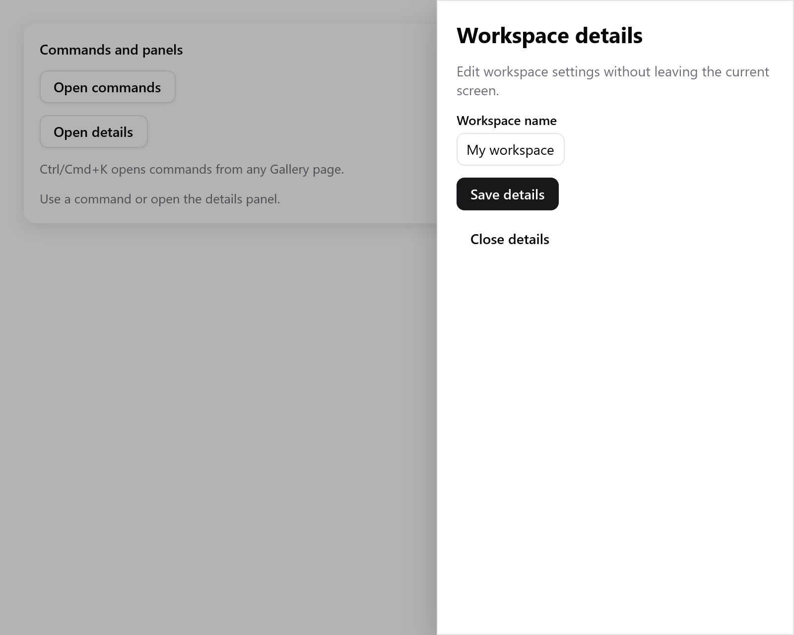

# Sheet

`ui.sheet` opens a modal panel against one edge of the window. Use it for
details, settings and filters beside the current screen.

<!-- demo: panels height=520 -->



```zig
// In app state: details: ui.OverlayState = .{},
if (ui.button(c, "Details", .{}).clicked) s.details.show();
if (ui.sheet(c, &s.details, .{ .label = "Project details" })) |panel| {
    defer panel.end();
    ui.heading(c, "Project details");
    _ = ui.textField(c, &s.name, .{ .width = .fill, .label = "Name" });
    if (ui.button(c, "Save", .{}).clicked) {
        s.save();
        s.details.close();
    }
}
```

Keep its `OverlayState` in app state. The panel holds ordinary widgets
and scrolls when its content is taller than the space.

| `SheetOptions` | Default | Meaning |
|---|---|---|
| `side` | `.right` | `.left`, `.right`, `.top` or `.bottom`, physical window edges |
| `size` | `360` | Width for left/right; height for top/bottom, in points |
| `label` | `"Sheet"` | Accessible modal-dialog name |
| `dismissible` | `true` | Backdrop presses close the panel |
| `escape` | `true` | Escape closes it after child controls have handled it |

**Behavior**

- It shares the [dialog](overlays.md) backdrop, Escape handling and focus
  restoration.
- The background gets no pointer input. Tab and Shift+Tab stay in the
  panel.
- The size is capped to the window, also after a resize.
- Content follows the app's text direction. `side` still names a
  physical edge.
- It opens with a short fade and movement. With reduced motion it
  appears at once.
- Closing removes it and gives the focus back where it was.

See the **Feedback** page in [Gallery](../../examples/gallery/feedback.zig).
