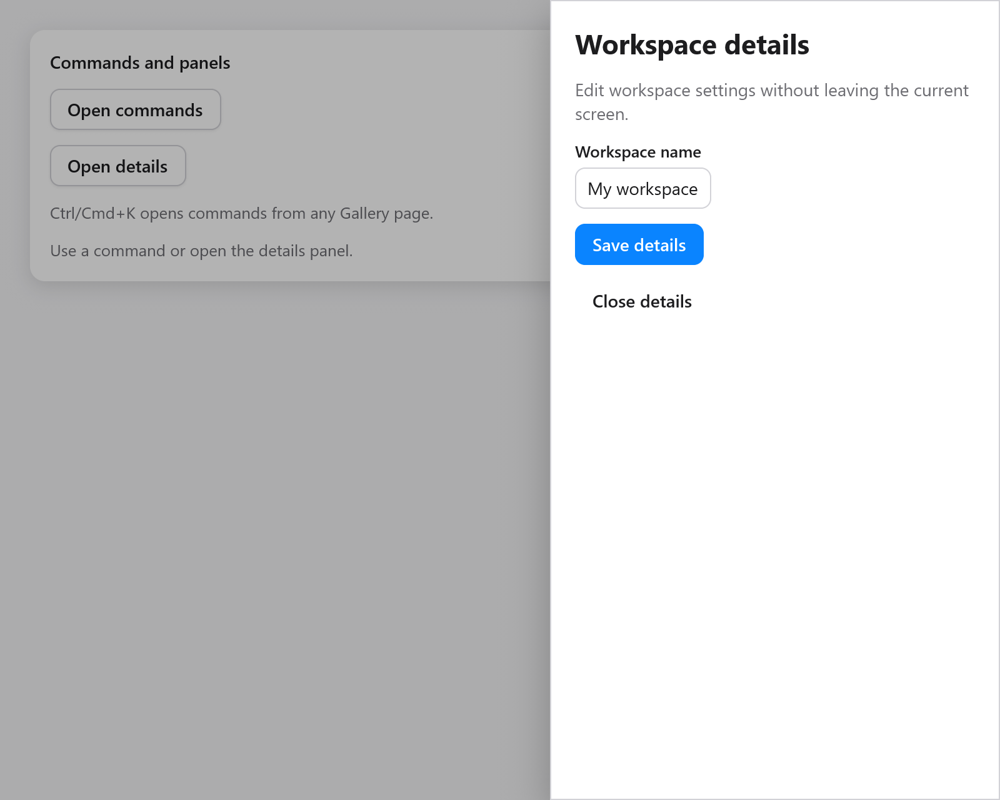

# Sheet

`ui.sheet` opens a modal panel against one edge of the window. Use it for
details, settings and filters beside the current screen.



```zig
// In app state: details: ui.OverlayState = .{},
if (ui.button(c, "Details", .{}).clicked) s.details.show();
if (ui.sheet(c, &s.details, .{ .label = "Project details" })) |panel| {
    defer panel.end();
    ui.heading(c, "Project details");
    _ = ui.textField(c, &s.name, .{ .width = .fill, .label = "Name" });
    if (ui.button(c, "Save", .{}).clicked) {
        s.save();
        s.details.close();
    }
}
```

Keep its `OverlayState` in app state. The panel can contain ordinary
widgets and scrolls when its content exceeds the available space. It
shares the [dialog](overlays.md) backdrop, Escape handling and focus
restoration. The background cannot receive pointer input, and Tab and
Shift+Tab stay within the panel.

| `SheetOptions` | Default | Meaning |
|---|---|---|
| `side` | `.right` | `.left`, `.right`, `.top` or `.bottom`, physical window edges |
| `size` | `360` | Width for left/right; height for top/bottom, in points |
| `label` | `"Sheet"` | Accessible modal-dialog name |
| `dismissible` | `true` | Backdrop presses close the panel |
| `escape` | `true` | Escape closes it after child controls have handled it |

The size is capped to the window, including after a resize. Content follows
the app's text direction; `side` continues to name a physical edge. The
panel has a short fade and movement on opening; reduced motion shows it
at once. Closing removes it and restores the previous focus.

See the **Feedback** page in [Gallery](../../examples/gallery/feedback.zig).
