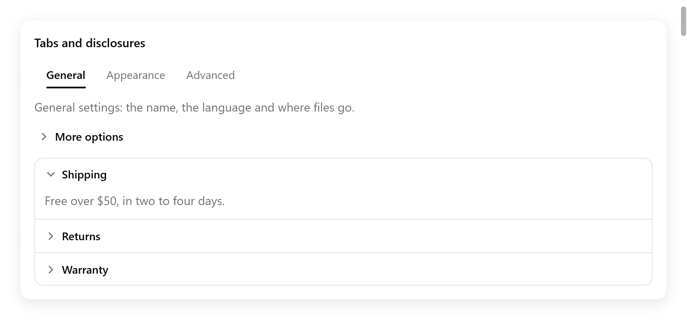
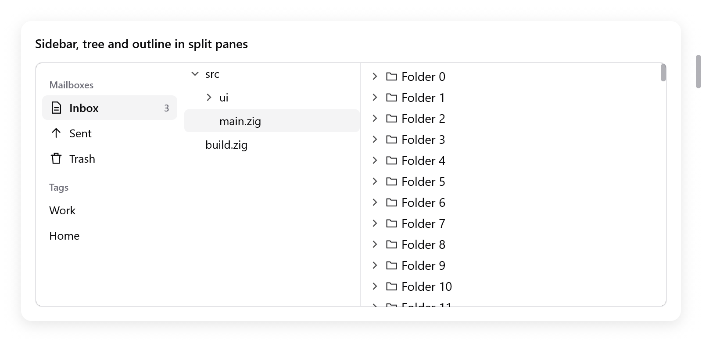
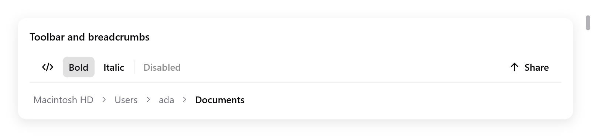

# Structures

The widgets that give a window its shape: tabs, disclosures and
accordions, split views, sidebars, toolbars and breadcrumbs. Lists,
trees, outlines, tables and grid views are on [Lists](lists.md). The grid
layout is on [Grid](grid.md).

They follow one pattern:

- The choice they make is the app's, passed by pointer: an index, an id,
  a `bool`, a size.
- Those that hold other content open a box that the view fills, then
  close it with `end`.
- Their `end`, or the call itself, returns what happened in this frame:
  `changed` when a click or a key changed the app's value, `focused`
  when they have the keyboard focus.

<!-- demo: structures height=397 -->



*Tabs, a disclosure and an accordion with the Shipping section expanded.*

## Tabs

`ui.tabs(c, labels, &selected, opts)` is a row of labels, one of them
chosen, over the page the view builds for it:

```zig
if (ui.tabs(c, &.{ "General", "Appearance", "Advanced" }, &s.tab, .{}).changed) s.save();
switch (s.tab) {
    0 => s.general(c),
    1 => s.appearance(c),
    else => s.advanced(c),
}
```

| `ui.TabsOptions` | Default | |
|---|---|---|
| `width` | `.fill` | |
| `size` | 13 | the font size |

- A click chooses a tab and gives the tab bar the keyboard focus. Then
  the arrows, Home and End choose too.
- The bar takes one Tab stop. Shift+Tab leaves it in reverse order.
- An empty bar takes no keyboard focus and keeps the selection unchanged.
- With tabs, a selection out of range is clamped to the last tab and
  reports `changed`. This includes when tabs are removed.
- Left and Right follow the layout direction, reversed in RTL.
- Modified keys stay free for the app's shortcuts.

For pages that are places the user goes to, with a history and back and
forward, use a [router](navigation.md#the-router).

## Disclosures

`ui.collapsible(c, title, &open)` is a header, `title` beside an arrow.
It opens and closes what the view builds below it. The content grows into
view and shrinks away. Build it while the disclosure's `shown` is true
(open, or still closing), then `end`:

```zig
const d = ui.collapsible(c, "More options", &s.advanced);
defer d.end();
if (d.shown) {
    _ = ui.checkbox(c, "Verbose logging", &s.verbose);
    _ = ui.checkbox(c, "Experimental features", &s.experimental);
}
```

A click on the header opens and closes it. So do Enter and Space while it
has the keyboard focus. The `ui.Disclosure` also has:

| Field | |
|---|---|
| `changed` | the header was pressed in this frame |
| `progress` | from 0 closed to 1 open, easing toward the state, for content that animates itself |
| `focused`, `id` | |

## Accordions

`ui.accordion(c, opts)` is a bordered box of sections, one above the
other. Each is a disclosure that opens on its own. Add each with
`Accordion.item(title, &open)`, which returns its `Disclosure`:

```zig
var acc = ui.accordion(c, .{});
defer acc.end();
const titles = [_][]const u8{ "Shipping", "Returns", "Warranty" };
const bodies = [_][]const u8{ "Free over $50.", "Within 30 days.", "Two years." };
for (titles, bodies, 0..) |title, body, i| {
    const it = acc.item(title, &s.sections[i]);
    defer it.end();
    if (it.shown) ui.text(c, body, .{ .color = c.theme.muted });
}
```

- Up and Down move the focus between the headers. Home and End move it
  to the first and the last.
- `ui.AccordionOptions` has `width` (`.fill`).
- For one section open at a time, close the others when one opens:
  `if (it.changed and s.sections[i]) for (&s.sections, 0..) |*o, j| if (j != i) o.* = false;`.

## Split views

<!-- demo: tree height=415 -->



*Sidebar, file tree and virtual outline arranged in split panes.*

`ui.split(c, &size, opts)` puts two panes side by side, or one above the
other with `vertical`. A divider between them resizes them:

```zig
var sp = ui.split(c, &s.sidebar_width, .{ .min = 120 });
s.files(c);
sp.second();
s.editor(c);
if (sp.end().changed) s.saveLayout();
```

- `ui.split` opens the first pane. `second()` closes it, adds the divider
  and opens the second. `end()` closes the split and returns a result.
- The pointer drags the divider, showing a resize cursor. Once the
  divider has the focus, the arrows move it.
- `size.*` is the first pane's width in points, or its height when
  `vertical`.
- With `percent`, `size.*` is its share of the room, from 0 to 100. Then
  both panes grow with the window.
- The divider keeps `min` points from either edge.
- When the window leaves less room, the first pane gives way. It takes
  its size back when there is room again: `size.*` keeps what the user
  chose.

| `ui.SplitOptions` | Default | |
|---|---|---|
| `vertical` | false | one pane above the other |
| `percent` | false | `size.*` is a percentage of the room |
| `min` | 40 | the least room either pane keeps |
| `width`, `height` | `.fill` | the split's box |
| `step` | 10 | how far the arrows move the divider |
| `grip` | 8 | how wide the divider is to the pointer, across its line |

The result has `changed` (a drag or a key moved the divider), `dragging`
and `focused`. Splits nest: a pane can hold another split.

## Sidebars

`ui.sidebar(c, &selected, opts)` is a source list, as in Finder and Mail.
It shows items with icons in sections, and chooses one item's id into
`selected.*`, a `[]const u8` the app keeps. Add sections and items, then
`end`:

```zig
var sb = ui.sidebar(c, &s.mailbox, .{ .width = .{ .px = 170 } });
if (sb.section("Mailboxes", &s.mailboxes_shown)) {
    sb.item("inbox", "Inbox", .{ .icon = "doc.text", .badge = "3" });
    sb.item("sent", "Sent", .{ .icon = "arrow.up" });
    sb.item("trash", "Trash", .{ .icon = "trash" });
}
if (sb.section("Tags", null)) {
    sb.item("work", "Work", .{});
    sb.item("home", "Home", .{});
}
if (sb.end().changed) s.showMailbox();
```

- `section(title, open)` adds a section title. A click on it hides and
  shows its items. It returns whether they show: always, for a null
  `open`.
- `item(id, label, opts)` adds an item that chooses `id`. The app keeps
  the id while the item shows.
- `ui.SidebarItemOptions` has `icon` (an SF Symbol, or myzig's line icon
  off macOS) and `badge` (a count or a word at the end of the row).
- The sidebar scrolls when its items do not fit.
- A click chooses an item. While the sidebar has the focus, Up, Down,
  Home, End and the first letters of an item's label choose among them.
- The chosen item shows in the accent color while the sidebar has the
  focus, in gray otherwise, as AppKit's do.

| `ui.SidebarOptions` | Default |
|---|---|
| `width` | `.{ .px = 220 }` |
| `height` | `.fill` |
| `background` | null: the theme's |

## Toolbars

<!-- demo: toolbar height=210 -->



*Toolbar actions and a breadcrumb trail.*

`ui.toolbar(c, opts)` is a row of controls along the top of a window or
a pane. The controls take no face of their own until hovered.

```zig
var tb = ui.toolbar(c, .{});
_ = tb.button("", .{ .icon = "chevron.left.forwardslash.chevron.right" });
_ = tb.toggle("Bold", &s.bold);
_ = tb.toggle("Italic", &s.italic);
tb.separator();
_ = tb.button("Disabled", .{ .disabled = true });
tb.spacer();
if (tb.button("Share", .{ .icon = "arrow.up" })) s.share();
tb.end();
```

- `button(title, opts)` is true when clicked, or pressed with the keys.
  Its options are `icon` and `disabled`. The icon goes before the title,
  or alone when the title is empty.
- `toggle(title, &value)` stays down while `value.*` is true. It is true
  in the frame it toggles.
- `toggleIcon(title, icon, &value)` shows an icon, with the title for
  assistive technology.
- `spacer()` pushes the controls after it to the end.
- `separator()` draws a thin vertical line between groups.

A toolbar is one stop of the keyboard, as a
[focus group](navigation.md#focus-groups) is for other controls:

- A click on a control gives it the focus.
- Left and Right then move among its controls. Home and End move to the
  first and the last.
- Enter or Space presses the one shown.

| `ui.ToolbarOptions` | Default | |
|---|---|---|
| `width` | `.fill` | |
| `height` | 40 | |
| `border` | true | a line under it |

In a window whose title bar is hidden, make `c.title_bar_height` the
toolbar's height. Then dragging its empty room moves the window (see
[Windows](../windows.md)).

## Breadcrumbs

`ui.breadcrumbs(c, items, &chosen, opts)` shows a path of places. Each is
a link but the last, which is where the user is. It returns true in the
frame a link was chosen, with its index in `chosen.*`:

```zig
const path = [_][]const u8{ "Macintosh HD", "Users", "ada", "Documents" };
if (ui.breadcrumbs(c, &path, &s.crumb, .{})) s.goUp(s.crumb);
```

`ui.BreadcrumbsOptions` has `size` (13) and `max_item_width` (200).
Longer items are clipped.
