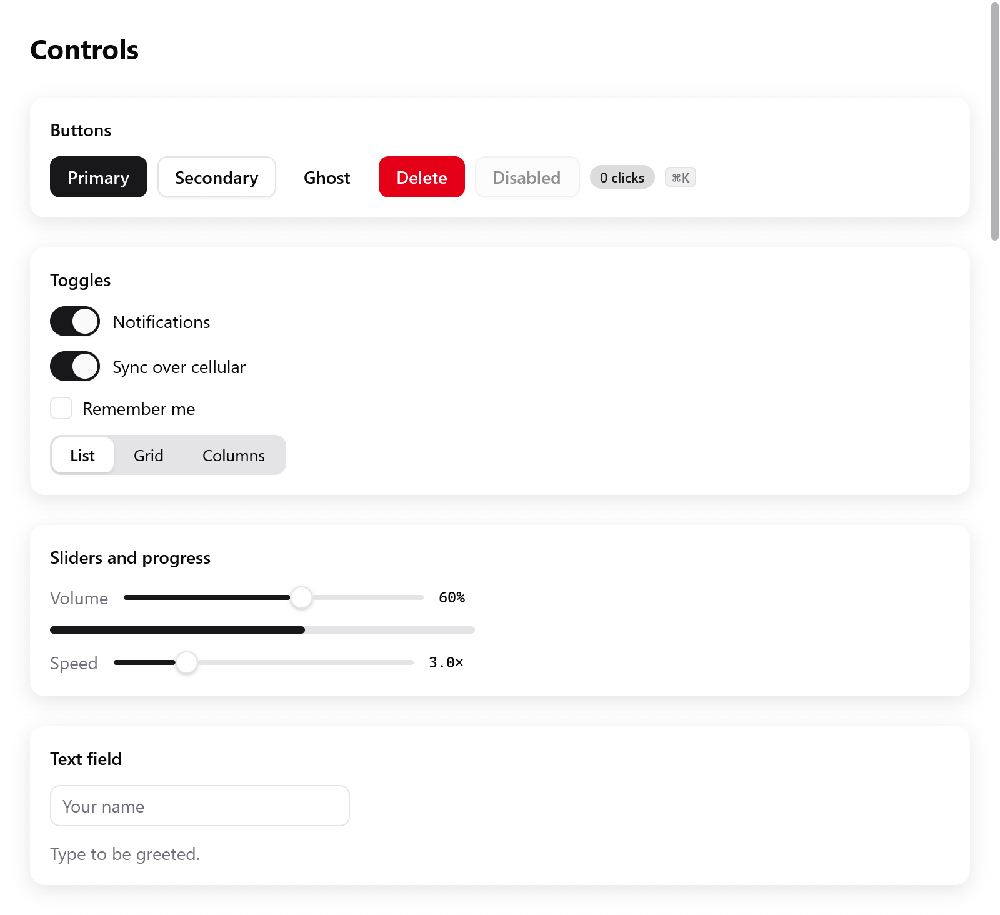
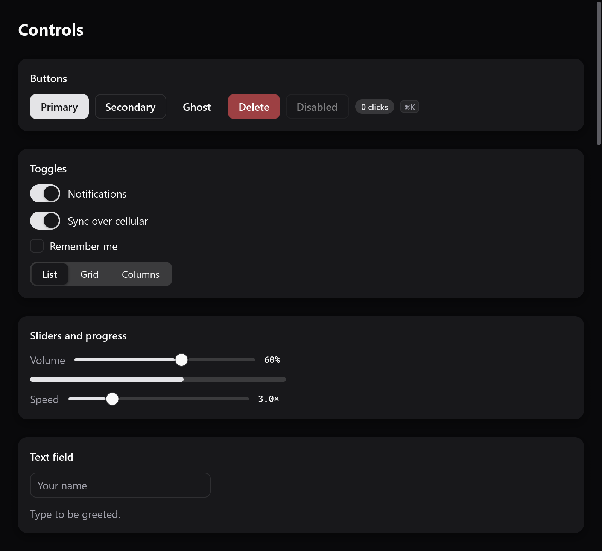

# Styling and themes

A box's look is part of its `ui.Style`, beside its layout: a background,
a border, rounded corners, a shadow, opacity. Widgets take their colors
from the frame's theme, `c.theme`. It follows the system's light or dark
appearance unless the app fixes it.



*The Gallery controls with the light theme.*



*The same controls with the dark theme.*

```zig
ui.column(c, .{
    .padding = .all(16),
    .gap = 8,
    .background = c.theme.surface,
    .border = c.theme.border,
    .radius = 12,
    .shadow = .{ .color = c.theme.shadow, .blur = 16, .y = 4 },
});
defer ui.end(c);
```

## The look of a box

| field | what it draws |
|---|---|
| `background: ?Color` | the fill, inside the rounded corners |
| `border: ?Color`, `border_width` (1) | a border inside the box's edge |
| `radius` | the corners' radius, in points; `1e4` (`roundedFull()`) makes a pill or a circle |
| `corners` | how they curve: `.circular` (CSS's), or `.continuous` (`continuous()`), as macOS and iOS curve theirs |
| `shadow: ?Shadow` | a Gaussian shadow: `color`, `blur` (its standard deviation, 12 by default) and `y` (its drop, 4) |
| `opacity` | the box and its content together, 0 to 1 |
| `gradient: ?*const Gradient` | linear, radial or conic colors over the background |
| `blur` | blurs the box and its children as drawn (CSS's `filter: blur()`) |
| `effect: ?*const Effect` | draws the box from what is under it (frosted glass) |

```zig
ui.card(c, .{ .radius = 18, .corners = .continuous, .shadow = .{ .blur = 18, .y = 6 } });
const tile = ui.div(c).w(64).h(64).rounded(14).continuous().bg(th.accent);
```

**Continuous corners** are "squircles": Core Animation's continuous
corner curve and SwiftUI's rounded rectangles. A card or a button then
looks as the system's do.

- The edges leave farther from the corner, about 1.53 times the radius,
  and bend gradually.
- They shape the box's background and border, its shadow, its picture
  (`ui.image`'s `corners`), its gradient and what it clips.
- Every renderer draws them alike, the CPU and the GPUs.
- A backdrop effect keeps circular corners.

Gradients, blur, backdrop effects and transforms have a page of their
own: [transforms and effects](transforms.md). A gradient is kept until
the frame is drawn. Pass a constant, the app's memory, or the frame's
(`c.alloc().create(ui.Gradient)`).

## Colors

`ui.Color` is sRGB with straight alpha, each channel from 0 to 1:

```zig
const blue: ui.Color = .hex(0x0a84ff);
const faint = blue.alpha(0.15);                 // multiplies its opacity
const between = c.theme.surface.mix(blue, 0.3); // 30% of the way to blue
const ink: ui.Color = .{ .r = 0.1, .g = 0.1, .b = 0.12 };
```

`ui.Color.white`, `.black` and `.transparent` are constants.

```zig
const accent = ui.oklch(0.62, 0.19, 255);
const hover = ui.oklch(0.55, 0.19, 255);
```

For palettes, `ui.oklch(l, c, h)` makes a color in Oklch, as CSS's
`oklch()`:

- `l`: lightness from 0 to 1. `c`: chroma from about 0 to 0.4. `h`: hue
  in degrees.
- Colors of one lightness look equally light. A palette of hues at one
  lightness and chroma stays even, and an accent's hover is the same hue
  a little darker.
- A color sRGB cannot show loses chroma, keeping its lightness and hue.
- `ui.toOklch(color)` goes back, as `[3]f32`.

## State, not selectors

```zig
const i = c.open(.{ .padding = .xy(12, 6), .radius = 6 }, null);
defer c.end();
const it = c.interact(i, .{});
const t = c.animate(it.id, 0, if (it.hovered) 1 else 0, 18);
c.node(i).style.background = c.theme.surface.mix(c.theme.surface_hover, t);
```

There are no selectors and no pseudo-classes. The view knows the state,
and styles boxes from it.

- Hover, press and focus come from the box's interaction.
- `c.animate` eases a value toward a target, so a change of look is
  animated rather than abrupt.
- `ui.div(...).hover(color)` does this for a background.
- Hover follows ancestry, as CSS's `:hover` does. A row is hovered while
  the pointer is over a button inside it. So a row that shows its buttons
  on hover keeps them while the pointer goes to them.

See [custom widgets](custom-widgets.md) for interactions and
[motion](motion.md) for springs, keyframes and transitions.

## The theme

`ui.Theme` holds the colors every widget uses, and the fonts:

| field | used for |
|---|---|
| `dark` | whether it is a dark theme |
| `background` | the window |
| `surface`, `surface_hover` | cards, fields, secondary buttons; their hover, and what is chosen in lists, menus and tables |
| `text`, `muted` | text, and secondary text (labels, placeholders) |
| `border` | borders, dividers |
| `accent`, `accent_hover`, `accent_text` | primary buttons, switches that are on, text selection, and text on the accent |
| `ring` | the border and glow of what has the keyboard's focus |
| `track`, `knob` | sliders', switches' and progress bars' tracks and knobs |
| `danger`, `success`, `warning` | destructive actions and errors; done; what calls for attention |
| `shadow` | the color of shadows |
| `font`, `mono_font` | font families, null for the system's ([text](text.md)) |
| `tooltip_delay` | seconds the pointer rests before a tooltip shows; 0 is 0.6, negative at once ([overlays](overlays.md#tooltips)) |

`ui.Theme.light` and `ui.Theme.dark_theme` are myzig's: the zinc
[palette](#palettes). A window uses one or the other as the system's
appearance is, and switches when it changes. To fix a window's colors,
give it a theme:

```zig
var mine = ui.Theme.dark_theme;
mine.accent = .hex(0xff9f0a);
mine.font = "Inter";
_ = try app.newWindow(.{ .title = "Player", .theme = mine, .content = .{ .view = .init(&state, State.view) } });
```

- Within the view, `ui.themes.apply(c, theme)` makes a theme the
  frame's. Widgets built after it read it, and so does the window's
  background. Call it first.
- `myzig.isDark()` and `myzig.accentColor()` read the system's
  appearance and accent outside a view.

## Palettes

<!-- demo: palettes height=230 -->


`ui.Palette` is one of [shadcn/ui](https://ui.shadcn.com)'s themes: a
base of grays with its own primary, or with one of the accents as the
primary.

| | |
|---|---|
| `base` | `neutral`, `stone`, `zinc` (the default), `mauve`, `olive`, `mist`, `taupe` |
| `accent` | `amber`, `blue`, `cyan`, `emerald`, `fuchsia`, `green`, `indigo`, `lime`, `orange`, `pink`, `purple`, `red`, `rose`, `sky`, `teal`, `violet`, `yellow`; null for the base's own |

```zig
fn view(s: *State, c: *ui.Context) void {
    ui.themes.use(c, .{ .base = .stone, .accent = .blue });
    // ...
}
```

`ui.themes.use` makes one the frame's theme, light or dark as the window
is. Call it first in the view.

```zig
_ = try app.newWindow(.{ .theme = ui.Palette.theme(.{ .accent = .rose }, true), .content = .{ .view = .init(&state, State.view) } });
```

`palette.theme(dark)` is the `ui.Theme` itself. Use it to fix a window in
one appearance, or to change to it animated.

For text or icons in the accent color, use `theme.accentInk()`, not
`theme.accent`. A colored primary is dark in the dark theme, and yellow
is light in the light one. `accentInk()` comes nearer the text's color
there, so it reads.

## Named themes

`ui.themes.builtins` lists myzig's themes by name: `light`, `dark`,
`light-high-contrast` and `dark-high-contrast`.

For a theme kept in settings by name, `ui.themes.find(list, name)` looks
the name up:

1. in the app's own list;
2. in myzig's;
3. among the palettes (`stone-light`, `blue-dark`, `stone-blue-dark`).

```zig
const app_themes = [_]ui.themes.Named{
    .{ .name = "solarized", .theme = solarized },
};

fn view(s: *State, c: *ui.Context) void {
    if (ui.themes.find(&app_themes, s.theme_name)) |t| ui.themes.apply(c, t);
    // ...
}
```

| function | |
|---|---|
| `ui.themes.forAppearance(dark, light_theme, dark_theme)` | picks the light or the dark one of a pair |
| `ui.themes.withAccent(theme, color)` | gives a theme another accent, with its hover, and black text on it where white would not stand out, as on yellow |
| `ui.themes.mix(a, b, t)` | blends every color of two themes |

## Switching themes, animated

`ui.ThemeSwitcher` (`ui.themes.Switcher`) changes from one theme to
another with every color easing, as the system does when its appearance
changes. Keep it in the state, change it with `switchTo`, and `apply` it
first in the view:

```zig
const State = struct {
    dark: bool = false,
    theme: ui.ThemeSwitcher = .{},

    fn view(s: *State, c: *ui.Context) void {
        s.theme.apply(c);
        ui.column(c, .{ .padding = .all(20), .gap = 12 });
        defer ui.end(c);
        if (ui.toggle(c, "Dark", &s.dark))
            s.theme.switchTo(if (s.dark) ui.Theme.dark_theme else ui.Theme.light);
    }
};
```

- Before the first `switchTo`, the window's own theme shows.
- `duration` is 0.3 seconds by default.
- `changing()` tells whether a change is under way. `current()` is the
  theme shown now.
- Colors move nothing, so themes change smoothly even when the user asked
  for less motion.

## The desktop's preferences

`ui.preferences.apply(c)`, called first in the view, makes the frame
follow the user's settings. It returns them as a `ui.Preferences`:

| field | from |
|---|---|
| `accent` | the accent color the user chose, null where the desktop has none |
| `high_contrast` | macOS's Increase contrast, Windows' contrast themes, a GTK high-contrast theme |
| `text_scale` | Windows' text size, GTK's font resolution, 1 for usual |
| `reduce_motion` | the system's reduced motion setting (see [motion](motion.md)) |

- The theme takes the accent.
- With high contrast, borders and secondary text come nearer the text's
  color (`ui.preferences.highContrast(theme)`).
- The text is scaled by `text_scale` through `c.setZoom`.
- The desktop is asked once per process. `ui.preferences.refresh()` asks
  again, for when it says its settings changed.

An app's own settings override the desktop's for the context. Each takes
null to follow the desktop again:

- `ui.preferences.setHighContrast(c, on)`
- `setTextScale(c, scale)`
- `setAccent(c, color)`

`ui.preferences.get(c)` reads what the frame follows without applying
it.

```zig
fn view(s: *State, c: *ui.Context) void {
    if (s.big_text_changed) ui.preferences.setTextScale(c, if (s.big_text) 1.3 else null);
    const prefs = ui.preferences.apply(c);
    _ = prefs;
    // ...
}
```
