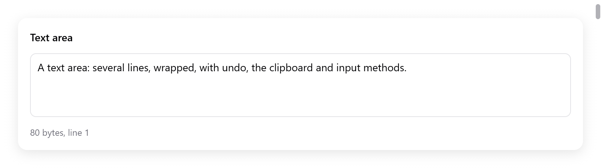

# Text area

`ui.textArea` edits multi-line text, wrapped or scrolled sideways. It has
the platform's keys, the pointer, the clipboard, undo and input methods.

- Its text is a `ui.TextArea` that the app keeps.
- The document is a rope: a text of a hundred thousand lines edits as
  quickly as one of ten.
- Only the lines in view are laid out.
- The [code editor](code-editor.md) is built on the same parts.

For one line of text, use `ui.textField` ([Text input](text-input.md)).

<!-- demo: text-area height=248 -->



*A multiline text area with its byte count and caret line.*

```zig
const Notes = struct {
    body: ui.TextArea,

    fn view(s: *Notes, c: *ui.Context) void {
        const r = ui.textArea(c, &s.body, .{ .placeholder = "Notes", .lines = .{ 3, 12 } });
        if (r.changed) s.save();
    }
};

var notes: Notes = .{ .body = .init(gpa, "Hello") };
defer notes.body.deinit();
```

`zig build run-text-buffer` edits 100 000 lines (`examples/text-buffer`).
The gallery's Text page and `examples/code-editor` show text areas too.

## Options

`ui.TextAreaOptions`:

| field | default | meaning |
|---|---|---|
| `width` | `.fill` | its width |
| `height` | 140 points | its height |
| `lines` | null | grows with its text from `lines[0]` rows to `lines[1]`, past which it scrolls, as a message field does (in place of `height`) |
| `size` | 14 | the text's size |
| `mono` | false | the monospaced font |
| `wrap` | true | wrap long lines; false scrolls them sideways, with a scroll bar |
| `placeholder` | `""` | shown while it is empty |
| `read_only` | false | selectable and copyable, not editable |
| `tab` | false | Tab types a tab, rather than moving the focus |
| `bare` | false | no box of its own (border, fill, focus ring): for an editor filling a window |

It returns a `ui.TextAreaResult`:

| field | |
|---|---|
| `changed` | the text changed this frame |
| `focused` | it has the focus |
| `first_line`, `last_line` | the lines it built |
| `lines` | each line built and its top from the top of the view, as scrolled, in frame memory |
| `row_h` | a row's height |

`lines` and `row_h` are for what the app puts over the lines.

## Editing

Everything a text field of the platform does:

- Arrows, with Shift to select. By words with Option (macOS) or Control
  (Linux, Windows). To the line's ends with Command or Home and End. To
  the text's ends. Page Up and Page Down.
- Up and down keep the column they started from.
- Backspace and Delete, by characters, words, and to the line's start.
- Select all, copy, cut and paste through the system clipboard (the
  Tester's own in tests).
- Undo and redo. Characters typed in a row, within a second, are one
  step. So are deletions in a row.
- Input methods (Chinese, Japanese, Korean, dead keys). The composition
  is shown underlined in the text until it is committed.
- The pointer: a click places the caret and a drag selects. A double
  click selects a word and a triple click a line; dragging from there
  goes by words or lines. Shift-click extends the selection.

**More carets** (`src/ui/textarea_multi.zig`):

- Control-Alt (Command-Option) with Up or Down adds one a line above or
  below.
- Control-D (Command-D) selects the word at the caret, then each next
  match.
- Control-click (Command-click) adds one where it lands.
- Typing, deleting, Tab, Enter, cut and the arrows then act at every
  caret, as one step of undo. Escape goes back to one.
- The main caret is in `sel`, the others in `TextArea.extra`.

On macOS the keys come through the text input system
(`NSTextInputClient`), so the user's own key bindings apply. Elsewhere
they are mapped as the platform binds them (`src/ui/textarea_keys.zig`).

## The state

A `ui.TextArea` holds:

- the document: `doc`, a `ui.TextDoc`;
- the selection: `sel`, a `ui.TextSel` of `anchor` and `caret` byte
  offsets;
- an input method's composition;
- what the view keeps between frames.

Make it with `ui.TextArea.init(gpa, text)`, free it with `deinit()`. The
app reads and changes it between frames:

| method | does |
|---|---|
| `text(gpa)` | the whole text, in memory of `gpa` |
| `len()` | its length in bytes |
| `setText(s)` | replaces the text as an edit, which undo takes back |
| `reset(s)` | replaces it as a new document, without history (a file opened) |
| `select(anchor, caret)`, `collapse(at)` | sets the selection |
| `selectedText(gpa)` | the selection's text |
| `caretLine()` | the caret's line, from 0 |
| `insert(s)` | types `s` at the caret, as the keyboard does |
| `replaceSelection(s, kind)`, `replaceRange(a, b, s, kind)` | replaces text, as a step of undo |
| `deleteTo(at)` | deletes the selection, or from the caret to `at` |
| `undo()`, `redo()` | |
| `takeChanged()` | whether the text changed since the last call |
| `wordAt(i)`, `lineRange(line)` | ranges of a word and a line |
| `prevChar`, `nextChar`, `prevWord`, `nextWord` | boundaries from a byte |

```zig
if (ui.button(c, "Insert date", .{}).clicked) {
    s.body.insert(c.print("{d}-{d:0>2}-{d:0>2}", .{ y, m, d }));
}
if (ui.button(c, "Clear", .{ .disabled = s.body.len() == 0 }).clicked) s.body.setText("");
```

Offsets are bytes of UTF-8. The caret never stops inside a character.

## The document

`ui.TextDoc` is the text a text area or a code editor edits. It holds:

- a rope;
- its undo history;
- a log of the lines each edit replaced. Views read it to update what
  they keep per line (wrapped rows, highlighting states) without looking
  at the rest of the document.

It can be used on its own:

```zig
var doc = ui.TextDoc.init(gpa, source);
defer doc.deinit();
doc.replace(0, 0, "// Generated.\n"); // one step of undo
const first = doc.line(gpa, 0);        // without its newline
```

- Reading: `len()`, `lineCount()`, `lineStart(i)`, `lineEnd(i)`,
  `lineOf(offset)`, `byteAt(i)`, `line(gpa, i)`, `slice(gpa, a, b)`,
  `text(gpa)`.
- Editing: `replace(a, b, s)` and `set(s)` are one step of undo each.
  `reset(s)` starts a new document.
- Several edits join one step between `begin(kind, sel, time)` and
  `end(sel)`, each made with `edit(a, b, s)`.
- History: `undo()` and `redo()` return the selection to restore. Also
  `canUndo()` and `canRedo()`.
- `max_undo` is 1000 steps. `group_seconds` is 1 s: typing within it
  joins the step before. `breakGroup()` makes the next typing a step of
  its own.
- Changes: every edit bumps `version`. `spliceSeq()` is a sequence
  number.
- `splicesSince(seen)` gives the splices since one: each a line, how
  many lines it replaced and how many it put there. It is null when they
  are gone, and a reader must read everything again.

## The rope

`ui.Rope` is the text as a balanced tree (AVL) of chunks of UTF-8, after
Zed's rope.

- Its leaves own up to 2 KB each. Its branches count the bytes and
  newlines below them.
- An edit touches the leaves it changes and the path to them.
- A line's start, a byte's line and a range of text are found in
  O(log n).
- `replace(a, b, s)`, `lineStart(line)`, `lineOf(at)`,
  `slice(gpa, a, b)`, `chunks(from)` and `lines(gpa, first)` iterate it.
- Unlike mygo's rope, the tree is changed in place. Undo keeps the
  edits, not versions.

## Large texts

- Only the rows in view are built, with a few more above and below. A
  frame costs what a screenful costs.
- Wrapped rows are measured once and kept per line, updated from the
  document's splices. The scroll bar knows the text's height without
  laying it all out.
- With `wrap = false`, long lines scroll sideways. The widest line shown
  so far sizes the horizontal scroll bar.

**Long lines.** A line of 4 KB or more is minified code, a log without
breaks, a megabyte of data on one line. It is laid out in pieces of at
most 256 bytes, kept with its rows across frames (`textlayout_long.zig`):

- A frame shapes and wraps at most 32 KB of the long lines it shows.
- A huge line shows its first rows at once and the rest over the next
  frames, rather than stalling the frame that shows it.
- An edit keeps the pieces before it. Typing in a long line shapes the
  piece it is in and those after.
- Of a line that does not wrap, what shows is drawn, not its whole text.

## Testing

```zig
var s: Notes = .{ .body = .init(gpa, "") };
defer s.body.deinit();
var t: ui.Tester = undefined;
try t.init(gpa, .init(&s, Notes.view), .{});
defer t.deinit();
try t.clickText("Notes");     // the placeholder: focuses it
t.typeText("Hello\nworld");
const text = s.body.text(gpa);
defer gpa.free(text);
try std.testing.expectEqualStrings("Hello\nworld", text);
```

The Tester types characters, keys, key combinations (`t.shortcut`) and an
input method's operations (`t.textOps`). It keeps a clipboard of its own.
See `src/ui/tests_textarea.zig` and [Testing](testing.md).
