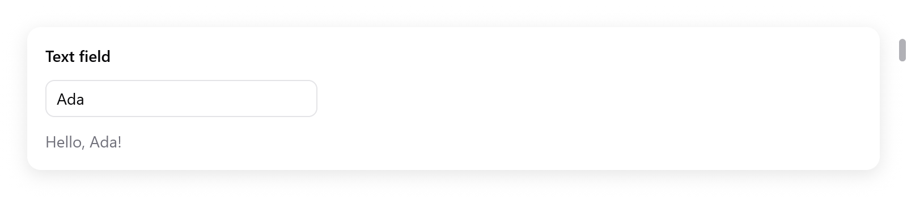
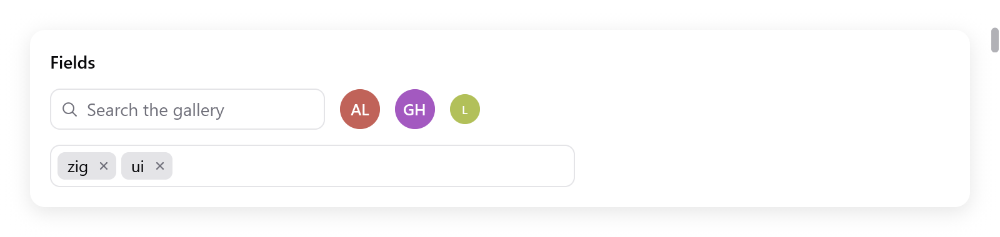
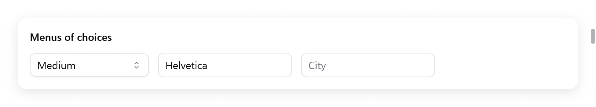

# Text input

`ui.textField` edits one line of text kept in your state, in a
`ui.TextBuffer`. Built on it are a search field, a token field of chips, a
combobox and an autocomplete. For several lines, see the
[text area](text-area.md); for code, the [code editor](code-editor.md).

<!-- demo: text-input height=120 -->



*The text field contains Ada; the view immediately shows the greeting.*

## Text fields

```zig
const State = struct {
    name: ui.TextBuffer = .{},
};

fn view(s: *State, c: *ui.Context) void {
    // ...
    const r = ui.textField(c, &s.name, .{ .placeholder = "Your name" });
    if (r.submitted) s.greet();
    const name = s.name.text();
    ui.text(c, if (name.len == 0) "Type to be greeted." else c.print("Hello, {s}!", .{name}), .{});
}
```

- A click or Tab gives a field the keyboard focus.
- It shows a caret and a selection, and scrolls sideways to keep the
  caret in view.
- While focused, it eases in a ring of the accent color.
- It edits through the platform's text input: typing, accents and input
  methods, the system's key bindings, and the clipboard.
- The keyboard and the mouse select: a drag selects, a double click
  selects a word.
- `TextBuffer.set(text)` replaces the text and puts the caret at its end.
- `TextBuffer.select(anchor, caret)` selects bytes in the next frame, as
  a box renaming a file chooses its name without its extension.

`ui.TextFieldOptions`:

| field | default | what it does |
|---|---|---|
| `placeholder` | `""` | faint text shown while it is empty |
| `width` | 240 points | a `ui.Length`; `.fill` across its parent |
| `size` | 14 | the text's size |
| `disabled` | false | dim the field, prevent editing and remove it from Tab navigation |
| `password` | false | bullets instead of the text, and the text kept off the clipboard |
| `suggestion` | `""` | text drawn faintly after what is typed, as a shell's autosuggestion; → or End at the end of the text takes it |
| `bare` | false | no box of its own (border, fill, focus ring), for a field inside a larger frame, as a chat composer |
| `caret_width` | 1.5 | the caret's width in points, at least a device pixel; 0 hides it, the field staying editable (text areas take it too) |
| `label` | `""` | names it for assistive technology (a [form's field](forms.md) names its own) |

It returns a result:

| field | true when |
|---|---|
| `changed` | the text changed in this frame |
| `submitted` | Return was pressed |
| `focused` | it has the keyboard focus |
| `accepted` | the suggestion was taken into the text |
| `caret` | (a `usize`) the caret's byte offset after this frame's edits |

Use [Input Group](input-group.md) to share a frame with icons, affixes and action buttons.

## The buffer

`ui.TextBuffer` holds up to 1024 bytes of UTF-8, inline, with no
allocation: keep it in your state.

| method | what it does |
|---|---|
| `text()` | the text, a slice of the buffer |
| `set(s)` | replaces the text; the caret goes to its end |
| `clear()` | empties it |
| `insert(at, s)` | inserts at byte `at`; returns how many bytes went in |
| `remove(from, to)` | removes bytes `[from, to)` |
| `replace(from, to, s)` | replaces bytes `[from, to)` with as much of `s` as fits, never cutting a UTF-8 sequence |

- Setting `want_caret` places the caret in the next frame, after the app
  changed the text.
- Copy the text out (`dupe`) to keep it after the buffer changes.

```zig
if (r.submitted or ui.button(c, "Add", .{ .variant = .primary }).clicked) {
    s.add(std.mem.trim(u8, s.task.text(), " "));
    s.task.clear();
}
```

## Editing

The keys a field understands come from the platform:

- on macOS, AppKit's key bindings through the text input system, so a
  user's own bindings work too;
- elsewhere, the usual keys of Linux and Windows.

Each becomes a `ui.TextCommand` applied to the focused text:

- moving the caret by characters, words and to the line's ends, and
  extending the selection the same ways with Shift (`move_word_left`,
  `select_line_end`, ...);
- deleting backward and forward, by characters and words, and to the
  line's start;
- selecting all, copying, cutting and pasting;
- Up, Down, Page Up, Page Down and the document's ends, which in a
  one-line field go to an end of the text.

Pasted newlines become spaces in a one-line field. On macOS the Edit
menu's Cut, Copy, Paste and Select All reach the focused field too.

## Input methods

| Platform | |
|---|---|
| macOS | a native view is an `NSTextInputClient` (`src/ui/textinput.zig`) |
| Linux | GTK's input method context gives the field the text it commits |
| Windows | typed characters, and what an IME commits, come as characters |
| browsers | a hidden text area takes the composition, which shows underlined |

On macOS, every field takes accents (holding a key), the Character
Viewer, dictation, and the input methods of Chinese, Japanese and Korean.
The text being composed shows underlined, with the candidate window under
the caret.

## Search fields

<!-- demo: fields height=214 -->



*A search field, avatars and a token field containing zig and ui.*

```zig
const r = ui.searchField(c, &s.query, .{ .placeholder = "Search the gallery" });
if (r.changed) s.filter();
if (r.cleared) s.showAll();
```

`ui.searchField(c, &query, options)` is a field for searching: a
magnifying glass, the text, and a button clearing it. The button shows
while it holds any text; Escape then clears it too.

- `ui.SearchFieldOptions`: `placeholder` (`"Search"`), `width`
  (220 points) and `size` (14).
- The result (`ui.SearchResult`) has `changed`, `submitted`, `cleared`
  (the clear button or Escape emptied it) and `focused`.

## Token fields

```zig
const tags = [_][]const u8{ "design", "docs", "bug", "feature", "performance", "ui", "zig" };

const State = struct {
    tokens: ui.Tokens = .{},
};

_ = ui.tokenField(c, &s.tokens, &tags, .{ .placeholder = "Add a tag", .width = 420 });
```

`ui.tokenField(c, &tokens, suggestions, options)` edits a set of tokens,
as tags or a mail's recipients. It returns true when the tokens change.

- Each token is a chip with a button taking it out. Chips wrap onto more
  lines, before a text field.
- Enter or a comma adds what was typed. Backspace while empty takes out
  the last.
- The suggestions containing what was typed show below it. Case is
  ignored, and tokens already there are left out.
- Up and Down move among them; Enter or a click adds one.

`ui.Tokens` holds up to 64 tokens of 2 KB in all, inline, and the text
being typed (`query`). The app reads and changes it with:

- `get(i)`, `count`, `contains(s)`;
- `append(s)`: trims; false if empty, already there, or too long for
  what is left;
- `remove(i)`.

`ui.TokenFieldOptions`: `placeholder`, `width` (300 points) and
`max_suggestions` (8).

## Comboboxes

<!-- demo: selects height=168 -->



*A select, font combobox and city autocomplete field.*

```zig
const fonts = [_][]const u8{ "Avenir", "Futura", "Georgia", "Helvetica", "Menlo", "Palatino" };

const State = struct {
    font: ?usize = 3,
    font_box: ui.ComboboxState = .{},
};

const r = ui.combobox(c, &s.font, &fonts, &s.font_box, .{ .placeholder = "Font", .width = .{ .px = 180 } });
if (r.changed) s.applyFont();
```

`ui.combobox(c, &selected, options, &state, field_options)` chooses one
of `options` (strings) into `selected` (a `?usize`).

- It shows the choice.
- A click or Down shows all the options. The click selects the text, so
  typing replaces it.
- Typing filters the options.
- The text goes back to the choice as the field loses the focus.
- In the open list, the arrows move, Enter chooses and Escape closes the
  list (not the field's focus).
- `ui.ComboboxState` keeps its list and the text typed. Keep one per
  combobox in your state.
- The result has `changed` (a new option was chosen), `open` and
  `focused`.

## Autocomplete

```zig
const cities = [_][]const u8{ "Amsterdam", "Berlin", "Lisbon", "London", "Madrid", "Paris" };

const r = ui.autocomplete(c, &s.city, &cities, &s.city_box, .{ .placeholder = "City" });
if (r.submitted) s.search(s.city.text());
```

`ui.autocomplete(c, &buffer, suggestions, &state, field_options)` is a
text field whose text is the app's (a `ui.TextBuffer`). Below it, it
suggests those of `suggestions` that contain what was typed.

- Up and Down move among them, Enter or a click takes one, and Enter on
  none submits.
- `ui.AutocompleteState` keeps the list.
- The result has `changed` (typed or a suggestion taken), `submitted`,
  `open` and `focused`.

`ui.ComboFieldOptions`, shared by both: `placeholder`, `width`
(240 points, a `ui.Length`) and `size` (14).

A menu of fixed choices with no typing is a select; see [menus](menus.md).

## Text that a widget takes itself

A widget of your own that edits text reads the event's operations rather
than its keys. `c.input.ops` is a slice of `ui.TextOp`, each one of:

- `.insert`: text typed or pasted;
- `.set_marked`: an input method's composition, with the selection inside
  it, to be shown underlined until it is committed or `.unmark`ed;
- `.command`: a `ui.TextCommand` (`.delete_backward`, `.move_word_left`,
  `.select_all`, `.copy`, `.insert_newline`, `.cancel`, ...).

Set `c.focused_text` each frame to the text, its selection and where the
caret is drawn. The input method can then ask about them between frames
and place its candidate window.

The [text area](text-area.md) and the [code editor](code-editor.md) are
built this way. Tests feed operations with `Tester.textOps` and type with
`Tester.typeText`.
