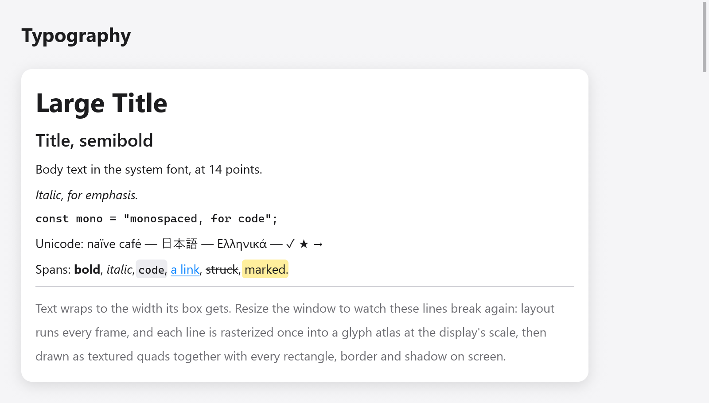

# Text

`ui.text` shows a string in a `ui.TextStyle`; `ui.textf` formats it first,
into the frame's memory:



*System-font headings, italic and monospaced text, rich spans and wrapped text.*

```zig
ui.text(c, "Large Title", .{ .size = 30, .weight = .bold });
ui.text(c, "Italic, for emphasis.", .{ .italic = true });
ui.text(c, "const mono = \"monospaced, for code\";", .{ .mono = true, .size = 13 });
ui.textf(c, .{ .mono = true, .size = 12 }, "{d:.0}%", .{s.volume * 100});
```

The string (and a rich text's spans) is copied into the frame's memory:
layout measures it and paint draws it after the view returns, so the view
may free or change its own copy right after `ui.text`, as two panes
rebuilding one list of names in turn do. Strings in the frame's memory
(`c.print`, `c.alloc()`) are copied too; for a text of many megabytes,
show the part in view (as `ui.textArea` and `ui.codeEditor` do).

## Style

| field | default | what it does |
|---|---|---|
| `size` | 14 | the font's size, in points |
| `weight` | `.regular` | `.regular`, `.medium`, `.semibold` or `.bold` |
| `color` | `c.theme.text` | the text's color |
| `wrap` | false | breaks lines to fit the width the parent gives |
| `mono` | false | the monospaced font |
| `italic` | false | the italic face, or the regular one slanted where the family has none |
| `leading` | 1 | the line height as a multiple of the font's (1.4 or 1.5 for airy prose) |
| `family` | null | a family of its own, in place of the theme's (`font` or `mono_font`) |
| `features` | `""` | OpenType features by commas: `"calt=0,ss01"`, `"-liga"`, `"+zero"` (DirectWrite and HarfBuzz) |
| `weight_value` | 0 | a weight from 100 to 900 in place of `weight`'s; 0 for `weight` |

Text that does not wrap is as wide as it is. Text that wraps takes the
width its parent gives (`.fill`) and breaks at spaces onto as many lines as
it needs; in a row with too little room it gives room back, so a label
beside a button wraps rather than pushing the button out:

```zig
ui.text(c, "Text wraps to the width its box gets. Resize the window to watch these lines break again.",
    .{ .wrap = true, .color = c.theme.muted, .leading = 1.4 });
```

## Headings and labels

`ui.heading(c, str)` is a 22-point bold title, which assistive technology
reads as a heading; `ui.label(c, str)` is 13-point text in the muted color,
for captions and secondary information.

```zig
ui.heading(c, "Settings");
ui.label(c, c.print("{d} of {d} left", .{ left, total }));
```

## Rich text

`ui.richText(c, str, spans, style)` draws one paragraph whose byte ranges
have looks of their own. Each `ui.Span` covers bytes `[start, end)` and
may set:

| field | what it does |
|---|---|
| `color` | the text's color (ANSI output, syntax highlighting) |
| `weight` | another weight |
| `italic` | italics |
| `mono` | the monospaced font (inline code), a little smaller to match |
| `background` | a fill behind the text (a mark, inline code) |
| `underline`, `strike` | a line under or through it |

```zig
const s = "Spans: bold, italic, code, a link, struck, marked.";
// Spans are copied, as the string is: the frame's memory or the app's.
const spans = c.alloc().dupe(ui.Span, &.{
    .{ .start = 7, .end = 11, .weight = .bold },
    .{ .start = 13, .end = 19, .italic = true },
    .{ .start = 21, .end = 25, .mono = true, .background = c.theme.surface_hover },
    .{ .start = 27, .end = 33, .color = c.theme.accent, .underline = true },
    .{ .start = 35, .end = 41, .strike = true },
    .{ .start = 43, .end = 49, .background = ui.Color.hex(0xffd60a).alpha(0.4) },
}) catch &.{};
ui.richText(c, s, spans, .{ .wrap = true });
```

Spans that only color, fill or underline text keep the fast path of plain
text; spans that change the font (a weight, italics, monospace) shape the
paragraph as runs, wrapped across them. Both are cached across frames as
plain text is.

For whole documents, see [Markdown](markdown.md), which draws headings,
lists, code blocks and tables from Markdown text, and the
[rich text editor](rich-text.md) for text the user styles.

## Selectable text

A box styled `selectable = true` lets the pointer select its texts, and
its children's, as a terminal's or a page's: a press on text starts a
selection, a drag extends it across lines and boxes in reading order, and
Copy (⌘C or Ctrl+C, or the Edit menu) copies it, unless the focused text
field has a selection of its own. A drag that selects is not a click.

```zig
ui.column(c, .{ .selectable = true, .gap = 6 });
defer ui.end(c);
for (s.log_lines) |line| ui.text(c, line, .{ .mono = true, .size = 12 });
```

Controls inside a selectable box (`control = true`, as buttons, toggles and
links are) keep their texts out of the selection, so the pointer is a hand
all over them.

## Fonts

On macOS, text is shaped and measured by CoreText in the system's fonts
(SF Pro and SF Mono). On Linux and Windows, and on macOS built with
`-Dportable=true`, myzig shapes text itself from the installed TrueType and
OpenType fonts (`src/ui/tt/`): the system's font folders are read once,
each face known by its family, weight, italics and width, and loaded when
first used, with kerning, and fallback fonts for characters a font lacks.
Browsers get the fonts the site bundles (see [browsers](../browsers.md)).

The theme names the families, null for the system's:

```zig
var t = ui.Theme.light;
t.font = "Inter";
t.mono_font = "JetBrains Mono";
_ = try app.newWindow(.{ .title = "Notes", .theme = t, .content = .{ .view = .init(&state, State.view) } });
```

A family that is not installed falls back to the system's. Matching a
style picks the family's nearest face: its bold for `.bold`, its italic
for `.italic`, else the regular face slanted by about 11 degrees.

## How text is drawn

A run of text is shaped once into a layout (glyphs, positions and the fonts
fallen back to) that measuring and painting share. Layouts are cached while
they are used, so a label that stays the same costs nothing to lay out
again. Glyphs are rasterized once into a glyph atlas at the display's scale
and drawn as textured quads with every rectangle, border and shadow in the
frame, so text that changes every frame (a counter, a clock) costs a
shaping and no rasterizing. On macOS the exact fast path for printable
ASCII (`src/ui/shaper.zig`) skips CoreText for most labels, and a test
proves it lays text out as CoreText does.

Shaping is the system's: CoreText on macOS, DirectWrite on Windows
(`src/ui/text_dw*.zig`: script itemization, its font fallback, glyph
placement, grayscale rasterization, color emoji), and HarfBuzz with
FreeType and fontconfig on Linux (`src/ui/text_hb*.zig`, `text_ft.zig`,
`text_fc.zig`, all loaded at run time; color emoji from their color
bitmaps). Text in several directions is split into runs by the Unicode
bidirectional algorithm (`src/ui/bidi.zig`, UAX #9) and laid out in visual
order; carets move in logical order and selections across directions show
as several ranges. Arabic letters join, ligatures a font has are used, and
characters a font lacks (CJK, emoji) come from fallback fonts. Simple text
whose characters were seen takes a fast path that gives the same layout.
Where the libraries are missing (a bare Linux, browsers), myzig's own
TrueType reader (`src/ui/tt/`) shapes text as before.

## Zoom

`c.setZoom(z)` scales every text of the window by `z`, from 0.5 to 3, as an
app's ⌘= and ⌘- do; boxes sized by their text grow with it. The desktop's
text size comes through [`ui.preferences.apply`](styling.md#the-desktops-preferences),
which sets the zoom.

## Icons

`ui.icon` draws a symbol by name, in the text's flow; see
[buttons and small things](buttons.md#icons).
