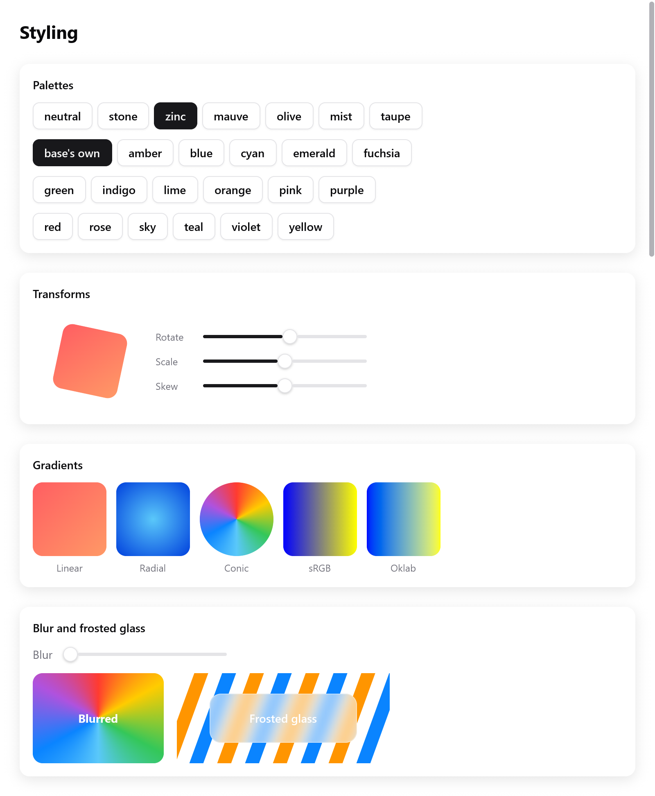

# Transforms and effects

Move, scale, turn and slant a box as it is drawn, fill it with a gradient,
blur it, or draw it from what is under it as frosted glass.

- All of these are fields of `ui.Style`, so any box has them.
- Every renderer draws them alike: Metal, Direct3D 11, OpenGL, WebGL 2 and
  the CPU.
- The gallery's Styling page shows each one
  (`examples/gallery/motion.zig`).

<!-- demo: transforms height=520 -->



*Rotation, gradients, blur and a frosted-glass backdrop rendered by myzig.*

## Transforms

```zig
_ = c.leaf(.{
    .width = .{ .px = 80 }, .height = .{ .px = 80 }, .radius = 12,
    .background = c.theme.accent,
    .transform = ui.Affine.rotation(s.rotate).then(.scaling(s.scale, s.scale)).then(.skewing(s.skew, 0)),
}, .none, null);
```

`Style.transform` is a `ui.Affine`, an affine map of the plane, as CSS's
`transform`.

- It acts after layout, on the box and everything in it. The box keeps
  its place, and its siblings don't move.
- It acts about `Style.transform_origin`, in fractions of the box: its
  center by default, `.{ .x = 0, .y = 0 }` its top left.

| Function | CSS |
|---|---|
| `Affine.translation(x, y)` | `translate(x, y)` |
| `Affine.scaling(sx, sy)` | `scale(sx, sy)`; negative values reflect |
| `Affine.rotation(degrees)` | `rotate()`, clockwise on the screen |
| `Affine.skewing(x, y)` | `skew()`, in degrees |
| `Affine{ .a, .b, .c, .d, .x, .y }` | `matrix(a, b, c, d, x, y)` |

They compose in call order: `a.then(b)` is `a`, then `b`.

| Method | |
|---|---|
| `m.translate(x, y)`, `m.scale`, `m.rotate`, `m.skew` | shorthands for `m.then(...)` |
| `m.about(point)` | acts about a point rather than the origin |
| `m.apply(point)` | maps a point |
| `m.inverse()` | the map back; null for one that flattens the plane |
| `m.bounds(rect)` | the smallest rectangle holding a rectangle mapped |

- Quarter turns are exact.
- A child's transform acts first, then its parent's.
- A box flattened to nothing (a scale of 0) shows nothing and takes no
  pointer.

### The pointer follows what is drawn

Clicks, hover and drags reach a transformed box where it is drawn, not
where the layout put it. A turned button is pressed inside its turned
outline.

<details>
<summary>How hit testing does it</summary>

Hit testing keeps each transformed box's own rectangle and the map from
the window to it (`src/ui/hit.zig`).

</details>

### How transforms are drawn

Transforms are the cheapest thing to animate: animating one changes no
layout. See [Motion](motion.md):

```zig
const s = ui.motion.to(c, "scale", if (hovered) 1.05 else 1, .snappy);
```

Text, borders, shadows and images of a slanted box are drawn slanted too.

<details>
<summary>Simple and general transforms</summary>

- Most transforms only move boxes and scale them alike both ways
  (`Affine.isSimilar`). They are folded into the boxes as they are
  painted, which stay plain round boxes, so they cost nothing.
- Turns, slants and uneven scales keep their boxes in the subtree's own
  coordinates and give them the transform. The renderers draw each pixel
  from where it is in it (`src/ui/paint_xf.zig`).

</details>

## Opacity and offset

- `Style.opacity` fades a box and its content together.
- `Style.offset` moves a box after layout without moving its siblings, as
  a translation does. It also places an `absolute` box within its parent.

## Gradients

```zig
const sunset: ui.Gradient = .{
    .stops = &.{ .{ .color = .hex(0xff5e62), .at = 0 }, .{ .color = .hex(0xff9966), .at = 1 } },
    .angle = 135,
};
const ocean: ui.Gradient = .{ .kind = .radial, .stops = &.{
    .{ .color = .hex(0x5ac8fa), .at = 0 }, .{ .color = .hex(0x0040dd), .at = 1 },
} };

_ = c.leaf(.{ .width = .{ .px = 90 }, .height = .{ .px = 90 }, .radius = 12, .gradient = &sunset }, .none, null);
```

`Style.gradient` points to a `ui.Gradient`, blended across the box over
its background, within its rounded corners. It works as CSS's
`linear-gradient()`, `radial-gradient()` and `conic-gradient()`.

| Field | Meaning |
|---|---|
| `kind` | `.linear` (default), `.radial` or `.conic` |
| `stops` | `ui.Stop`s (`color`, `at` from 0 to 1), in order, at most `Gradient.max_stops` (16) |
| `angle` | linear: degrees clockwise from upward; 180 (default) goes top to bottom, 90 left to right |
| `start` | conic: where the turn starts, in degrees from upward (CSS's `from`) |
| `center` | radial and conic: in fractions of the box |
| `radius` | radial: the radius of the last stop in points; null reaches the farthest corner |
| `oklab` | mix in Oklab, whose midpoints keep their lightness, rather than sRGB (CSS's `in oklab`) |

- The first color shows before the first stop, the last after the last.
- Two stops at one place make a sharp edge.
- The gradient is kept until the frame is drawn. Make it a constant, or
  put it in the app's memory or the frame's (`c.alloc()`), never on the
  view's stack.

## Blur

```zig
_ = c.open(.{ .width = .{ .px = 160 }, .height = .{ .px = 110 }, .radius = 12,
    .gradient = &wheel, .blur = s.blur, .align_items = .center, .justify = .center }, null);
ui.text(c, "Blurred", .{ .weight = .bold, .color = .white });
c.end();
```

`Style.blur` blurs the box and its children as drawn, as CSS's
`filter: blur()`. It is a standard deviation in points.

The box is drawn into a layer of its own, blurred and drawn in its place,
so the blur spreads past its edges.

## Backdrop effects

```zig
const frost: ui.Effect = .{ .blur = 10 };

_ = c.open(.{ .width = .{ .px = 180 }, .height = .{ .px = 60 }, .radius = 14,
    .effect = &frost, .background = ui.Color.white.alpha(0.25),
    .border = ui.Color.white.alpha(0.5), .align_items = .center, .justify = .center }, null);
ui.text(c, "Frosted glass", .{ .weight = .semibold, .color = .white });
c.end();
```

`Style.effect` points to a `ui.Effect`. The box draws from what is drawn
under it, below its own background and children. With only `blur`, it is
frosted glass, as CSS's `backdrop-filter: blur()`.

<details>
<summary>How the backdrop is drawn</summary>

At the box's place in paint order, each renderer:

1. reads what it has drawn so far around the shape;
2. blurs it: averaged down for large blurs, then a Gaussian along rows
   and columns (`src/ui/backdrop.zig`);
3. draws the box from it, then draws on.

</details>

### Effects with a shader

```zig
const Invert = struct {
    fn color(in: *const ui.effect.Input) [3]f32 {
        const b = in.sample(in.p[0], in.p[1]);
        return .{ 1 - b[0], 1 - b[1], 1 - b[2] };
    }
    const shader: ui.effect.Shader = .{ .name = "invert", .cpu = color };
};
const lens: ui.Effect = .{ .blur = 0, .shader = &Invert.shader };
```

An effect can also color its pane with a shader: a function of the
pixel, the shape and the blurred backdrop. It may sample the backdrop
anywhere, as a lens bends what shows through it.

| `ui.effect.Shader` | |
|---|---|
| `name` | each renderer compiles a shader once |
| `hlsl`, `glsl`, `msl` | its sources for the GPUs |
| `cpu` | its CPU twin, which must draw the same pixels |

The twin gets a `ui.effect.Input`:

| Field | |
|---|---|
| `p` | the pixel's center, in the frame's pixels |
| `rect`, `radius` | the shape (x, y, w, h) and its corners' radius, in pixels |
| `params` | the effect's four `[4]f32` parameters (`Effect.params`) |
| `sample(x, y)` | the blurred backdrop there |

The GPU sources define `effect_color`, with the same arguments:

```
HLSL, GLSL:  float3 effect_color(EffectIn i)                        (vec3 in GLSL)
Metal:       float3 effect_color(EffectIn i, texture2d<float> backdrop)
```

They sample with `backdrop_at(i, p)`, in Metal with
`backdrop_at(i, backdrop, p)`.

Writing the same effect three times, and once more in Zig, is a lot:

- the [glass plugin](../plugins/glass.md) is such an effect;
- most apps write shaders once in ZSL instead ([Shaders](shaders.md)),
  which `ui.shaderEffect` turns into an effect.

`ui.gpu_testing` renders a view with a GPU renderer and with the CPU one,
for a plugin's tests to compare them.

## Clips

- `Style.clip` clips a box's children to it, following its rounded
  corners.
- A scrolling box (`scroll`) clips too.
- A transformed box clips in its own coordinates, so a turned card's
  content stays inside the turned card.

## See also

- [Motion](motion.md): animating transforms, opacity and colors.
- [Drawing](drawing.md): paths, strokes and gradients of your own shapes.
- [Shaders](shaders.md): boxes and effects drawn by a shader.
