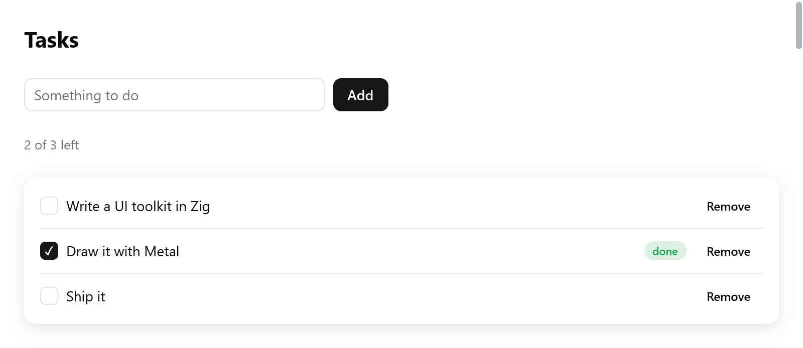

# Views

The view is a function from your app's state to its interface. It takes a
pointer to your state and the window's `*ui.Context`. myzig calls it on
the main thread to build a frame:

- after input or a resize;
- while something animates;
- when the app asks.

<!-- demo: tasks height=371 -->



*A view built from application state: a task list with completed and pending items.*

```zig
const Todos = struct {
    items: [32]Item = undefined,
    count: usize = 0,
    draft: ui.TextBuffer = .{},

    const Item = struct { title: [64]u8, len: usize, done: bool };

    fn view(s: *Todos, c: *ui.Context) void {
        ui.column(c, .{ .width = .fill, .height = .fill, .padding = .all(16), .gap = 8 });
        defer ui.end(c);
        for (s.items[0..s.count]) |*it| {
            ui.key(c, c.print("todo-{d}", .{@intFromPtr(it)}));
            _ = ui.checkbox(c, it.title[0..it.len], &it.done);
        }
        if (ui.textField(c, &s.draft, .{ .placeholder = "New to-do" }).submitted) {
            s.add(s.draft.text());
            s.draft.clear();
        }
    }

    fn add(s: *Todos, title: []const u8) void {
        if (s.count == s.items.len or title.len == 0) return;
        const n = @min(title.len, 64);
        s.items[s.count] = .{ .title = undefined, .len = n, .done = false };
        @memcpy(s.items[s.count].title[0..n], title[0..n]);
        s.count += 1;
    }
};
```

Make the state once, as the app starts, and give its view to the window:

```zig
var state: Todos = .{};
_ = try app.newWindow(.{ .title = "To-dos", .content = .{ .view = .init(&state, Todos.view) } });
```

- `ui.View.init(&state, Todos.view)` pairs the pointer with the function.
  Any `fn (ptr: *T, c: *ui.Context) void` works, so a view can be a
  method or a free function.
- The same `ui.View` can be given to several windows. Each window has its
  own context, so its own focus, scroll offsets and animated values.

The examples in these guides are parts of such a view: `c` is the view's
`*ui.Context` and `s` the pointer to your state. Values that last, such
as a [router](navigation.md), a `ui.TextBuffer` or a widget's state
struct, are fields of the state. They are never locals of the view, which
runs for every frame.

## Boxes, opened and ended

```zig
ui.row(c, .{ .gap = 8 });
defer ui.end(c);
ui.text(c, "Name", .{});
ui.spacer(c);
_ = ui.button(c, "Edit", .{});
```

A view is a tree of boxes. Containers open a box that the next calls go
into, until it is ended.

- `ui.column`, `ui.row`, `ui.card`, `ui.scroll` and `ui.pressable` each
  open a box that `ui.end` closes.
- `ui.div(c)` returns a `ui.Div` whose own `end` closes it.
- Widgets that take children of their own return a value with an `end`
  method too: a form's field, a popover's panel, a tab's page.
- `defer` keeps each end beside its open. For a box in the middle of a
  function, a block `{ ... }` with a `defer` inside scopes it.

## Interactions and the second build

Widgets answer from the previous frame's layout. When the pointer goes
down, myzig hit-tests the boxes as they were last laid out. So
`ui.button(...).clicked` is true in the build that handles the click,
before the new frame is laid out.

A widget whose interaction changes the app's state sets `c.changed`:

1. At the end of the build, if `c.changed` is set, myzig builds the frame
   again. The input's edges, the click and the key, are already consumed.
2. Only then does it lay the frame out and draw it.
3. So the screen always shows the state after the event.

`c.stats.passes` counts the builds of the last frame.

Your own code that changes state in response to input gets the second
build for free, as a `ui.Div`'s `clicked` or a shortcut. If you read the
input yourself and change the state, set `c.changed = true`.

## Ids and keys

Each box has an id, made from its parent's id and its place among its
siblings. Focus, hover, scroll offsets, animated values and text field
carets are kept by id between frames, so ids must stay stable.

```zig
for (s.files) |f| {
    ui.key(c, f.path);
    s.fileRow(c, f);
}
```

Give each item a key when boxes come and go before others, as in a list
that is filtered, sorted or edited. `ui.key(c, k)` names the next
box, and its id is then made from the key rather than its place. Keys are
strings: use something that identifies the item, not its index.

```zig
for (s.todos.items) |*todo| {
    c.keyed(todo);
    todoRow(c, todo);
}
```

`c.keyed(value)` (or `ui.keyed(c, value)`) keys the next box by any value
Zig compares, without formatting a string:

- Two values differ as `std.meta.eql` tells them apart. Values of
  different types differ.
- A pointer keys the object it points to, whatever the object holds. So
  an item's pointer serves as its key as well as an id does.
- An integer, an enum, or a struct of them keys by its value.

**A box shown only sometimes.** A single box shown only sometimes before
a button, as a mark on hover, moves the button's id. A press in between
is lost.

- Key the button, or always build the box and hide it with its look
  ([custom widgets](custom-widgets.md#a-box-that-comes-or-goes-moves-the-ids-after-it)).
- Debug builds log a warning when a press is lost so.
- They also warn when a scrolled box's id changes so that its offset
  starts over or jumps.

`c.peekId(null)` returns the id the next box will get, for widgets that
need it before they open their box.

## The context

`ui.Context` is the window's, and lasts as long as it. The fields views
read:

| field | what it is |
|---|---|
| `theme` | the frame's colors and fonts ([styling](styling.md)) |
| `size` | the window's content size, in points |
| `scale` | pixels per point |
| `dt` | seconds since the previous frame |
| `time` | seconds since the first frame, the clock of animations a view drives itself |
| `frame` | the frame's number |
| `input` | this event's input: the pointer, buttons, keys, text, wheel |
| `stats` | what the last frame cost (`ui.FrameStats`) |

And the ones views set:

| field or method | what it does |
|---|---|
| `changed = true` | builds the frame again before drawing it |
| `c.animationFrame()` | asks for another frame at the next refresh |
| `c.frameIn(seconds)` | asks for a frame within `seconds` (a clock's next second) |
| `wants_moves = true` | every pointer move draws a frame (a graph's crosshair); cleared each frame |
| `wants_keys = true` | key presses and releases come as `input.key_down` / `input.key_up` (games) |
| `wants_wheel = true` | the wheel comes as `input.scroll` where nothing scrolls |
| `cursor = .resize_left_right` | the pointer's shape (`ui.Cursor`) |
| `title_bar_height` | how much of the top moves a window with a hidden title bar |
| `c.setZoom(z)` | scales every text by `z` (0.5 to 3), as an app's ⌘= and ⌘- |

`c.print(fmt, args)` formats into the frame's memory, and `c.alloc()`
gives that allocator itself. Both are freed when the next frame begins.

## Shortcuts

`c.shortcut` takes a key combination when this event is it:

```zig
if (c.shortcut(.{ .key = 'k', .cmd = true })) s.clear();
if (c.shortcut(.{ .key = ui.Shortcut.escape })) s.closePanel();
```

- Command means Control off macOS, so one shortcut serves every platform.
- Characters are lowercase. Other keys are constants such as
  `ui.Shortcut.up`, `.enter` and `.tab`.
- A shortcut the view takes goes no further in the frame
  (`c.shortcut_taken` is set).
- `ui.keys.label` writes a combination for `ui.kbd`, as the platform
  does. It is given at compile time with the Mac's symbols: `"⌘P"`
  becomes `"Ctrl+P"` on Linux and Windows.

For shortcuts with a name, a menu item and a palette entry, see
[`ui.Actions`](navigation.md).

## Focus and the keyboard

- Controls take the keyboard focus when pressed.
- Tab and Shift-Tab move it through them in the order they were built.
- A control focused from the keyboard draws a ring in the accent color
  (`c.focus_visible`).
- Enter and Space click a focused button, checkbox or switch. The arrows
  move sliders, radio groups and ratings.

## Changing the state from outside

The view reads your state on the main thread. Work done elsewhere, as a
timer, a process's output or a network reply, changes the state on the
main thread. Then it asks the window for a frame with `Window.redraw`:

```zig
fn tick(ctx: ?*anyopaque) callconv(.c) void {
    const s: *State = @ptrCast(@alignCast(ctx));
    s.seconds += 1;
    s.window.redraw();
    myzig.App.after(1000, ctx, tick);
}

// In main, after the window is made:
myzig.App.after(1000, &state, tick);
```

- `App.after` runs a function on the main thread after a delay.
- From other threads, hand the work to the main thread first. The
  [mainthread plugin](../plugins/mainthread.md) posts jobs to the main
  thread's own queue on every platform.
- Within the view, prefer `c.frameIn(seconds)` for what changes on a
  schedule (a clock, a spinner). It asks for that frame only, without
  drawing every refresh in between.

## Text and input that a view takes itself

A widget that edits text in its own way:

- reads `c.input.ops`, the text operations of the event (`ui.TextOp`):
  inserted text, an input method's composition, commands such as
  `.delete_backward` or `.move_word_left`;
- sets `c.focused_text` to tell the input method where the caret is.

See [text input](text-input.md) and [custom widgets](custom-widgets.md).
